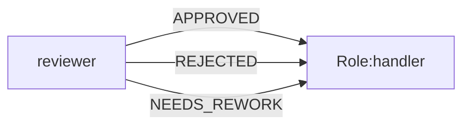

# 固定业务事件的最小判定标准与可视化配置方案

> **状态：当前版本方案。** 本文只补齐审核判定标准和设计器配置体验，不新增运行时抽象。
> 固定业务事件的名称、路由约束和保留事件仍以
> [`business-event-protocol-v1.md`](business-event-protocol-v1.md) 及
> `src/business-events.ts` 为准。

## 1. 目标与边界

当前 Runtime 已经能够校验 Role 输出、匹配出边事件、执行条件路由、投影
`context.map`、校验 `role_input` 和 `output.schema.json`，并处理 Join、quorum、循环和人工审核。
本方案解决的是更窄的问题：

- 让业务人员知道什么条件可以“同意”、什么情况应“不同意”或“再改改”；
- 让 Role 输出可审计的判定依据，而不是只输出一个事件名；
- 让一个 Role 被多个不同事件进入时，可以清楚地配置事件处理逻辑；
- 让 Studio 用简单表格辅助配置，同时保留专业人员的细粒度编辑能力。

本方案不引入 Approval Engine、策略中心、Prompt Runner、事件 Broker、全局验收标准数据库或新的事件状态机。
不增加业务事件类型，不把自然语言 Prompt 当作唯一校验来源，也不改变现有工作区隔离和 Runtime 路由。

## 2. 当前实现与差距

当前版本已完成本文第 8 节所需的核心 Runtime、发布门禁和 Studio 配置链路。下面的“已有能力”描述已落地行为；剩余限制是边界约束，不是未实现的业务引擎。

### 2.1 已有能力

当前版本固定使用以下五个业务结果事件：

| 事件 | 面向业务人员的显示 | 基本含义 |
| --- | --- | --- |
| `READY` | 准备好了 | 当前结果可以交给下一步 |
| `APPROVED` | 同意 | 审核通过，可以进入通过路径 |
| `REJECTED` | 不同意 | 存在硬性问题，不接受当前结果 |
| `NEEDS_REWORK` | 再改改 | 存在可修复问题，需要修改后重做 |
| `BLOCKED` | 办不了 | 缺少资料、权限、工具或外部条件，暂时无法判断或继续 |

Runtime 已支持：

1. Role 输出事件必须是固定注册表中的事件，并且必须匹配实际出边。
2. 同一事件可以有多条出边，但必须由条件路由消除歧义；无法消歧时失败闭合。
3. 不同事件可以指向同一个 Role；目标 Role 通过 `direct.event` 或
   `source(<roleId>).event` 读取入站事件。
4. `context.map` 可以将事件、内容和结构化数据投影给目标 Role。
5. `role_input`、`output.schema.json`、`postconditions`、Join、quorum、循环预算和人工审核均已有执行路径。
6. 审核 Role 的运行输出会校验 `decisionReason`、完整条件集合、证据引用和 `requiredChanges`；硬性否决优先于返工，办不了必须给出原因和证据。
7. Readiness 会检查输出事件枚举、审核数据字段的 `required` 声明、Profile/Tool/Law 和工具命令；编译器会阻止多事件入口缺少事件投影。
8. Studio 支持确认后生成 `context.map` 建议和 `prompt.md` 的 `ogs:event-rules` 规则块。

### 2.2 当前边界

判定仍然只针对 Role 自己声明的条件，不会替业务人员凭空推断标准。`flow.label` 是可读的流转触发条件说明，不会被当作可执行规则；可执行路由仍使用现有条件 AST。Studio 生成的事件规则块是可编辑 Prompt 辅助内容，保存前必须确认，最终约束仍由 Schema、Compiler 和 Runtime 执行。

这里必须区分两个层次：**配置定义质量标准，运行输出报告本次检查结果**。配置不是运行结论，运行输出也不能临时发明一套未配置的标准。

## 3. 最小判定标准

审核类 Role 按已配置的质量条件逐项检查，再按以下顺序决定事件。顺序固定，避免同一份结果在不同 Role 中产生相反解释。

1. **无法判断**：必需资料、权限、工具或外部条件缺失，输出 `BLOCKED`（办不了）。
2. **硬条件失败**：违反安全、合规、契约或其他不可豁免约束，输出 `REJECTED`（不同意）。
3. **全部必需条件通过**：证据完整，没有不可接受风险，输出 `APPROVED`（同意）。
4. **只有可修复问题**：配置的质量条件中存在可修复的不达标项，没有硬性否决，输出 `NEEDS_REWORK`（再改改）。
5. **没有合法修复路径**：仍输出 `REJECTED`，并在原因中说明为什么不能通过返工解决。

`READY`（准备好了）用于普通交接，不代表审核通过。普通 Role 默认只需要 `READY` 和 `BLOCKED`；只有承担审核职责的 Role 才声明 `APPROVED`、`REJECTED` 或 `NEEDS_REWORK`。

“不同意”和“再改改”的边界：

- **不同意**：当前结果不能接受，原因是硬性条件失败或不可豁免约束；不能仅靠补充几处修改直接转为通过。
- **再改改**：目标仍然可达，问题有明确、有限、可执行的修改路径。
- **办不了**：不是质量结论，而是当前信息或外部条件不足，补齐条件后才能重新判断。

## 4. 结构化输出合同

不增加全局事件 Schema。每个审核 Role 在自己的 `output.schema.json` 中声明所需字段，统一采用以下推荐字段：

```json
{
  "event": "APPROVED",
  "content": "所有必需条件通过。",
  "data": {
    "criteria": [
      {
        "id": "security",
        "status": "pass",
        "severity": "required",
        "evidence": ["artifacts/security-report.json"]
      }
    ],
    "decisionReason": "所有必需条件通过",
    "requiredChanges": [],
    "risks": []
  }
}
```

字段约定：

| 字段 | 要求 |
| --- | --- |
| `criteria` | 验收条件数组；每项必须有稳定的 `id` |
| `criteria[].status` | `pass`、`fail` 或 `unknown` |
| `criteria[].severity` | `required`、`advisory` 或 `critical` |
| `criteria[].evidence` | 支撑该条件的文件、字段或运行证据引用；Runtime 校验非空字符串合同，Artifact/发布器负责实际文件的生成、封存和哈希校验 |
| `decisionReason` | 面向协作人员的简短判定理由 |
| `requiredChanges` | `NEEDS_REWORK` 时必须列出可执行修改项，并引用失败条件 `id` |
| `risks` | 已知风险；不能用风险文字替代条件状态 |

最小门禁：

- `APPROVED` 不得包含 `critical` 或 `required` 的 `fail/unknown` 项；
- `REJECTED` 至少包含一项 `fail`，并提供 `decisionReason`；
- `NEEDS_REWORK` 至少包含一项已配置且 `failureAction` 为 `rework` 的失败条件，并提供引用该条件的非空 `requiredChanges`；
- `BLOCKED` 至少包含一个 `unknown` 条件，并为每个未知条件提供具体 `reason` 和非空 `evidence`，不能把“暂时没有证据”写成 `REJECTED`；
- `READY` 只需满足该 Role 自己声明的交接 Schema，不自动获得审核含义。

这些规则是发布和运行前校验的最小增量。缺少审核 Role 所需 Schema、质量条件或出边时，新版本直接给出诊断并阻断发布，不静默猜测事件。

### 4.1 配置与运行输出的分工

设计阶段配置的是稳定的质量条件和失败处理：

```json
{
  "id": "cost_limit",
  "description": "总成本不超过预算上限",
  "severity": "required",
  "failureAction": "rework",
  "evidenceHint": "artifacts/cost-estimate.json"
}
```

运行阶段输出的是本次执行对这些条件的判断：

```json
{
  "id": "cost_limit",
  "status": "fail",
  "severity": "required",
  "evidence": ["artifacts/cost-estimate.json"],
  "reason": "预计成本超过预算 8%"
}
```

因此，`NEEDS_REWORK` 的最小要求不是“有一段修改文字”，而是：

1. 至少一个已配置条件实际为 `fail`；
2. 该条件的 `failureAction` 为 `rework`；
3. 输出 `requiredChanges`，并能通过条件 `id` 对应到失败项；
4. 提供当前证据或明确说明需要补充的证据。

`REJECTED` 对应 `failureAction: "reject"` 的硬性失败；`BLOCKED` 用于条件为 `unknown` 且原因是缺少输入、权限、工具或外部条件。这样“质量不达标”和“暂时无法判断”不会混为一谈。

## 5. 事件路由与同一 Role 多入口

允许多个事件指向同一个 Role：



目标 Role 不需要为每个入口复制一份 Role。它通过输入投影读取事件：

```text
%% context.map.handler.incoming_event=direct.event
%% context.map.handler.reason=direct.data.decisionReason
%% context.map.handler.changes=direct.data.requiredChanges
```

如果目标是 Join，则使用已声明的来源：

```text
%% context.map.handler.reviewer_a_event=source(reviewer_a).event
%% context.map.handler.reviewer_b_event=source(reviewer_b).event
```

目标 Role 的 `output.schema.json` 只描述它自己的输出事件，不把入站事件加入 `outputs.events`。
入站事件是输入数据，出站事件仍必须与目标 Role 的出边和输出合同一致。

### 5.1 事件对应的 Prompt 逻辑

同一个 Prompt 可以使用结构化入站字段，根据事件选择不同处理规则。建议由 Studio 生成可编辑的规则草稿：

```md
<!-- ogs:event-rules:start -->
## 入站事件处理

当前入站事件：`input.incoming_event`

### APPROVED

保留通过结论，继续执行交付准备。

### REJECTED

记录不同意原因，不得将当前方案视为已通过；如无合法处置路径，输出 `REJECTED`。

### NEEDS_REWORK

按 `requiredChanges` 逐项修改，完成后重新输出审核结果。

### BLOCKED

说明缺少的资料或外部条件，不要猜测审核结论。
<!-- ogs:event-rules:end -->
```

规则块是 Prompt 辅助内容，不替代 `output.schema.json` 和 Runtime 校验。Studio 生成后必须由用户确认再保存，避免静默改写专业人员的 Prompt。

### 5.2 每条线路一个流转触发条件

业务模式可以把每条出边简化为一个“流转触发条件”说明项：

| 线路 | Role 输出事件 | 流转触发条件 |
| --- | --- | --- |
| 发布 | `APPROVED` | 所有必需条件通过，且没有严重风险 |
| 返工 | `NEEDS_REWORK` | 存在允许返工的质量条件未达标 |
| 终止 | `REJECTED` | 存在不可豁免的硬性失败 |
| 补资料 | `BLOCKED` | 缺少必需输入或外部条件 |

流转触发条件只说明“该线路何时成立”，供业务人员理解和审计；它不复用审核标准的 ID，也不负责生成事件。Role 根据自身审核标准和结构化证据输出事件，Runtime 先按事件筛选出边，再按现有条件 AST 选择线路。

页面分别标记 Role 的“审核标准”和 Flow 的“流转触发条件”。前者是角色作出判断的依据，后者是对出边成立场景的说明。当前版本的流转触发条件只保存为业务可读说明，页面不会把任意中文文本直接转换成可执行规则。专业人员仍可展开编辑已有的 `flow.condition` AST，并由 Runtime 按现有语义执行。

任意自由文本不能直接作为 Runtime 的可执行条件。未来若增加固定模板转换，也必须是有限、可验证的 lowering，并在保存前展示生成的 AST；无法确定转换结果的文本只能作为说明和 Prompt 提示，不能参与确定性路由。同事件多出边在没有可执行条件时继续报告 `IR_ROUTE_AMBIGUOUS`。

## 6. Studio 最小可视化配置

不新增独立审批页面，只在 Role Inspector 增加“审核标准”区域。配置模式分为业务模式和专业模式。

### 6.1 业务模式

业务人员只填写一张表：

| 验收项目 | 是否必需 | 问题处理 | 证据来源 |
| --- | --- | --- | --- |
| 安全要求 | 是 | 不同意 | 安全报告 |
| 成本上限 | 是 | 再改改 | 成本估算 |
| 用户体验 | 是 | 再改改 | 测试结果 |

保存时 Studio 生成或更新：

1. 该 Role 的 `output.schema.json` 条件字段；
2. 业务人员填写的审核标准及证据提示；
3. 缺少证据、出边或输出字段时的诊断。

每次修改都先留在当前设计草稿中，用户点击保存后才写入 TeamVersion。业务模式不要求用户编辑 JSON、Semantic IR 或 Prompt 模板；出边建议和 Prompt 规则由页面提供确认按钮，确认后才写入当前草稿。

### 6.2 专业模式

专业人员可以继续直接配置：

- `role.json` 的 `outputs.events` 和 `postconditions`；
- `output.schema.json` 的条件、证据和领域字段；
- Semantic IR 条件 AST 与优先级；
- `context.map` 和 `role_input`；
- Prompt 规则块及工具参数。

专业模式不绕过 Runtime 的固定事件注册、输出校验和失败闭合规则。

### 6.3 多入边自动提示

当 Studio 检测到一个 Role 有多个不同事件入边时，显示入站事件摘要和“生成入站事件映射”按钮。按钮只在用户确认后写入当前草稿，预览/生成内容保持在现有 `context.map` 编辑器内：

- 非 Join Role：`incoming_event=direct.event`，以及带 `?` 的可选 `decision_reason`、`required_changes` 数据映射；
- `all_of` Join：为每个已声明来源生成 `source(<roleId>).event` 映射；
- `quorum_of` Join：只提示先声明 `join.sources`，不自动扩大读取范围。

同一场景还提供“生成入站事件规则”按钮。它在 `prompt.md` 中维护带 `<!-- ogs:event-rules:start/end -->` 标记的可编辑规则块；已有规则块会在确认后替换，其他 Prompt 内容保持不变。目标 Role 当前允许的输出事件继续显示在 Role Inspector 中。

## 7. 发布门禁与诊断

新版本发布时，对拥有审核事件出边的 Role 执行以下检查：

1. Role 的 `outputs.events` 与图谱出边集合一致；
2. `output.schema.json` 的 `event` 枚举只能包含已声明的出边事件；
3. 审核 Role 的 `data.criteria`、`data.decisionReason` 和需要时的 `data.requiredChanges` 存在且在 `data.required` 中声明；
4. `context.map` selector 合法且来源可用；多事件入口缺少事件投影时报 `EVENT_INPUT_MAPPING_MISSING`；
5. 同事件多出边存在可证明的条件优先级，无法消歧时报 `IR_ROUTE_AMBIGUOUS`；
6. 审核 Role 的每个结果都有合法目标或结束路径。

诊断应直接指向可修复动作，例如：

```text
DECISION_APPROVED_EVIDENCE_MISSING
DECISION_REJECTED_HARD_FAILURE_REQUIRED
DECISION_REWORK_CHANGES_REQUIRED
DECISION_BLOCKED_REASON_REQUIRED
DECISION_BLOCKED_EVIDENCE_REQUIRED
EVENT_INPUT_MAPPING_MISSING
```

这些是诊断码，不是新的业务事件，不进入 Flow 或 `outputs.events`。

## 8. 验收用例

实现或发布该方案时，至少验证以下用例：

1. 全部必需条件通过，Role 输出 `APPROVED`；证据引用会写入运行审计，文件型证据由 Artifact 封存记录定位。
2. 必需条件失败，Role 输出 `REJECTED`；缺少失败条件或原因时被 Schema/门禁拒绝。
3. 只有可修复问题，Role 输出 `NEEDS_REWORK`，目标路径回到已声明的返工 Role。
4. 缺少输入或工具，Role 输出 `BLOCKED`，不会误报为 `REJECTED`。
5. `APPROVED` 与 `REJECTED` 同时进入同一个 Role，目标 Role 能读取 `direct.event` 并按规则处理。
6. Join 场景能读取声明的 `source(...).event`；未声明来源时失败闭合。
7. 同事件的无条件多出边仍报告 `IR_ROUTE_AMBIGUOUS`。
8. 普通 `READY` 交接的现有团队行为不变。
9. Studio 业务模式生成的配置与专业模式手工配置通过相同 Runtime 校验。

建议继续复用现有构建、Runtime、Visualizer、Team Site 和浏览器测试，在新增门禁后补充上述聚焦用例；不为文档方案单独引入第二套模拟执行器。

## 9. 不做的事情

- 不新增全局“审核策略中心”或数据库；验收标准属于 Role 自己的 Schema。
- 不把 `confidence`、模型概率或自然语言语气自动转换成 `APPROVED`。
- 不把 `REJECTED` 自动改写为 `NEEDS_REWORK`，也不把 `BLOCKED` 当成质量否决。
- 不让入站事件污染目标 Role 的出站事件合同。
- 不通过隐式祖先遍历读取上下文；远端数据必须经 `context.map`、Join source 或父 Role 显式转发。
- 不改变 Backend、工具绑定、工作区权限、产物封存和现有事件路由机制。
- 不为旧配置提供兼容或迁移；新版本按本文门禁直接校验。

## 10. 当前验证记录

当前版本已按以下顺序完成实现和验证：

1. Runtime 先校验审核 Role 的输出 Schema、判定证据和事件映射，保持现有路由执行代码不变。
2. Studio Role Inspector 提供审核标准表格、多入边映射预览和确认后 Prompt 规则生成；严格 `role_input` Schema 只生成已声明字段。
3. 业务线路继续保存可读的 `flow.label`，专业人员按需配置现有 `flow.condition` AST，复用 `context.map`、`role_input` 和 Prompt 模板保存机制。
4. 结构化输出、路由歧义、Join 入站、Start 入站和普通 `READY` 回归测试已覆盖；工具和外部证据的实际存在性仍由对应执行器和 Artifact 校验负责。
5. 经典团队已完成 lint、仿真文件归档和可用 API backend 的真实模型运行验证；没有可用 provider 时，结果必须明确标记为阻塞，不以 dry-run 代替真实证据。

### 10.1 实际 API 验证记录（2026-11-14）

- 五个经典团队均通过直接 API 运行：跨底座审核完成 `NEEDS_REWORK -> APPROVED`，管理咨询完成并行分析、`quorum_of` 汇聚、复核和文档发布，软件研发与专家会诊完成并行汇聚，正反方辩论完成一轮返工和媒体发布。
- 管理咨询运行目录实际封存 `md/json/csv/xlsx/docx/pdf`，正反方辩论实际封存 `json/png/mp4/mp3`；两者均生成 `artifact-manifest.json` 和 `seal-manifest.json`。
- DOCX/PDF/XLSX 已通过实际可读性检查，PNG/MP4/MP3 已通过 `ffprobe` 格式检查。模型能力以当前 API 账户实际可执行的模型为准；目录中的“可发现”模型不等于当前账户都可调用。

这样可以弥补“有事件、无判定依据”的差距，同时保持现有 Runtime、Flow Contract 和团队配置的结构稳定。
