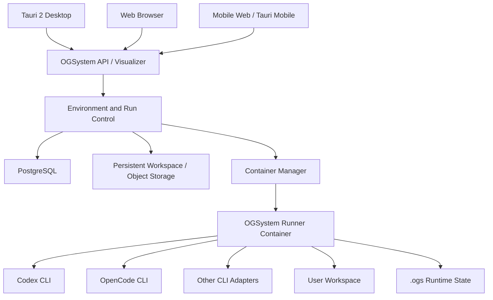
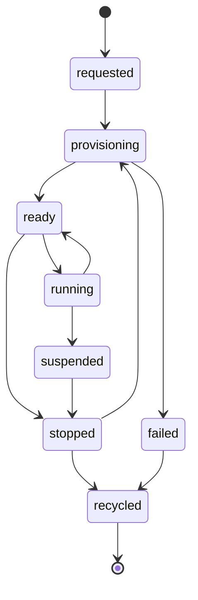
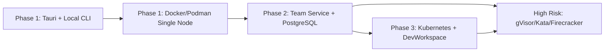

# OGSystem AI 生产力平台组合选型规划

状态：`proposed`（规划中，尚未表示为已实现能力）
日期：2026-10-15

## 1. 背景

OGSystem 当前是本机优先的 CLI/runtime。它已经具备受限 Mermaid 流程、角色责任、模型绑定、Visualizer、运行审计、checkpoint 和文件优先恢复能力。Codex、OpenCode 等模型执行器通过本机 CLI 服务和各自的用户配置参与运行。

当前实现边界包括：

- 项目、角色包和 `.ogs/runs/<run-id>/` 位于本地文件系统；
- `state.json`、`sessions.json`、checkpoint 和执行结果构成恢复权威集；
- Visualizer 可以在本机运行，也可以在受信网络中通过 HTTPS 访问；
- 当前不包含跨主机分布式 runtime、动态多租户执行器或托管 SaaS 控制面；
- Codex、OpenCode 的凭据由各自 CLI 管理，OGSystem 不接管长期 provider 凭据。

产品下一阶段需要从单机工具扩展为 AI 生产力平台：用户可以在桌面端、Web 或移动端创建和管理一个可恢复的 AI 工作环境，由隔离的执行器运行 Codex、OpenCode 和其他 CLI，并保留流程审计、人工审批和运行恢复能力。

## 2. 目标

### 2.1 产品目标

- 为用户创建全新的、可恢复、可回收的 AI 工作环境；
- 在环境中安全运行 Codex、OpenCode 和其他 CLI；
- 复用 OGSystem 的流程语义、角色责任、审计、checkpoint 和恢复机制；
- 提供 Tauri 2 桌面入口，以及面向 Web/移动端的统一 API；
- 第一阶段服务开发者和小团队，支持本机和单机自托管；
- 后续可以迁移到 Kubernetes 和更强的代码执行隔离层。

### 2.2 非目标

- 第一阶段不实现完整的公有云 SaaS 和复杂计费平台；
- 不让业务 API 直接暴露 Docker socket；
- 不以 OpenHands、Dify、n8n 或 LangGraph 替换 OGSystem 的核心流程 runtime；
- 不在移动设备上直接运行 Codex/OpenCode；
- 不在没有并发和运维需求证据前引入 Kubernetes、分布式队列或微虚拟机。

## 3. 选型结论

选择“本地优先、可自托管、逐步服务化”的组合：

| 层级 | 第一阶段选型 | 后续演进 | 选择理由 |
| --- | --- | --- | --- |
| 桌面端 | Tauri 2 | Tauri 2 Mobile | 复用 Web 前端，资源占用小，适合本地文件和 CLI |
| Web/移动端 | 现有响应式 Web + 版本化 API | 移动端 Tauri 封装 | 先稳定服务接口，再扩展原生能力 |
| 流程和运行时 | OGSystem runtime | 保持为核心 | 责任图、审计、恢复是产品差异化 |
| 编码执行器 | Codex、OpenCode、Aider adapter | OpenHands adapter | 执行器可替换，避免绑定单一模型或 Agent 框架 |
| 环境描述 | Dev Container | DevWorkspace | 采用开发环境事实标准，便于镜像复用 |
| 容器运行时 | Docker Engine 或 rootless Podman | Kubernetes | 第一阶段部署和调试成本最低 |
| 状态数据库 | PostgreSQL | PostgreSQL 集群 | 生态成熟，支持环境、租约、运行和权限数据 |
| 文件和产物 | 持久卷 | S3 兼容对象存储 | 保持现有文件格式，同时支持远程恢复 |
| 回收调度 | OGSystem Reaper | 队列/工作流调度器 | 先满足单机租约和回收，再扩展弹性 |
| 高风险隔离 | 受限 rootless 容器 | gVisor、Kata 或 Firecracker | 按风险逐步提高隔离强度 |
| 企业工作区 | 不引入 | Kubernetes + DevWorkspace 或 Coder | 多用户长期工作区和资源治理 |
| 业务集成 | OGSystem API | n8n 或 Dify connector | 外围集成复用成熟产品，不侵入核心 runtime |

OpenHands 作为 AI 软件工程 Agent 的运行时参考和可选 adapter；Dify、n8n、LangGraph 和 Temporal 作为后续集成或专项能力，不作为第一阶段核心依赖。

## 4. 总体架构



控制面负责鉴权、项目和环境元数据、租约、配额、运行状态及回收。Runner 负责执行具体任务。容器是可替换的执行环境，不是持久状态真相；项目、运行状态、checkpoint、审计和产物必须保存在持久卷、数据库或对象存储中。

## 5. 动态环境生命周期



创建流程：

1. 用户提交环境模板、项目来源、资源限制和网络策略。
2. 控制面创建幂等的 Environment 记录和租约。
3. Container Manager 根据已批准的模板和镜像 digest 创建 runner。
4. 挂载项目 workspace 和 `.ogs` 持久目录，注入短期凭据。
5. Runner 完成健康检查后进入 `ready`，任务开始后进入 `running`。
6. Runner 通过心跳、事件和产物接口向控制面报告状态。
7. 任务完成、用户停止或租约过期后，Reaper 停止并回收容器。

交互开发环境可以保留长期容器；批处理任务使用一次性短生命周期容器。停止环境时删除容器写层，但保留项目、checkpoint、审计和明确配置为持久的数据。

## 6. 公共接口

第一阶段新增环境资源接口：

```text
POST   /api/v1/environments
GET    /api/v1/environments/:id
POST   /api/v1/environments/:id/start
POST   /api/v1/environments/:id/stop
POST   /api/v1/environments/:id/rebuild
DELETE /api/v1/environments/:id
```

创建请求至少包括：

```text
template
projectId
workspace source
image digest
resource limits
network policy
idle timeout
```

内部状态使用：

```text
requested -> provisioning -> ready -> running
running -> suspended -> stopped -> recycled
provisioning -> failed -> recycled
```

接口必须支持幂等创建、状态轮询、主动停止、心跳超时和重建。API 不接受任意 Docker 参数，只接受服务端批准的模板、资源档位和网络策略。

## 7. 镜像、存储与资源

### 7.1 镜像内容

基础镜像包含：

- Linux、非 root 用户、Node.js、Python、Git、SSH 和 CA 证书；
- 固定版本的 OGSystem runtime；
- Codex、OpenCode 和已审核的 CLI adapter；
- 项目所需的构建工具；
- 健康检查、心跳和优雅退出脚本。

镜像不包含用户项目、API key、长期登录凭据或用户运行状态。建议提供 `ogs-node`、`ogs-python`、`ogs-node-python` 和 `ogs-full` 等镜像变体，并锁定版本和 digest。

### 7.2 持久数据

```text
/project      用户项目源代码
/ogs          OGSystem 配置、state、sessions、checkpoint
/cache        可回收的依赖缓存
/tmp          临时写层
```

环境元数据、租约、运行关联和权限进入 PostgreSQL。重要 checkpoint、日志、审计和导出产物同步到对象存储。现有 `state.json`、`sessions.json` 和 checkpoint 格式继续作为运行恢复格式。

### 7.3 初始资源档位

- 默认 1 至 2 vCPU；
- 默认 2 至 4 GB 内存；
- 默认 10 至 30 GB 临时磁盘；
- 单任务最大执行时间；
- 空闲回收时间；
- 用户级和全局并发配额；
- 进程数、文件句柄和网络连接数上限。

## 8. 安全边界

- 使用 rootless 容器和非 root runner；
- 基础文件系统只读，workspace 只授予当前项目；
- 业务 API 不持有 Docker socket；
- Container Manager 只接受批准的模板和资源参数；
- 默认阻断宿主机敏感目录和云平台 metadata 地址；
- 出站网络使用 allowlist 或受控代理；
- Codex/OpenCode 使用短期凭据，任务完成或回收时撤销；
- 每个用户或任务使用独立容器、独立 workspace 和独立 CLI 会话；
- 对 CPU、内存、磁盘、进程数和执行时长强制限额；
- 不可信代码或高风险任务升级到 gVisor、Kata 或 Firecracker。

普通 Docker 容器不是最高等级的安全边界。是否启用更强隔离由任务风险、用户信任级别和部署环境决定。

## 9. 分阶段路线

### Phase 1：本地和单机自托管

交付 Tauri 2 桌面壳、本地 CLI 模式、Docker/Podman Container Manager、Dev Container、Codex/OpenCode runner、持久 workspace、环境创建/停止/重启/回收和基础审计。

### Phase 2：团队环境

增加 PostgreSQL 多用户权限、配额和并发限制、对象存储、Web/移动端远程控制、租约 Reaper、短期凭据和网络 allowlist。

### Phase 3：企业和弹性部署

在存在实际并发需求后引入 Kubernetes、DevWorkspace Operator 或 Coder、独立任务 Pod、队列调度、多副本控制面和强隔离执行器。保持 `Environment API` 不变，仅替换 Container Manager 实现。



## 10. 验收标准

- 环境创建具备幂等性，重复请求不会创建重复容器；
- 镜像拉取、runner 启动和健康检查失败时能清理残留资源；
- 心跳丢失、租约过期和空闲超时会触发可审计的回收；
- 容器重启后 workspace、`.ogs` 状态和 checkpoint 可以恢复；
- 用户之间的文件、CLI 会话和凭据互不可见；
- 网络策略、资源限制和执行时限确实生效；
- Codex/OpenCode 异常退出后仍能保留运行结果和诊断信息；
- Tauri、Web 和移动端使用同一版本化 API 时行为一致；
- runner 不能访问 Docker socket 或宿主机敏感路径；
- 文档、API 和实现不会把 Phase 2/3 能力误标为当前已实现能力。

## 11. 当前仓库衔接

- `README.md`：本机运行、模型 CLI 配置和非分布式边界；
- `docs/usage/usage-manual.md`：`ogs serve`、Visualizer、HTTPS 和模型服务；
- `docs/development/release-compatibility-policy.md`：版本兼容、迁移和运行恢复约束；
- `docs/development/README.md`：开发规划文档索引。

本规划不改变当前 runtime 行为，也不承诺跨版本运行记录自动迁移。环境服务化实现应先建立独立的 API/schema 版本，再逐步替换本地文件访问边界。
