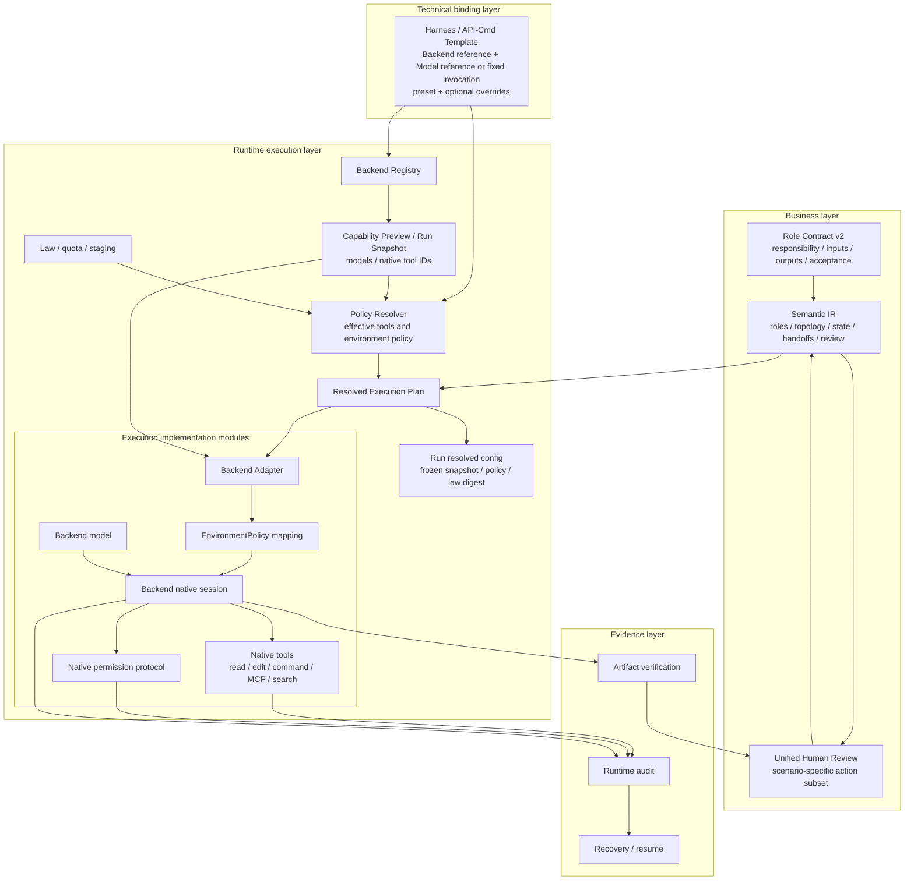
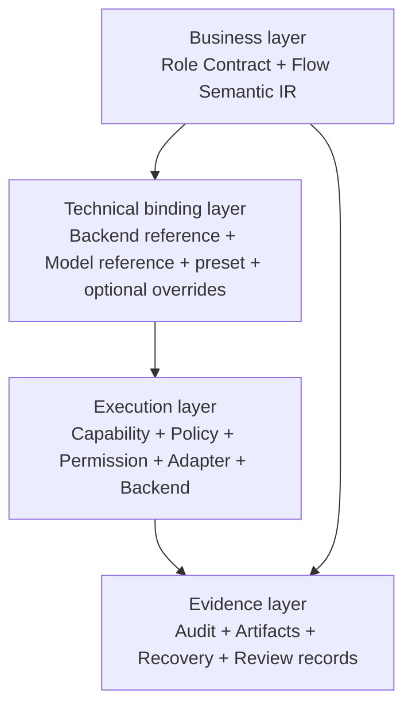
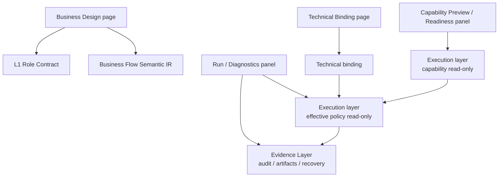
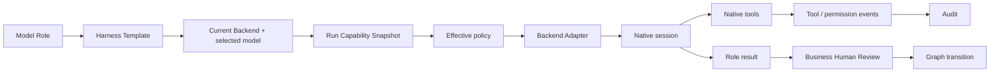
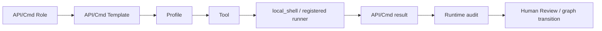
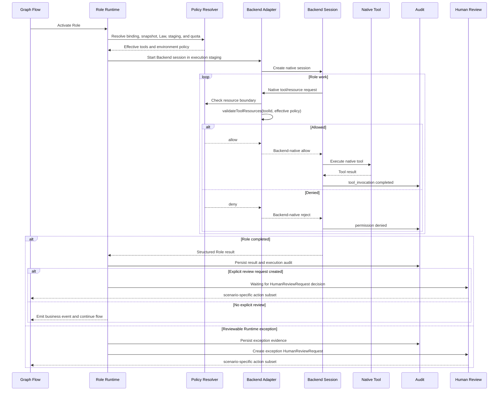
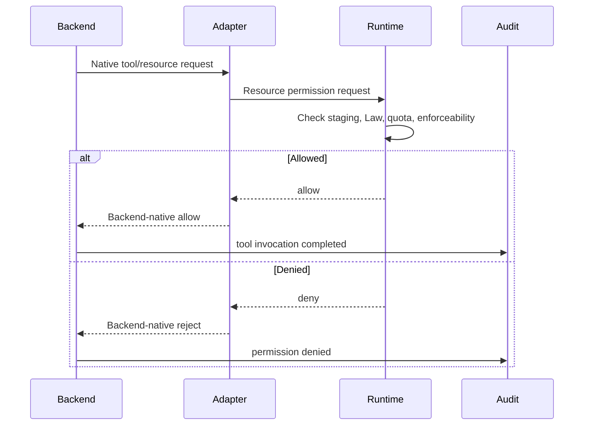
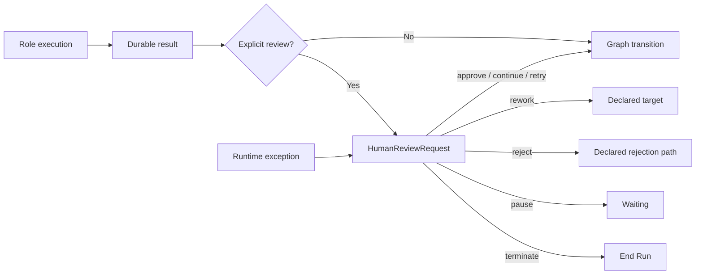

# Role Execution Architecture

This document defines how business Roles bind to Harness or API/Cmd templates and become
resolved, auditable executions.

## Contract Set Version

This document describes **OGS Contract Set v2**. The cutover is breaking and does not retain
runtime compatibility with Contract Set v1. Every persisted Role Contract, Semantic IR, Execution
Binding, Review Request, Evidence Event, and Run snapshot must identify:

```json
{ "ogsContractVersion": 2 }
```

`adapterVersion` remains an independent Backend Adapter implementation version. It does not
identify an OGS contract version. Old v1 fields, schemas, and runtime branches are removed by the
cutover; they are not read as fallback input.

Version ownership is split explicitly:

| Field | Meaning |
| --- | --- |
| `ogsContractVersion` | OGS cross-object contract set; v2 for this architecture |
| `SemanticIR.version` | Semantic IR schema version |
| `BusinessEventProtocol.version` | Shared business event protocol version |
| `FlowContractFile.version` | Flow Contract file format version |
| `schemaVersion` | Input, output, or business-state schema version |
| `RuntimeEventEnvelope.version` | Runtime evidence event format version |
| `adapterVersion` | Backend Adapter implementation version |

`ogsContractVersion` is an envelope field. It does not replace object-local version fields.

## 1. Goal

The target architecture separates business configuration from technical execution:

```text
Role = business responsibility and acceptance
Backend = model and native tools
Runtime = resource boundaries, audit, and recovery
Adapter = mapping to backend-native configuration
```

The default execution policy is automatic. A Role uses all verified native tools exposed by its selected Backend unless an explicit technical restriction is configured. Human Review is created either after a durable Role result before handoff or at a configured Runtime exception boundary; both triggers use the same request and decision protocol.

### Final architecture constraints

These constraints are normative. A new field, module, UI panel, or adapter API must
belong to one of the following boundaries before it is added. Do not create another
product layer for an implementation detail.

```text
Business Layer
  Role Contract, Semantic IR, Flow, and Human Review semantics.

Technical Binding Layer
  Harness/API-Cmd Template, Backend reference, Model reference, preset, allowedTools,
  environment intent, limits, and Profile references.

Execution Layer
  Graph Runtime, capability discovery, Policy Resolver, staging, Law, quota, Resolved
  Plan, Adapter, Backend session, Profile/Tool Runner, retry, and process lifecycle.

Evidence (cross-cutting)
  Graph transition records, policy decisions, audit, tool events, permission results,
  artifacts, Human Review records, checkpoints, and recovery.
```

The following rules are fixed:

1. Adapter, Backend, Capability, Policy, and Permission are Execution modules, not
   additional user-facing architecture layers.
2. Capability Discovery has one OGS entry point. It orchestrates discovery and probe,
   calls the selected Adapter for Backend-specific work, and produces Capability Preview
   or the frozen Run Capability Snapshot. Adapters do not independently publish a second
   discovery model.
3. Technical Binding Projection is a Studio read model. It exposes binding options and
   diagnostics, but owns no runtime decision and is not an execution layer.
4. Harness environment intent, EffectiveEnvironmentPolicy, and Backend-native mapping
   are three different objects. The first is user configuration, the second is computed
   by Runtime, and the third is owned by the Adapter.
5. `allowedTools` is the only Model Role tool restriction field. Omitted means all
   verified tools, an empty list means no native tools, and a non-empty list is an
   explicit allow-set. Do not add `requiredTools`, `deniedTools`, `tools.mode`, or a
   technical permission profile.
6. Permission decisions are only `allow` or `deny`. Technical permission never creates
   a review, pending state, or graph transition. Human Review uses one request protocol
   for both explicit result gates after a durable Role result and configured Runtime
   exception boundaries; it never approves an individual tool call.
7. `noop` is not an execution mode. Every executable Role must resolve to a Harness Template
   or an API/Cmd Template; an unresolved binding is a readiness error.
8. `Supervised`, `Auto-accept`, and `Full access` are not OGS permission modes. Backend-native
   approval modes remain Adapter internals and are never exposed as a second OGS permission model.
9. A Resolved Model Role plan must contain Backend, Model, Run Capability Snapshot,
   `effectiveTools`, and EffectiveEnvironmentPolicy. `adapterVersion` is read from the
   snapshot and is not duplicated on the plan node.
10. Every Graph node remains a Responsibility Role. Model Role and API/Cmd Role describe
    execution binding kinds for a Responsibility Role; they are not new Graph node types.
11. Role handoff data is explicit. Only declared event, context mappings, Flow Contracts, and
    authorized Artifact references cross a Role boundary.
12. Evidence events are append-only; checkpoints and result records use versioned/CAS writes.
   Evidence records and restores execution facts, but does not own mutable business or
   technical configuration.
13. Graph definitions, topology, business state, and handoff semantics belong to Business.
   Graph Runtime state transitions and Policy calculation belong to Execution. Evidence
   may record and restore both, but never owns Graph definitions or Policy logic.

Current implementation status is deliberately narrower than the target model:

| Capability | Current status |
| --- | --- |
| Runtime, staging, Law, quota, audit, artifacts, and recovery | Existing foundation |
| Backend/model discovery and registered adapters | Partially available and Backend-specific |
| Unified native tool discovery and resource enforceability | Not complete |
| Codex/OpenCode policy mapping | Partially available; requires final capability/readiness integration |
| Pi execution staging and resource policy | Incomplete; must remain degraded until mapped |
| Claude Adapter | Not registered; must not enter the verified catalog |

The target document must not describe an incomplete Adapter as a verified Backend.

### Normative terminology

The following terms are normative. A module, schema field, API, or UI label should not
reuse one of these names with a broader or different meaning.

#### Business objects

```text
Role Contract
  Business responsibility, input/output contract, acceptance, and failure semantics.

Business Graph
  Business topology: Role nodes, edges, events, joins, loops, and handoff semantics.

Business Event
  A Role result label used by the Business Graph for routing.

Human Review
  A business or Runtime control-plane decision represented by one Review Request schema.
  It may be triggered after a Role result or by a configured reviewable Runtime exception.
```

`Runtime Graph State` is not the Business Graph. It is the current execution position,
Role status, pending event, branch, join, loop, and review state for one Run.

#### Technical binding objects

```text
Harness Template
  Backend reference, Model reference, preset, optional allowedTools, and environment intent.

API/Cmd Template
  A Profile reference for a fixed invocation. It does not duplicate command definitions.

Profile ownership
  Technical Binding stores only the Profile reference. Profile and Tool definitions,
  parameter resolution, and the fixed-invocation runner belong to Execution.

Backend reference / Model reference
  Technical identifiers stored by a binding. They do not make the binding the owner of
  the Backend implementation or its native tools.

allowedTools
  An optional technical allow-set of Backend-native tool IDs. It is not a tool definition.

Role execution kind
  The resolved invocation path for a Responsibility Role: `harness` or `api_cmd`.
  It is binding metadata, not a Graph node type.
```

Backend presets are Backend-owned defaults. They are not another user configuration
object. Run snapshots are runtime facts, not Templates.

#### Runtime objects

```text
Capability Preview
  Read-only discovery and readiness data shown while editing or importing.

Run Capability Snapshot
  The verified Backend/model/tool result frozen for one Run.

EnvironmentIntent
  The resource intent stored in a Harness Template.

EffectiveExecutionPolicy
  The coordinated Runtime result for one Run:
  effectiveTools + EffectiveEnvironmentPolicy.

EffectiveEnvironmentPolicy
  The final filesystem, process, network, staging, and limit constraints.

PermissionDecision
  The runtime allow/deny result for one native tool or resource request.

Backend Session
  The actual model session created by an Adapter for a Run.
```

The calculation is:

```text
Capability
  + allowedTools
  + EnvironmentIntent
  + Law / quota / staging
  -> EffectiveExecutionPolicy
  -> PermissionDecision
```

Capability describes what can be provided and enforced. Policy describes what this Run
chooses. Permission describes the result for one request. These terms are not synonyms.

#### Backend and execution terminology

```text
Backend
  The execution backend visible to OGS, such as Codex or OpenCode.

Provider
  A Backend-internal CLI, SDK, or service provider concept. It is not an OGS product
  configuration object.

Adapter
  The OGS conversion and protocol boundary between normalized policy and Backend-native
  parameters. Capability Discovery is orchestrated by OGS and calls the Adapter for
  Backend-specific discovery and probes.

NativeTool
  A tool supplied by the Model Backend and invoked by the native session.

Profile
  A reusable fixed invocation configuration for an API/Cmd Role.

Tool
  The Profile-resolved fixed invocation definition.

local_shell / registered runner
  The executor for a fixed invocation.
```

The two execution paths are distinct:

```text
Model Role
  -> Harness Template
  -> Backend Session
  -> NativeTool

API/Cmd Role
  -> API/Cmd Template
  -> Profile
  -> Tool
  -> local_shell / registered runner
```

#### Staging and evidence terminology

```text
Execution staging
  The OGS execution boundary for one Role attempt.

Orca worktree
  One possible implementation substrate for staging. It is not semantically identical
  to OGS staging.

Evidence
  Append-only or checkpointed records of execution facts. Evidence can record and
  restore facts, but does not own Business Graph definitions or Policy calculation.

Graph Transition Evidence
  A record that a Runtime Graph State transition occurred.

Policy Decision Evidence
  A record of EffectiveExecutionPolicy or PermissionDecision results.

Recovery Checkpoint
  A durable Runtime state used to resume a Run.
```

#### T3 Code and Orca boundary

```text
T3 Code
  Backend / Provider / Session / NativeTool / Tool UX implementation reference.
  It maps into OGS Backend Adapter, Capability Discovery, and Native Session modules.

Orca
  staging / worktree / worker / terminal / process lifecycle implementation reference.
  It maps into OGS Execution Environment, Process Runner, and Session Lifecycle modules.
```

T3 Code Provider, Tool, and Session objects do not become OGS configuration. Orca
worktree, worker, and terminal objects do not become OGS Roles or Graph nodes. Their
capabilities enter a Run only through the OGS Adapter, Capability Snapshot, and Runtime
Policy.

### Explicit Role Handoff

Role-to-Role information transfer has one structural contract and three business channels:

```ts
type RoleResult = {
  event: BusinessEventType;
  data: Record<string, unknown>;
  artifacts: ArtifactReference[];
};

type RoleInput = {
  task: unknown;             // immutable Task request
  input: Record<string, unknown>; // current hop input
  sourceEvent: BusinessEventType;
  data: Record<string, unknown>;
  artifacts: ArtifactReference[];
};

// A read-only projection of an existing FlowContract; it is not a new persisted contract.
type FlowContractHandoffView = {
  sourceRole: string;
  targetRole: string;
  event: BusinessEventType;
  contextMap: FieldMapping[];
  artifactMap: ArtifactMapping[];
};
```

`FlowContractHandoffView` is derived from the existing Flow Contract and the actual Flow edge.
It does not create `handoff-contracts.json`, a second compiler, or a second validation source.
`contextMap` and `artifactMap` extend the existing Flow Contract representation.

The channels have fixed meanings:

```text
Business Event
  Route the Flow.

Typed Data
  Carry declared structured business facts, decisions, and status values.

Artifact Reference
  Carry documents, media, code, and other large outputs through ArtifactResolver.
```

`event` must be a value from the shared Business Event registry. The Flow edge is the only
source of the routable event; `sourceEvent` is derived from that edge and is never configured
as a second event field.

`task` remains the original user request. `input` is the changing per-hop payload. A Role does
not receive the entire upstream context, prompt history, Backend session, workspace path, or raw
tool output by implication. Artifact references are opaque and authorized; a filesystem path is
not an authorization token. Join nodes use explicit source and field mappings rather than an
implicit merge of all upstream data.

## 2. Target Architecture



## 3. Layering and Responsibility

### Layering

The target product model has four layers. Capability discovery, policy resolution, permission enforcement, adapters, and the Backend runtime remain separate implementation modules inside the execution layer; they are not separate user configuration concepts.



### Layer responsibilities

| Layer | Owns | Receives | Produces | Must not own |
| --- | --- | --- | --- | --- |
| Business | responsibility, inputs, outputs, acceptance, topology, state, events, handoffs, Human Review source | business requirements and graph design | Role Contract and Semantic IR | Backend, model, native tool, resource permission |
| Technical binding | Harness Template or API/Cmd Template, Backend/model reference, preset, `allowedTools`, environment intent | project or TeamVersion technical configuration and Backend catalog | normalized binding input for execution | business acceptance rules, capability snapshot, native tool implementation |
| Execution | Backend Registry, capability discovery/snapshot, effective policy, permission allow/deny, staging, Law, quota, Adapter, Backend session | normalized technical binding, Run context, and business execution plan | Role result, native tool events, execution outcome | business review decisions and mutable Role configuration |
| Evidence | audit, artifacts, recovery, Human Review records | events and durable results from all relevant layers | replayable Run evidence | mutable business and technical configuration |

Evidence may record Graph transitions, Policy decisions, Run state, checkpoints, and
Human Review records, and may restore them during recovery. It does not define Graph
topology, calculate Policy, or become the source of mutable Business or Technical
Binding configuration.

### Dependency direction

Dependencies flow downward for execution and upward only as evidence:

```text
Business -> Technical binding -> Execution -> Evidence
Business ---------------------> Evidence (business review state)
```

Inside the Execution layer:

```text
Capability = what the Backend can provide and enforce
Technical policy = what this Run chooses within those capabilities
Permission = the final allow/deny result for one resource request
Adapter = the mapping from policy to Backend-native parameters
Backend = the model and native tools that execute the request
```

Capability is descriptive, while permission is prescriptive and runtime-scoped. Permission is not a separate business layer or a user-facing tool approval model.

### User Page Configuration by Layer

The UI should expose the layers according to ownership. It should not turn internal Backend implementation details into business configuration.



| Page or panel | Layers involved | User can edit | User can only inspect |
| --- | --- | --- | --- |
| Business Design / Role | Business | purpose, responsibility, inputs, outputs, acceptance criteria, business failure semantics | resolved Backend and technical policy summary |
| Business Design / Flow | Business | roles, edges, events, topology, joins, loops, Human Review requirement | compiled business flow diagnostics |
| Technical Binding | Technical binding | Backend, model, execution preset, optional advanced overrides | binding validation and unresolved references |
| Capability Preview / Readiness | Execution | refresh discovery and readiness checks | verified models, native tool IDs, adapter readiness, preview time and digest |
| Runtime Policy / Diagnostics | Execution | normally none; technical overrides are edited in Technical Binding | effective tools, staging root, Law, quota, degradation, allow/deny reasons |
| Adapter / Backend Diagnostics | Execution | normally none | native permission mapping, adapter version, unsupported policy fields, native tool events |
| Run / Evidence / Review | Evidence | Human Review decision, rework, pause, terminate | tool calls, permission decisions, artifacts, errors, recovery history |

The normal user workflow is:

```text
Business Design
  -> Technical Binding
  -> Execution capability validation and policy calculation
  -> Adapter starts Backend
  -> Run Evidence and Human Review
```

The Execution layer contains capability discovery, policy calculation, permission enforcement, adapter mapping, and the Backend session. It is not exposed as several independent business configuration surfaces.

## 4. User Page Design

The user-facing product exposes two configuration pages and two operational pages. Capability, permission, and adapter internals remain automatic or read-only diagnostics.

### 4.1 Business Design

Business Design is the primary authoring page. It contains Role and Flow tabs.

#### Role tab

```text
Role identity
  Role ID (system-managed)
  Display name
  Purpose

Responsibility
  Responsibility kind
  Owned business state
  Contributes
  Does not own

Input contract
  Business fields
  Type
  Required / optional
  Business constraints
  Preconditions

Output contract
  Result fields
  Type
  Artifact declarations
  Postconditions
  Acceptance criteria
```

The user does not configure Backend, native tools, API/Cmd commands, or permission parameters on this tab.

#### Flow tab

```text
Role nodes
Handoff edges
Event labels
Conditional routes
Join mode and sources
Loop budget
Human Review gate
```

The Flow is the single source for routable event names. The system compiles outgoing
event labels into the Role's `allowed_events` runtime field. Role Contract output fields
describe result semantics; they do not define a second routable event list.

### 4.2 Technical Binding

Technical Binding is a separate page for project or TeamVersion maintainers.

```text
Backend
  Select an installed and verified Backend

Model
  Select a model discovered from the selected Backend

Execution preset
  Default: Backend recommended preset

Advanced overrides (collapsed by default)
  Optional allowedTools
  Optional filesystem/process/network overrides
  Optional timeout and quota overrides
```

The normal page only requires Backend and Model. The selected Backend supplies the
default native tools, environment intent, adapter parameters, and recommended limits
through its execution preset. The Runtime still owns the enforceable staging boundary
and platform safety limits. Advanced overrides are optional and are stored as
differences from the preset rather than as a complete duplicate policy.

The tool list is read from the Backend Capability Preview while editing. Users cannot
create a Model Role tool, edit a native tool command, or configure Backend-specific flags
such as `sandboxPolicy` or `allow dangerous`.

### Harness Template as the Model Role Binding

The primary purpose of a `Harness Template` is to bind a Model Role to the Backend that will run it and to a model offered by that Backend. The Backend is the source of truth for the CLI/adapter, model catalog, native tools, and supported permission mapping. A template stores references and restrictions; it does not own native tool definitions or Backend permission parameters.

The reusable technical template for a Model Role represents the complete CLI/Backend harness in which the Role runs:

```text
Harness Template
  Backend / CLI adapter identity
  Model exposed by that Backend
  Optional allowedTools references
  Optional filesystem/process/network policy intent
  Optional timeout and quota overrides
```

The user-facing relationship becomes:

```text
Model Role -> Harness Template -> current Backend -> selected Backend model
                                  \-> Backend native tools and permission mapping
```

Each Model Role has its own resolved Harness Template reference. Different Roles may select different templates, and multiple Roles may reuse one template when that is intentional. A project or TeamVersion may define a default Harness Template for Model Roles that do not select one explicitly; this is an explicit fallback, not an invisible global execution policy.

Persist only one user-facing technical object per invocation kind. Do not create separate
binding or execution-template objects in addition to Harness and API/Cmd Templates. The
recommended storage shape is:

```json
{
  "ogsContractVersion": 2,
  "schemaVersion": 1,
  "harnessTemplates": {
    "codex-default": {
      "kind": "harness",
      "backend": "codex",
      "model": "gpt-6-luna",
      "preset": "backend-default",
      "environment": {
        "filesystem": { "read": true, "write": true },
        "process": true,
        "network": false
      },
      "limits": {
        "timeoutMs": 600000,
        "maxOutputBytes": 200000,
        "maxStorageBytes": 200000000
      }
    },
    "codex-no-network": {
      "kind": "harness",
      "backend": "codex",
      "model": "gpt-6-luna",
      "preset": "backend-default",
      "environment": {
        "filesystem": { "read": true, "write": true },
        "process": true,
        "network": false
      }
    }
  },
  "apiCmdTemplates": {
    "local-shell-builder": {
      "kind": "api_cmd",
      "profileId": "local-shell-builder"
    }
  },
  "defaults": {
    "harnessTemplate": "codex-default"
  },
  "roles": {
    "writer": { "harnessTemplate": "codex-default" },
    "reviewer": { "harnessTemplate": "codex-no-network" },
    "builder": { "apiCmdTemplate": "local-shell-builder" }
  }
}
```

Harness binding rules:

```text
backend:
  Required. Identifies the installed Backend/CLI adapter used to create the session.

model:
  Required. Must be present in the selected Backend's verified model catalog.
  A model reference is not portable to a different Backend unless that Backend
  exposes the same model and the binding is revalidated.

preset:
  Optional Backend-owned defaults for native tools, environment intent, and limits.

environment:
  Optional resource policy intent. It is not a per-tool approval workflow.

allowedTools omitted:
  Use every verified native tool exposed by the selected Backend.

allowedTools = []:
  Explicitly disable Backend-native tool calls for this Harness.

allowedTools with entries:
  Use only the listed tools. Every entry must exist in the Capability Preview during
  editing and in the frozen Run Snapshot before Backend startup.
```

Changing `backend` invalidates the model, tool, and permission resolution until the
new Backend is discovered and the template passes readiness. Changing `model` keeps
the Backend but reruns model-specific readiness and freezes the resulting capability
snapshot for the next Run.

### Backend-specific mapping boundary

The Technical Binding stores only normalized intent:

```text
backend
model
preset
allowedTools
environment intent
limits
```

Backend-specific flags, tool names, sandbox modes, approval modes, and protocol
responses stay inside the selected Adapter. They must not appear in Role Contract,
Semantic IR, generic Runtime policy types, or business-facing Studio forms.

The current project-level mapping is:

| Backend | Current status | Native mapping owned by Adapter | Default boundary |
| --- | --- | --- | --- |
| Codex | registered and runnable | App Server `sandboxPolicy` / `approvalPolicy`; execution staging becomes the writable root | filesystem and command only when the corresponding policy is enforceable; network stays denied unless explicitly verified |
| OpenCode | registered and runnable | SDK session tools for read/list/glob/grep/edit/bash; execution directory and external-directory restriction | workspace tools follow the effective policy; network stays denied until a verified adapter mapping exists |
| Pi | registered, policy mapping incomplete | RPC session currently starts from the Backend target directory; per-execution policy still requires adapter work | do not claim write, process, or network enforcement until the staging and policy arguments are passed through |
| Claude | no adapter currently registered | no OGS native mapping yet | unavailable in the verified Backend catalog until an adapter and probe exist |

This table describes adapter readiness, not a second user-maintained capability matrix.
When a Backend cannot express a requested resource boundary, the Adapter returns a
readiness failure or a denied effective resource. It never widens the execution root or
disables a sandbox to make the binding appear runnable.

### Execution substrate integration

T3 Code and Orca are implementation references or optional execution substrates inside
the Execution Layer. They do not introduce a new OGS product layer or replace OGS
business and policy ownership.

```text
T3 Code
  Backend / Provider / Session / Native Tool / Tool UX
  -> OGS Backend Adapter, Capability Discovery, Native Session

Orca
  staging / worktree / worker / terminal / process lifecycle
  -> OGS Execution Environment, Process Runner, Session Lifecycle

OGS
  Business semantics, Technical Binding, Graph orchestration, Policy resolution,
  Audit, Artifact, and Recovery
```

The integration boundaries are fixed:

1. T3 Code Provider, Tool, and Session objects do not become OGS product configuration.
2. Orca worktree, worker, and terminal objects do not become OGS Business Roles or
   Graph nodes.
3. T3 Code and Orca capabilities enter a Run only through the OGS Adapter, Capability
   Snapshot, and Runtime Policy.

In this model:

```text
Harness Template:
  Project or TeamVersion-owned reusable CLI/Backend technical binding.

Backend preset:
  Backend-owned default values, resolved internally and not a second user configuration object.

Capability Preview:
  Refreshable discovery/readiness data shown before Run start.

Run Capability Snapshot:
  Generated and frozen at Run start; not manually authored.

Effective Policy:
  Computed by Runtime from the environment, capabilities, Law, staging, and quota.
```

The Harness Template is a configuration template. The Capability Preview is an editing
diagnostic; the Run Capability Snapshot and Effective Policy are Run execution results.
This keeps the user model small while preserving deterministic recovery.

### Default Harness Template

Defaults are resolved in this order:

```text
1. Role.harnessTemplate
2. TeamVersion or project default harnessTemplate
3. Backend-owned default preset for the selected Backend
4. Readiness error when no Backend can be resolved
```

The default is applied when a Model Role is created or when its binding is resolved. The resolved Role-to-Harness reference is written into the Run snapshot, so recovery never depends on a later default change.

Backend-owned presets are read-only. Project or TeamVersion default Harness Templates can be customized and versioned.

### Team Import and Export

The Team package should carry business structure, logical Harness Templates, and logical API/Cmd Templates, not machine-specific execution state.

```text
Team export includes:
  Role Contracts
  Flow / Semantic IR
  Input and output schemas
  Acceptance criteria
  Human Review configuration
  Harness Templates
  API/Cmd Templates
  Role -> Harness or API/Cmd Template references
```

The Team package excludes:

```text
Backend native tool implementations
Local command paths
Backend sandbox or approval internals
Capability Snapshots
Effective Policies
Run staging directories
Audit, Artifact, and Recovery records
Credentials and Secrets
Machine-specific Backend discovery results
```

Import resolves technical availability in the target environment:

```text
Import Team
  -> Read Roles and Flow
  -> Read Harness Templates
  -> Resolve Backend and Model against local Backend Registry
  -> Generate a new Capability Preview
  -> Recalculate Effective Policy
  -> Run Readiness
```

When a target environment does not have a referenced Backend or Model, the Team can still be imported. The Harness Template is marked unresolved and the Team cannot be released or run until the binding is repaired.

API/Cmd Role packages use `API/Cmd Template` as the configuration and UI abstraction. At Runtime the existing execution chain remains `Profile -> Tool -> local_shell` (or the equivalent registered runner). Their export contains the logical `profileId` reference, but not duplicated command definitions, host-specific paths, credentials, or generated execution artifacts. Local command and dependency readiness is checked after import.
If the target environment does not have the referenced Profile/Tool, the API/Cmd Template is marked unresolved until that runtime binding is installed or repaired.

This keeps the portable Team package small:

```text
Team package
  = business structure + Harness Templates

Project / machine
  = Backend, Model, Capability, Adapter, and local resources

Run
  = frozen technical snapshot, audit, recovery, and delivery evidence
```

For an API/Cmd Role, the page shows a separate API/Cmd Template binding:

```text
API/Cmd template
Profile reference
Resolved Tool summary (read-only)
Command and argument details (owned by Profile/Tool)
```

### 4.3 Runtime Diagnostics

Runtime Diagnostics is read-only. It explains the technical decision generated for the current Run:

```text
Selected Backend and model
Capability Preview or Run Snapshot digest and verification time
Effective native tools
Execution staging root
Effective filesystem/process/network policy
Law and quota constraints
Capability degradation
Allow/deny reasons
Adapter mapping summary
```

The page explains why a capability is unavailable, but is not a second policy editor.

Capability state has two stages:

```text
Capability Preview:
  Refreshable discovery/readiness data shown while editing a Harness Template or
  importing a Team. It may change when Backend discovery is refreshed.

Run Capability Snapshot:
  The formal capability result created at Run start. It is stored in the Run
  snapshot and reused unchanged during recovery.
```

### 4.4 Evidence and Review

Evidence and Review is the operational page:

```text
Role result
Acceptance criteria status
Artifacts and verification
Native tool invocation history
Permission allow/deny history
Errors and recovery history
Human Review decision
```

Human Review uses the canonical action enum. The page filters actions by trigger:

```text
approve / continue / retry -> continue the applicable control path
rework                    -> return to the configured Role or target
reject                    -> follow the declared rejection path
pause                     -> keep the Run waiting
terminate                 -> end the configured scope
```

These actions are business decisions. They do not approve or reject individual Backend tool calls.

### 4.5 Page Save and Readiness Rules

Business Design save checks:

```text
Role responsibility is present
Input and output business schemas are valid
Flow endpoints and event labels are valid
Join and loop settings are consistent
Human Review targets are resolvable
```

Technical Binding save checks:

```text
Backend is installed and verified
Model belongs to the selected Backend
Every allowedTools entry exists in the Capability Preview
Requested environment resources are expressible by the Adapter
Required limits are valid
```

Run readiness checks:

```text
Capability Preview is available and the Run Capability Snapshot can be created
Run Capability Snapshot is frozen before Backend startup
Effective Policy can be calculated
Execution staging can be created
Law and quota checks pass
All explicitly selected technical capabilities are enforceable
```

The normal navigation is:

```text
Business Design -> Technical Binding -> Readiness -> Run -> Evidence / Review
```

### 4.6 Optimized Page Information Architecture

The four-layer architecture should not become four separate technical pages. The product navigation should expose three main workspaces:

```text
Design
  Business Design: Role and Flow

Environments
  Harness Templates and API/Cmd Templates

Operate
  Run status, evidence, recovery, and Human Review
```

Capability discovery, effective policy, and Adapter mapping appear as read-only details inside Environments and Operate. They do not become primary navigation items.

#### Design workspace

```text
Left: Role list and Flow element list
Center: Flow canvas
Right: selected Role or Flow business inspector
```

The Role inspector contains only:

```text
Purpose
Responsibility
Input fields
Output fields
Acceptance criteria
```

The Flow inspector contains:

```text
Source and target Role
Event label
Condition
Join / Loop settings
Review before handoff
```

The Role inspector contains a compact `Harness Template` selector for Model Roles or an
`API/Cmd Template` selector for API/Cmd Roles. It saves only the template reference,
not Backend tools or permission fields. A `View template` action opens the shared
template details without duplicating them in the Role configuration.

#### Environments workspace

```text
Left: Harness and API/Cmd Template list
Center: selected template summary
Right or drawer: advanced customization
```

The default view shows:

```text
Template name
Template kind
Backend
Model
Default status
Roles using this template
```

The advanced view shows:

```text
allowedTools override
Filesystem intent
Process intent
Network intent
Timeout and quotas
```

Capability Preview, effective tools, Adapter resource validation, and Adapter mapping are
read-only sections below the form or in a diagnostics drawer. Switching Backend or Model
refreshes these sections and validates existing overrides.

The primary action is `Use default`. The secondary action is `Customize`, which creates
or updates a Harness Template rather than adding fields to each Role. Changing a Role's
selector changes its technical binding; editing a shared template can affect every Role
that references it and therefore creates a new template revision for released
TeamVersions.

#### Operate workspace

```text
Run status
Flow progress
Current Role
Current Harness or API/Cmd Template
Effective policy summary
Artifacts
Audit timeline
Recovery controls
Human Review panel
```

The Human Review panel is shown when an explicit result review or configured Runtime exception
creates a `HumanReviewRequest`. It displays the scenario-specific subset of the canonical actions
`approve`, `continue`, `rework`, `retry`, `reject`, `pause`, and `terminate`. Native tool Permission
Decisions remain in the audit timeline and are not presented as user approval tasks.

#### Progressive disclosure rules

```text
Default view:
  business fields, Harness Template name, Backend, Model, readiness status

Advanced view:
  tool and environment overrides, limits, degradation details

Diagnostic view:
  Capability Preview or Run Snapshot, Adapter mapping, native permission events, raw audit data
```

The user should be able to complete a normal Role setup without seeing a native tool name. Technical detail is available for diagnosis and deliberate customization, but it is not required for ordinary business authoring.

### Input and Output Configuration

Input and output configuration is split between user-owned business data and Runtime-owned execution data.

#### User must configure

```text
Input business fields:
  field name, meaning, type, required/optional status, and business constraints

Input preconditions:
  facts that must be true before the Role starts

Output business fields:
  result fields, artifact declarations, and their business meaning

Output acceptance criteria:
  checks that determine whether the result is acceptable

Business outcome events:
  READY, BLOCKED, APPROVED, REWORK, or other events used by the Flow
```

The user defines the business schema, but does not manually repeat Runtime envelope fields.

#### Runtime generates or injects

```text
task and original user input
allowed_events derived from outgoing Flow edges
upstream and join context selectors
runId, roleId, executionId, branchId, and loop iteration
workspace root and artifact declaration envelope
technical tool and permission metadata
```

The Runtime prompt shell and audit envelope are not part of the business input/output schema.

#### Suggested, then confirmed by the user

```text
context map from upstream Flow edges to Role input fields
output schema skeleton from declared events and artifact declarations
event labels from outgoing Flow edges
required input fields inferred from the Role schema
```

The graph is the single source for routable event names. A Role Contract may expose the compiled event list for validation, but users should not maintain conflicting event lists in both the Role package and the Flow editor. Ambiguous context mappings require user confirmation before saving.

```text
Role Contract
  Business responsibility, inputs, outputs, acceptance criteria, and failure semantics.

Semantic IR
  Business topology, state, events, handoffs, joins, loops, and the single Human Review source.

Harness Template
  Backend, its selected model, Backend-native tool defaults, and optional environment overrides.

API/Cmd Template
  Fixed API or command invocation independent of a Model Role Backend.

Backend Registry
  Backend discovery, model catalog, native tool catalog, and resource enforcement capabilities.

Runtime
  Staging, Law, quotas, effective policy calculation, audit, and recovery.

Adapter
  Translation from the OGS environment policy to Backend-native parameters.

Backend
  Model inference, native tool execution, and native permission protocol.
```

Role packages do not define Backend tools, Harness configuration, API/Cmd templates, commands, or permission parameters.

## 5. Role Execution Paths

### Model Role



Model Roles do not use API/Cmd Templates.

### API/Cmd Role



API/Cmd Templates are independent of Models and Backend native tools. They are the
configuration and UI abstraction for fixed API calls and commands such as compilers,
converters, test runners, publishing scripts, and `tool.console.print`.

An API/Cmd Template stores only the `profileId`. Command definitions, arguments,
timeouts, output limits, and Tool details remain owned by the referenced Profile/Tool
configuration.

The Runtime implementation remains the existing `Profile -> Tool -> local_shell`
chain (or an equivalent registered runner). API/Cmd Template does not create a second
command executor. `API/Cmd Role` is the product-facing name; `Tool Role` may remain as
an implementation or legacy term only when it refers to this same role kind.

## 6. Role Contract

The business Role Contract does not contain Backend or tool configuration:

```json
{
  "ogsContractVersion": 2,
  "schemaVersion": 2,
  "roleId": "writer",
  "purpose": "Produce project documentation",
  "responsibility": {
    "kind": "atomic",
    "owns": ["document"],
    "contributes": [],
    "doesNotOwn": []
  },
  "inputs": {
    "preconditions": []
  },
  "outputs": {
    "postconditions": [],
    "decisionCriteria": []
  },
  "authority": {
    "controlActions": ["approve", "pause", "rework", "terminate"]
  },
  "failure": {
    "retryableErrorCodes": [],
    "terminalErrorCodes": []
  },
  "audit": {
    "requiredFields": []
  }
}
```

`authority.controlActions` describes the allowed business subset of the canonical
`HumanReviewAction` enum. It does not declare whether Human Review is required, and it does not
define Runtime exception actions such as `retry` or budget `continue`. The review requirement has
one source in the Semantic IR or graph definition; `ExecutionPlanNode.review` is only its compiled
read-only projection.

## 7. Technical Binding Resolution

Technical template references are kept outside the business Role package, for example in `.ogs/execution-bindings.json` or the released TeamVersion. The file is a binding index; the user-facing technical objects remain Harness Templates and API/Cmd Templates.

The preferred persisted form is a template plus a Role-to-template reference. The expanded object below is the resolved form used by the Runtime.

```json
{
  "ogsContractVersion": 2,
  "schemaVersion": 1,
  "roles": {
    "writer": {
      "kind": "harness",
      "harnessTemplate": "codex-default"
    },
    "builder": {
      "kind": "api_cmd",
      "apiCmdTemplate": "local-shell-builder"
    }
  }
}
```

Rules:

```text
Backend preset omitted:
  Use the selected Backend's default execution preset.

tools, environment, or limits omitted:
  Use the selected Backend/model preset's verified tools, resource policy,
  adapter settings, and limits.

allowedTools:
  Omitted means all verified tools; an empty list means no native tools; a non-empty
  list is an allow-set and can only name tools from the Backend capability preview.
```

The initial model does not keep a separate `deniedTools` field. Users cannot create Model Role tools in OGS. The resolved policy is generated from the Backend preset and optional overrides.

### Static and Resolved Execution Plan

The plan has a deliberate boundary between compilation and execution:

```text
Static Execution Plan
  Role and Flow references
  Harness/API-Cmd Template references
  May omit Backend capability and effective policy

Resolved Execution Plan
  Created before Backend startup
  Contains the complete frozen technical decision for the Run
```

An executable Model Role node must use the resolved form. These fields are required,
not optional:

```ts
type ResolvedExecutionPlanNode = {
  roleId: string;
  backend: string;
  model: string;
  capabilitySnapshot: RunCapabilitySnapshot;
  effectiveTools: string[];
  effectiveEnvironmentPolicy: EffectiveEnvironmentPolicy;
};
```

The resolved node is written into the Run snapshot together with the Semantic IR and
Law digests. Adapter version is read from `capabilitySnapshot.adapterVersion`; it is not
duplicated on the plan node. A node that lacks any required field cannot start a Model
Role session.

## 8. Capability Preview and Run Snapshot

The Preview is refreshable during editing and readiness. The Run Snapshot is created
immediately before Backend startup, frozen for the Run, and reused during recovery:

For a Model Role, the Run Snapshot always contains the resolved `backend` and `model`
pair. The Preview may exist at Backend level before a model is selected.

```ts
type CapabilityPreview = {
  backend: string;
  model?: string;
  tools: string[];
  adapterVersion?: string;
  verifiedAt: string;
  digest: string;
  readiness: "ready" | "degraded" | "unavailable";
};

type RunCapabilitySnapshot = {
  backend: string;
  model: string;
  adapterVersion: string;
  verifiedAt: string;
  tools: string[];
  digest: string;
};
```

The Capability Preview is the discovery result shown during editing. It is read-only and
can only be refreshed. The Run Capability Snapshot stores the verified Backend/model
identity and native tool IDs used by one Run. Tool
resource dependencies and Backend permission protocol details remain inside the Adapter;
they are not a second public capability matrix.

Capability sources are ordered as follows:

1. Backend protocol discovery;
2. Adapter static descriptor when discovery is unavailable;
3. No user-created descriptors.

Unverified tools are not included in the default effective set. Resource enforceability
is checked by the Adapter when the effective environment policy is applied.

The Adapter keeps the tool-to-resource mapping private:

```ts
type AdapterResourceCapabilities = {
  filesystem: boolean;
  process: boolean;
  network: boolean;
};

interface BackendAdapter {
  getResourceCapabilities(): AdapterResourceCapabilities;

  validateToolResources(
    toolId: string,
    policy: EffectiveEnvironmentPolicy
  ): { allowed: boolean; reason?: string };

  mapEnvironmentPolicy(policy: EffectiveEnvironmentPolicy): BackendNativeConfig;
}
```

The Policy Resolver uses `getResourceCapabilities()` together with the Harness
`environment` intent, staging, Law, and quota to calculate the Effective Environment
Policy. `validateToolResources()` then checks the selected tool at invocation time.
This avoids adding a public resource-dependency matrix to every tool descriptor while
still making each native request fail closed when its resource boundary cannot be
enforced.

## 9. Capability, Technical Policy, and Permission

These concepts have different ownership and meaning:

```text
Capability
  What the selected Backend and Adapter can actually provide and enforce.

Technical policy
  What this Project and Run choose to permit within the available capabilities.

Environment policy
  The resource policy intent for filesystem, process, network, staging, and limits.

Permission decision
  The final allow/deny result for one resource request at execution time.
```

Capability is descriptive; it is not permission. A Backend may support process execution, but the Run policy may deny it. A policy may request network access, but the capability snapshot may show that the Adapter cannot enforce a network boundary; the effective policy must then deny it.

The relationship is:

```text
Backend capability snapshot
  + Harness Template or API/Cmd Template reference
  + Adapter resource capabilities
  + Law / quota / staging
  -> Effective technical policy
  -> Permission allow / deny
```

The capability layer belongs to Backend discovery and readiness. The technical policy belongs to Runtime policy resolution. Permission is the enforcement result produced by Runtime and Adapter; it is not a second business configuration layer.

Backend-native settings such as `sandboxPolicy` and `approvalPolicy` exist only inside
the Adapter mapping. They are not persisted as OGS permission fields.

## 10. Flow Execution Model

The graph Flow remains a business handoff model. It does not contain native tool calls. A Role completes its responsibility, emits a business event, and the Runtime selects the next graph transition. Native tool activity is an internal execution trace for that Role.



Flow transitions are driven by Role business events, not by individual native tool events. Tool events remain evidence and diagnostics; they do not become graph edges.

## 11. Effective Policy Calculation

The Runtime calculates one coordinated effective execution policy. It has two related
outputs rather than two independent policy systems:

```ts
type EffectiveExecutionPolicy = {
  effectiveTools: string[];
  environment: EffectiveEnvironmentPolicy;
};
```

`effectiveTools` and `environment` are resolved together and are frozen together in the
Resolved Execution Plan.

```text
allowedTools omitted
  -> all verified Backend tools

allowedTools = []
  -> no native tools

allowedTools with entries
  -> exactly the listed verified Backend tools
```

If a configured `allowedTools` entry is not in the Capability Preview, readiness fails
before execution. Run startup repeats the check against the Run Capability Snapshot and
freezes the resulting `effectiveTools` list in the Resolved Execution Plan. At each
native request, the Adapter additionally validates the tool's private resource
dependencies against the effective environment policy. A request that cannot be
enforced is denied and recorded in audit; it does not introduce a second public tool
configuration model.

Resource policy resolution is explicit:

```text
Harness environment intent
  + Adapter.getResourceCapabilities()
  + staging boundary
  + Law and quota
  -> EffectiveEnvironmentPolicy
```

The effective environment policy is resource-oriented:

```ts
type EffectiveEnvironmentPolicy = {
  root: string;
  filesystem: {
    read: boolean;
    write: boolean;
  };
  process: boolean;
  network: boolean;
  limits: {
    timeoutMs: number;
    maxOutputBytes: number;
    maxStorageBytes: number;
  };
  degradation?: Array<{
    resource: string;
    reason: string;
  }>;
};
```

Default rules:

```text
filesystem.read = true inside execution staging
filesystem.write = true when the Backend can enforce the staging root
process = allow only when the Backend can enforce the process boundary
network = allow only when the Backend can enforce the network boundary
unknown tool = deny
unknown resource request = deny
```

All access remains subject to Law, staging, and quotas. Staging is the physical execution boundary;
it does not grant a Role access to arbitrary upstream context or files. Handoff `contextMap` and
the authorized Artifact set remain the business data boundary.

## 12. Permission Protocol

The Permission Protocol is a technical Backend control channel. It only returns:

```ts
type PermissionDecision = "allow" | "deny";
```



There is no technical Permission Review. A denied native request is recorded as a Permission
Decision and follows the Role's normal failure or exception policy. Human Review uses the single
control-plane protocol below.

## 13. Human Review

Human Review has one request schema and one action enum. It supports two trigger kinds:

```text
explicit
  The Role produced a durable result and the configured review gate is before handoff.

exception
  Runtime produced a configured reviewable exception, such as loop budget exhaustion,
  retry exhaustion, Join timeout, or Artifact verification failure.
```

The canonical action set is:

```ts
type HumanReviewAction =
  | "approve"
  | "continue"
  | "rework"
  | "retry"
  | "reject"
  | "pause"
  | "terminate";
```

Action meanings are fixed:

```text
approve   Accept the business result and continue the declared handoff.
continue  Resume the current control scope with an explicit runtime authorization.
rework    Route to the declared rework target.
retry     Repeat the current Role attempt or failed execution.
reject    Produce the declared business rejection outcome or route.
pause     Keep the Run waiting without a graph transition.
terminate End the Run or the declared review scope.
```

The available action list is computed for the trigger. It is not a second per-scenario enum:

```text
after_role_result:
  approve / rework / reject / pause / terminate

loop_budget_exceeded:
  continue / rework / reject / terminate

retry_exhausted or artifact_verification_failed:
  retry / rework / reject / pause / terminate
```

`resume` is a Runtime control command for a paused Run, not a Human Review action.
The `pause` decision leaves the request in `paused`; a later `resume` reopens it as `pending`
without creating a second Review model. Terminal decisions move the request to `resolved`.

```ts
type HumanReviewRequest = {
  ogsContractVersion: 2;
  schemaVersion: 1;
  reviewId: string;
  trigger: "explicit" | "exception";
  reasonCode: string;
  runId: string;
  roleId: string;
  executionId: string;
  branchId: string;
  lineageId: string;
  round: number;
  stateVersion: number;
  availableActions: HumanReviewAction[];
  status: "pending" | "paused" | "resolved" | "expired" | "cancelled";
  decision?: HumanReviewDecision;
};

type HumanReviewDecision =
  | { action: "approve"; actor: string; comment?: string; decidedAt: string }
  | { action: "continue"; actor: string; targetRoleId: string; additionalBudget: number; comment?: string; decidedAt: string }
  | { action: "rework"; actor: string; targetRoleId: string; comment?: string; decidedAt: string }
  | { action: "retry"; actor: string; executionId: string; attempt: number; comment?: string; decidedAt: string }
  | { action: "reject"; actor: string; targetRoleId: string; comment?: string; decidedAt: string }
  | { action: "pause"; actor: string; comment?: string; decidedAt: string }
  | { action: "terminate"; actor: string; scope: "branch" | "run"; comment?: string; decidedAt: string };
```

The compiled review policy is one object for both trigger kinds:

```ts
type HumanReviewPolicy = {
  afterRoleResult: boolean;
  exceptionCodes: string[];
};
```

The review policy has one compiled source in the Semantic IR/Execution Plan. It may declare
`after_role_result` and configured Runtime exception codes in the same policy. Runtime creates a
request from that policy; it does not create a second review model for exceptions. Every request
and decision is bound to `reviewId`, `round`, `lineageId`, `branchId`, and `stateVersion`.



Human Review decisions are applied only by Runtime reconciliation. They never approve or reject
individual Backend tool calls, and they do not create new Graph nodes.

## 14. Run Freeze and Recovery

At Run start, write `.ogs/runs/<run-id>/resolved-config.json` containing:

```text
ogsContractVersion: 2
Semantic IR digest
Resolved Harness/API-Cmd binding
Resolved Execution Plan
  backend
  model
  Run Capability Snapshot
  effectiveTools
  Effective EnvironmentPolicy
Law digest
```

Recovery must reuse this snapshot. It must not rediscover capabilities and silently change the technical decision for the same Run.
`resolved-config.json` freezes the technical decision; `state.json.graphState`, checkpoints,
and the session index remain the Runtime recovery authority.

## 15. Audit

Existing Role-level audit remains. Add normalized native tool and resource events:

```json
{
  "event": "tool_invocation",
  "runId": "run-1",
  "roleId": "writer",
  "executionId": "exec-1",
  "backend": "codex",
  "model": "gpt-6-luna",
  "tool": "exec_command",
  "decision": "allow",
  "status": "completed",
  "durationMs": 842,
  "policyDigest": "sha256:..."
}
```

```json
{
  "event": "permission_request",
  "requestId": "perm-1",
  "backend": "acp",
  "resource": "filesystem",
  "decision": "deny",
  "reason": "outside execution staging"
}
```

No new audit store is required. Existing events and Role audit records remain the persistence surface.

## 16. Studio

### Business panel

```text
Responsibility
Inputs and outputs
Acceptance criteria
Human Review
```

### Technical panel

```text
Backend
Model
Backend-native tools
Filesystem policy
Process policy
Network policy
Timeout and output quotas
Capability degradation
```

Tool rules:

```text
Read tools from the Backend capability snapshot.
Default to all verified tools.
Do not allow users to create Model Role tools.
Keep optional allowedTools as an advanced technical setting.
Keep API/Cmd invocation editing separate from Harness Templates.
```

## 17. Migration

The new Runtime does not read legacy fields. A one-time repository rewrite is required:

```text
old role.json
  -> Role Contract with ogsContractVersion: 2

old allowedToolsByRoleId
  -> Harness Template allowedTools

old workspace.* references
  -> Harness Template environment overrides

Legacy fixed invocation references
  -> API/Cmd Template

old tests, examples, and fixtures
  -> rewrite to the new schema

noop execution paths and three-mode permission profiles
  -> delete; do not migrate into v2
```

The migration must classify Model Roles and API/Cmd Roles explicitly. Existing Model Role tool declarations become an optional technical `allowedTools` override. Fixed command or API declarations become API/Cmd Template entries. The old fields must not be copied into the business Role Contract.

After migration:

```text
Legacy fields produce schema errors.
No runtime fallback is kept.
No dual write is kept.
```

## 18. Implementation Order

### P0: Model cutover

1. Set `ogsContractVersion: 2` on all new persisted contract roots.
2. Add Role Contract v2 and extend the existing Flow Contract with handoff mappings.
3. Remove `constraints.allowedTools`, `permissionProfile`, and `allowedToolsByRoleId`.
4. Remove `noop` lifecycle and execution branches.
5. Remove Supervised/Auto-accept/Full access permission modes and technical Permission Review.
6. Add `execution-bindings.json` with Harness/API-Cmd references.
7. Run the one-time repository rewrite before release, then reject all v1 fields; this is release
   tooling, not Runtime compatibility.

### P1: Backend capabilities

1. Add Backend tool and model discovery.
2. Add Capability Preview and Run Capability Snapshot.
3. Add EnvironmentPolicyResolver.
4. Freeze the snapshot and resolved policy per Run.
5. Default to all verified Backend-native tools.

### P2: Adapter mapping

1. Map OpenCode environment policy.
2. Map Codex sandbox and approval configuration.
3. Map ACP resource requests.
4. Complete Pi workspace and resource mapping.
5. Deny capabilities whose boundaries cannot be enforced.

### P3: Audit and recovery

1. Normalize `tool_invocation` events.
2. Normalize `permission_request` events.
3. Add the unified `HumanReviewRequest` and canonical action enum.
4. Bind every review decision to review, round, lineage, branch, and state versions.
5. Reuse frozen capability and policy snapshots on recovery.
6. Keep review application in Runtime reconciliation and review records in Evidence.

### P4: Studio

1. Separate business and technical panels.
2. Populate tools from Backend discovery.
3. Default to all verified tools.
4. Add optional advanced `allowedTools` settings.
5. Display capability degradation and readiness failures.

## 19. Acceptance Criteria

1. Role Contract contains no Backend, native tool, or environment permission fields.
2. Semantic IR contains no native tool or resource policy.
3. Model Roles resolve through a Harness Template.
4. API/Cmd Roles resolve through an API/Cmd Template, then use the existing Profile -> Tool -> local_shell chain (or equivalent registered runner), without a Backend model or native tool catalog.
5. Every Harness Template resolves one installed Backend and one model from that Backend's verified catalog.
6. Changing the Backend or model reruns readiness and freezes a new Run Capability Snapshot for the next Run.
7. Backend discovery returns verified models and tools.
8. Verified Backend tools are enabled by default.
9. Unknown tools and Adapter-denied resource requests are denied and audited.
10. Configured `allowedTools` entries must exist in the Capability Preview and the frozen
    Run Capability Snapshot.
11. Policy Resolver derives EffectiveEnvironmentPolicy from environment intent and Adapter resource capabilities.
12. Resolved Model Role plan nodes require Backend, Model, Run Capability Snapshot,
    `effectiveTools`, and EffectiveEnvironmentPolicy; adapter version is read from the
    snapshot.
13. Access outside execution staging always fails.
14. Permission decisions are only `allow` or `deny`.
15. Explicit Human Review occurs after a durable Role result and before handoff; exception-triggered
    Review occurs at the configured Runtime control boundary.
16. Recovery reuses the original Run Capability Snapshot and EffectiveEnvironmentPolicy.
17. Every native tool invocation produces an audit event.
18. Every Role handoff uses declared event, data, and Artifact mappings.
19. Active and exception-triggered Human Review use the same request schema and action enum.
20. Review decisions are bound to `reviewId`, `round`, `lineageId`, `branchId`, and `stateVersion`.
21. No `noop` execution or three-mode technical permission remains in Contract Set v2.
22. Legacy fields produce schema errors after the one-time rewrite.
