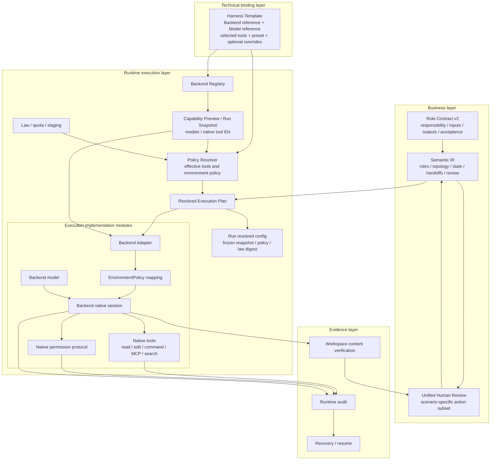
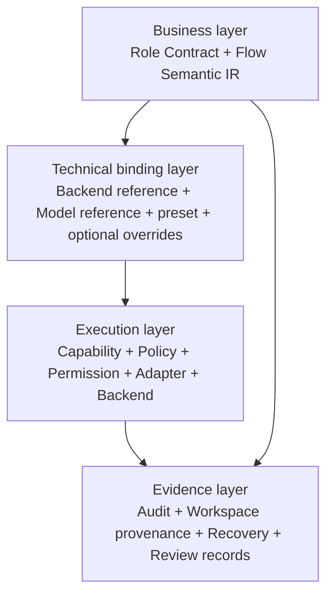
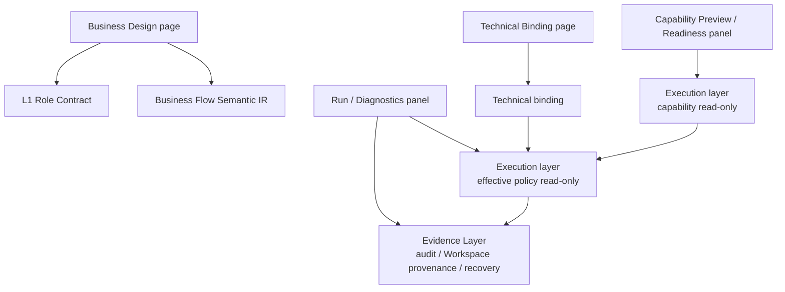
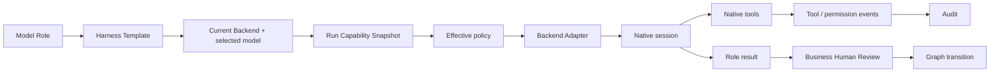
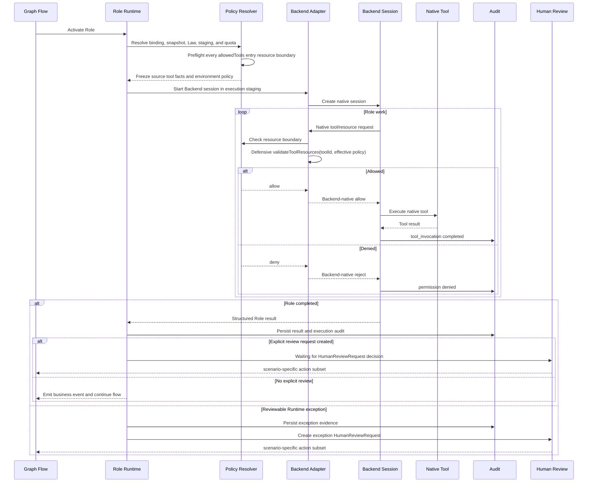
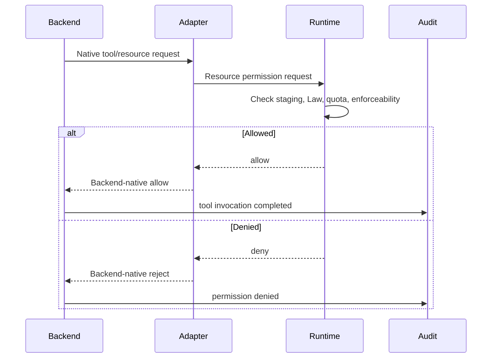
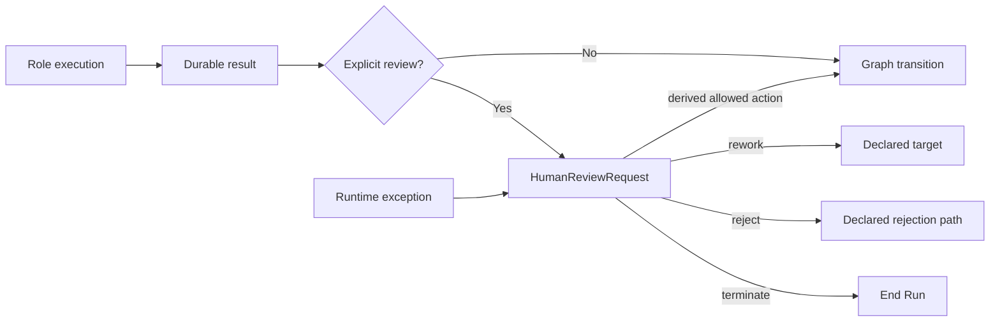

# Role Execution Architecture

This document defines how business Roles bind to Harness Templates and become resolved,
auditable executions.

> **Status: Contract Set v2 architecture standard.** Within the Constitution and immutable decisions, this document is
> the sole v2 architecture authority. The direct replacement remains subject to the release gates
> below. Source code and executable tests report implemented behavior and must conform to the active
> contracts; historical v1 documents are archived and are not runtime inputs.

Workspace fields, states, events, provenance, manifests, and APIs are defined by
[`v2-workspace-contracts.md`](v2-workspace-contracts.md). Workspace behavior and the Workspace-specific
acceptance baseline are described by [`v2-workspace-collaboration-design-and-acceptance.md`](v2-workspace-collaboration-design-and-acceptance.md);
release acceptance and evidence requirements are defined by [`v2-validation-and-acceptance.md`](v2-validation-and-acceptance.md)
and [`release-uat-checklist.md`](release-uat-checklist.md).
OGSystem coordinates general knowledge and office collaboration workflows; it is not modeled around
software delivery or project publication. Projects organize teams, materials, tasks, Reviews, and
collaboration outputs. A TeamVersion becomes eligible for mounting when it is trained and frozen.
Workspace materialization records remain Runtime implementation contracts, not a Project-level
publication object.

This architecture contains no public content-reference or delivery object outside those contracts.
Runtime parser, verifier, and persistence modules may retain internal transition symbols temporarily
during the rename, but those symbols are not contract fields. They must not be serialized into a
public architecture, schema, API, checkpoint, or UI. Public collaboration DTOs use WorkspaceRef,
Project Workspace binding, and Run evidence defined by the active contracts. Operational contract
reads separately expose checkpoint, lock, provenance, manifest, and event records as defined by the
Workspace API. Materialization is an access mechanism for committed collaboration files, not a
Project publication lifecycle or a claim that the framework is limited to file delivery.

## Contract Set Version

This document defines **OGS Contract Set v2**. The cutover is breaking and does not retain runtime
compatibility with Contract Set v1. Every persisted Role
Contract, Semantic IR, Execution Binding, Review Request, Evidence Event, and Run snapshot must
identify:

```json
{ "ogsContractVersion": 2 }
```

`adapterVersion` remains an independent Backend Adapter implementation version. It does not
identify an OGS contract version. Old v1 fields, schemas, and runtime branches are removed by the
cutover; they are not read as fallback input.

Version ownership is split explicitly:

| Field | Meaning |
| --- | --- |
| `ogsContractVersion` | OGS cross-object contract set; v2 for this architecture |
| `SemanticIR.version` | Semantic IR schema version |
| `BusinessEventProtocol.version` | Shared business event protocol version |
| `FlowContractFile.version` | Flow Contract file format version |
| `RoleContract.schemaVersion` | Role Contract object schema version; current v2 is `2` |
| `HarnessTemplate.schemaVersion` | Harness Template object schema version; current v2 is `1` |
| `schemaVersion` on other contract objects | The named input, output, or business-state object schema version |
| `RuntimeEventEnvelope.schemaVersion` | Runtime evidence event format version |
| `adapterVersion` | Backend Adapter implementation version |

`ogsContractVersion` is an envelope field. It does not replace object-local version fields.

## v2 Cutover Gate

Contract Set v2 is released only after every gate below is satisfied. Historical v1 inputs are
rejected by the active Runtime.

```text
1. Governance
   Approve the v2 Contract Set and update the Constitution, DECISIONS.md, and documentation index.

2. Contract implementation
   Update Role Contract, Semantic IR projections, Harness Template, HandoffProjection,
   HumanReviewRequest, Evidence records, and versioned schemas together.

3. Runtime cutover
   Implement resolved Run snapshots, effective policy/tool freezing, readiness fail-closed,
   WorkspaceRef authorization, Review CAS identity, and remove v1 runtime fallback branches.

4. Backend readiness
   Verify each registered Adapter's discovery, staging, resource enforcement, native session,
   tool invocation, permission allow/deny, error mapping, and recovery behavior.

5. Product surfaces
   Update Studio, CLI, import/export, diagnostics, and TeamVersion validation to use Harness
   Templates; remove v1 Role tool and execution fields from v2 authoring inputs.

6. Evidence and recovery
   Persist v2 event version fields, tool/permission evidence, Review scope identity, WorkspaceRef
   decisions, and frozen Run configuration; verify replay and resume from those records.

7. Direct replacement and validation
   Replace v1 fixtures, examples, tests, and authoring inputs with v2-only content; do not
   migrate released v1 data. Run schema, Runtime, Adapter, Studio, CLI, UAT, and recovery tests
   before release.

8. Documentation closure
   Mark the v1 manuals as historical/current-release background, promote the v2 entry points,
   and remove contradictory v1 instructions from the active v2 workflow.
```

This is the release gate for the active v2 work. The cutover is a direct replacement: there is no data
migration, offline migration tool, compatibility reader, fallback branch, or dual write.

## Core v2 Scope

The v2 cutover keeps one small Role/Execution core contract. Its mandatory product objects are:

```text
Role Contract
  Business responsibility, inputs, outputs, acceptance, and failure semantics.

Business Graph / Flow
  Role topology and handoff edges.

Business Event
  The shared event value emitted by a Role result and routed by a Flow edge.

Harness Template
  Backend, Model, allowedTools, EnvironmentIntent, and limits.

Resolved Run Policy
  Run-frozen Backend/Model, Harness `allowedTools`, Snapshot `verifiedTools`,
  EffectiveEnvironmentPolicy, policy digest, capability digest, and recovery identity. Runtime
  validates `allowedTools ⊆ verifiedTools` (failing closed with `V2_READINESS_TOOL_MISSING` if any
  configured tool lacks verification) and checks resources before computing the effective tool set
  in memory; it is not persisted as a third tool-set fact.

Business Review semantics
  Review triggers and business actions owned by the Business layer.

Evidence / Review Records
  Append-only facts and the minimal persisted review control record.
```

Workspace records such as `WorkspaceRef`, checkpoints, canonical locks, Releases, manifests, and
Workspace events are defined by [`v2-workspace-contracts.md`](v2-workspace-contracts.md). They are
cross-layer Workspace/Evidence records, not additional Role/Execution product layers.

The v2 core does not add Service Agent, Human Agent, Remote Agent, API/Cmd Role, Profile,
Tool, or `local_shell` objects. Fixed commands must be exposed as verified Backend-native
capabilities. Capability matrices, Studio tool-directory UX, Backend-specific permission protocol
variants, extended exception-review workflows, notification policy, and alternate evidence stores
are Deferred RFCs. V2 currently implements only the loop-budget exception Review path; v1 data is
not migrated into v2.

### Deferred RFC boundary

The following may be designed and implemented later without changing the core object model:

```text
Capability Preview refresh UX and Backend tool matrix
ACP/MCP transport details and static/request/none protocol variants
Pi, Kimi, and other Backend-specific probes
Extended Runtime exception review matrices, timeout, escalation, and notification
Action-specific review payloads and detailed evidence/result references
Alternate evidence stores and other non-core integrations
Service Agent, Human Agent, and Remote Agent bindings
```

These extensions must project into the core `allowedTools`, `verifiedTools`, the in-memory verified
executable tool set, EnvironmentPolicy, PermissionDecision, ReviewRequest, and Evidence contracts rather than create
parallel product objects.

## 1. Goal

The target architecture separates business configuration from technical execution:

```text
Role = business responsibility and acceptance
Backend = model and native tools
Runtime = resource boundaries, audit, and recovery
Adapter = mapping to backend-native configuration
```

The default execution policy is automatic. Harness Template generation selects all verified native
tools exposed by the selected Backend unless the template is intentionally restricted; a Role only
selects the template. Human Review is created either after a durable Role result before handoff or
at a configured Runtime exception boundary; both triggers use the same request and decision protocol.

### Final architecture constraints

These constraints are normative. A new field, module, UI panel, or adapter API must
belong to one of the following boundaries before it is added. Do not create another
product layer for an implementation detail.

```text
Business Layer
  Role Contract, Semantic IR, Flow, and Human Review semantics.

Technical Binding Layer
  Harness Template, Backend reference, Model reference, preset, `allowedTools`,
  environment intent, and limits.

Execution Layer
  Graph Runtime, capability discovery, Policy Resolver, staging, Law, quota, Resolved
  Plan, Adapter, Backend session, retry, and process lifecycle.

Evidence (cross-cutting)
  Graph transition records, policy decisions, audit, tool events, permission results,
  Run evidence, Human Review records, checkpoints, and recovery.
```

The following rules are fixed:

1. Adapter, Backend, Capability, Policy, and Permission are Execution modules, not
   additional user-facing architecture layers.
2. Capability Discovery has one OGS entry point. It orchestrates discovery and probe,
   calls the selected Adapter for Backend-specific work, and produces Capability Preview
   or the frozen Run Capability Snapshot. Adapters do not independently publish a second
   discovery model.
3. Technical Binding Projection is a Studio read model. It exposes binding options and
   diagnostics, but owns no runtime decision and is not an execution layer.
4. Harness environment intent, EffectiveEnvironmentPolicy, and Backend-native mapping
   are three different objects. The first is user configuration, the second is computed
   by Runtime, and the third is owned by the Adapter.
5. `allowedTools` is the only Harness Template tool selection field. Generated defaults
   populate it with all verified tools, an empty list means no native tools, and a non-empty
   list is an explicit allow-set. Do not add `requiredTools`, `deniedTools`, `tools.mode`, or
   a technical permission profile.
6. Permission decisions are only `allow` or `deny`. Technical permission never creates
   a review, pending state, or graph transition. Human Review uses one request protocol
   for both explicit result gates after a durable Role result and configured Runtime
   exception boundaries; it never approves an individual tool call.
7. `noop` is not an execution mode. Every executable v2 Model Role must resolve to a Harness
   Template; an unresolved binding is a readiness error.
8. `Supervised`, `Auto-accept`, and `Full access` are not OGS permission modes. Backend-native
   approval modes remain Adapter internals and are never exposed as a second OGS permission model.
   When a Backend supports non-interactive execution, its Adapter uses the most permissive native
   approval behavior within the frozen Harness environment; for Codex, `process: allow` maps to
   `approvalPolicy: never`. Users can narrow tools and resources in the Harness Template.
9. A Resolved Model Role plan must contain Backend, Model, Run Capability Snapshot,
  `allowedTools`, `verifiedTools`, and EffectiveEnvironmentPolicy. Runtime enforces fail-closed
  subset validation (`allowedTools ⊆ verifiedTools`, rejecting unverified tools) and computes the
  executable tool set (`allowedTools`) in memory. `adapterVersion` is read from the
   snapshot and is not duplicated on the plan node.
10. Every Graph node remains a Responsibility Role. The v2 Harness binding describes how a
    Responsibility Role executes; it is not a new Graph node type.
11. Role handoff data is explicit. Only declared event, context mappings, Flow Contracts, and
    authorized WorkspaceRef values cross a Role boundary.
12. Evidence events are append-only; checkpoints and result records use versioned/CAS writes.
   Evidence records and restores execution facts, but does not own mutable business or
   technical configuration.
13. Graph definitions, topology, business state, and handoff semantics belong to Business.
   Graph Runtime state transitions and Policy calculation belong to Execution. Evidence
   may record and restore both, but never owns Graph definitions or Policy logic.
14. The EffectiveExecutionPolicy applies to every v2 Harness execution. There is no separate
    API/Cmd or `local_shell` execution path in Contract Set v2.
15. The executable tool set is the Runtime-verified `allowedTools` set after fail-closed subset
    validation (`allowedTools ⊆ verifiedTools`) and capability, environment,
    Law, staging, quota, and readiness filtering. It is not a permissive intersection that silently
    drops unverified `allowedTools`. The selected intent is the `allowedTools` stored on the Harness
    Template; generated defaults populate it with all verified candidates before policy filtering.
16. Core Permission is only `allow` or `deny`. Backend permission protocol variants are
    Adapter implementation details and Deferred RFCs. Native approval prompts never become OGS
    Human Review. A dynamic, unverified, or unforceable capability fails closed and cannot enter
    the executable set.
17. Pi, Kimi, ACP, and other Backend bindings are not verified until their execution staging and
    resource policy probes pass. A missing or non-enforceable boundary produces readiness error
    or deny; it never widens the host working directory to make execution succeed.

Current implementation status is deliberately narrower than the target model:

| Capability | Current status |
| --- | --- |
| Runtime, staging, Law, quota, audit, Workspace provenance, and recovery | Existing foundation |
| Backend/model discovery and registered adapters | Partially available and Backend-specific |
| Unified native tool discovery and resource enforceability | Not complete |
| Codex/OpenCode policy mapping | Partially available; requires final capability/readiness integration |
| ACP transport and permission-request mapping | Adapter-specific; must pass protocol and resource probes |
| Pi/Kimi execution staging and resource policy | Incomplete; must remain degraded until mapped |
| Claude Adapter | Not registered; must not enter the verified catalog |

The target document must not describe an incomplete Adapter as a verified Backend.

### Normative terminology

The following terms are normative. A module, schema field, API, or UI label should not
reuse one of these names with a broader or different meaning.

#### Business objects

```text
Role Contract
  Business responsibility, input/output contract, acceptance, and failure semantics.

Business Graph
  Business topology: Role nodes, edges, events, joins, loops, and handoff semantics.

Business Event
  A Role result label used by the Business Graph for routing.

Human Review
  A business or Runtime control-plane decision represented by one Review Request schema.
  It may be triggered after a Role result or by a configured reviewable Runtime exception.
```

`Runtime Graph State` is not the Business Graph. It is the current execution position,
Role status, pending event, branch, join, loop, and review state for one Run.

#### Technical binding objects

```text
Harness Template
  Backend reference, Model reference, preset, selected `allowedTools`, and environment intent.
  The template generator reads the Backend Capability Preview and materializes the initial tool
  selection. A Role only references the template.

Backend reference / Model reference
  Technical identifiers stored by a binding. They do not make the binding the owner of
  the Backend implementation or its native tools.

allowedTools
  The Harness Template's technical allow-set of Backend-native tool IDs. It is selected at
  template generation/editing time, not on a Role, and is not a tool definition.

Role execution kind
  The v2 resolved invocation path for a Responsibility Role: `harness`.
  It is binding metadata, not a Graph node type.
```

Backend presets are Backend-owned defaults. They are not another user configuration
object. Run snapshots are runtime facts, not Templates.

#### Runtime objects

```text
Capability Preview
  Read-only discovery and readiness data shown while editing or importing.

Run Capability Snapshot
  The verified Backend/model/tool result frozen for one Run.

EnvironmentIntent
  The resource intent stored in a Harness Template.

workspace.*
  Current OGS internal resource-capability projection (for example `workspace.write` or
  `workspace.run`). In the v2 target it is an Adapter/Runtime implementation concept, not a
  user-facing Backend-native tool catalog or a new tool definition.

EffectiveExecutionPolicy
  The coordinated Runtime result for one Harness Run:
  an in-memory verified `allowedTools` set (`allowedTools ⊆ verifiedTools`) + EffectiveEnvironmentPolicy.

Tool set stages
  The persisted/contract collections are `allowedTools` (Harness Template user selection) and
  `verifiedTools` (Run Capability Snapshot Backend facts). Runtime enforces `allowedTools ⊆ verifiedTools`
  (failing closed with `V2_READINESS_TOOL_MISSING` otherwise) and checks resources in memory. It
  does not persist a third tool-set fact.

EffectiveEnvironmentPolicy
  The final filesystem, process, network, staging, and limit constraints.

PermissionDecision
  The runtime allow/deny result for one native tool or resource request.

PermissionProtocol
  Deferred Adapter RFC term for Backend request-channel modes. It is not a v2 core persisted
  field; every mode must normalize to the core `allow | deny` decision.

Backend Session
  The actual model session created by an Adapter for a Run.
```

The calculation is:

```text
Capability
  + allowedTools
  + EnvironmentIntent
  + Law / quota / staging
  -> Runtime-local verified subset check (`allowedTools ⊆ verifiedTools`)
  -> in-memory executable tool set (`allowedTools`) + EffectiveEnvironmentPolicy
  -> PermissionDecision
```

Capability describes what can be provided and enforced. `allowedTools` describes the user's
technical selection intent. Policy computes what this Run may execute. Permission describes the
result for one request. These terms are not synonyms.

#### Backend and execution terminology

```text
Backend
  The execution backend visible to OGS, such as Codex or OpenCode.

Provider
  A Backend-internal CLI, SDK, or service provider concept. It is not an OGS product
  configuration object.

Adapter
  The OGS conversion and protocol boundary between normalized policy and Backend-native
  parameters. Capability Discovery is orchestrated by OGS and calls the Adapter for
  Backend-specific discovery and probes.

NativeTool
  A tool supplied by the Model Backend and invoked by the native session.

CapabilitySnapshot
  The verified facts for this Backend/model/run, including `verifiedTools` and enforceable
  resource capabilities. It is an internal read-only fact set, not a user-managed tool library.

Legacy fixed invocation
  The v1 `exec.bind` -> Profile -> Tool -> `local_shell` path. It is historical context only and
  has no v2 product binding or migration path.
```

Before cutover, the current v1 path and the proposed v2 path are distinct:

```text
Model Role
  -> Harness Template
  -> Backend Session
  -> NativeTool

Legacy Tool Role (v1 only)
  -> exec.bind
  -> Profile
  -> Tool
  -> local_shell
```

#### Staging and evidence terminology

```text
Execution staging
  The OGS execution boundary for one Role attempt.

Orca worktree
  One possible implementation substrate for staging. It is not semantically identical
  to OGS staging.

Evidence
  Append-only or checkpointed records of execution facts. Evidence can record and
  restore facts, but does not own Business Graph definitions or Policy calculation.

Graph Transition Evidence
  A record that a Runtime Graph State transition occurred.

Policy Decision Evidence
  A record of EffectiveExecutionPolicy or PermissionDecision results.

Recovery Checkpoint
  A durable Runtime state used to resume a Run.
```

#### T3 Code and Orca boundary

```text
T3 Code
  Backend / Provider / Session / NativeTool / Tool UX implementation reference.
  It maps into OGS Backend Adapter, Capability Discovery, and Native Session modules.

Orca
  staging / worktree / worker / terminal / process lifecycle implementation reference.
  It maps into OGS Execution Environment, Process Runner, and Session Lifecycle modules.
```

T3 Code Provider, Tool, and Session objects do not become OGS configuration. Orca
worktree, worker, and terminal objects do not become OGS Roles or Graph nodes. Their
capabilities enter a Run only through the OGS Adapter, Capability Snapshot, and Runtime
Policy.

### Explicit Role Handoff

Role-to-Role information transfer has one structural contract and three business channels:

```text
Role result
  Business Event + typed data + optional committed WorkspaceRef values.

Role input
  Immutable Task request + current-hop input + source event + projected typed data.

HandoffProjection
  A read-only view of an existing FlowContract that may authorize WorkspaceRef values.
```

The WorkspaceRef value and its `workspaceRefs` carrier fields, optionality, validation, and
authorization rules are defined only by [`v2-workspace-contracts.md`](v2-workspace-contracts.md).
This architecture describes the handoff boundary; the projection does not create a new persisted
contract.

`workspaceRefs` contains immutable commit/path/digest references authorized by the existing Flow
edge. Runtime verifies each reference against the committed Git tree and Workspace policy before
exposing it to the downstream Role; it never copies raw Workspace data across a Role boundary.

WorkspaceRef transfer is empty by default. An explicit `context.map` may select authorized
references with `direct.workspaceRefs` or `source(<roleId>).workspaceRefs`; required and optional
selector behavior remains the existing fail-closed projection rule.

`HandoffProjection` is an in-memory, read-only join of the existing sources. It does not
create `handoff-contracts.json`, a second compiler, or a second validation source. The unique
sources are:

```text
contextMap
  Existing graph/role `context.map`; it is the source of field projection mappings.

Flow Contract
  Existing `handoff.contracts.json` / Flow Contract compiler; it validates the payload schema
  and relation metadata. `FlowContractDefinition` is not extended with `contextMap` or
  `workspaceRefs` by this proposal.

workspaceRefs
  A read-only list of declared `WorkspaceRef` values authorized by the Framework. It is not a
  second persisted Workspace contract.
```

The view combines these sources only for execution planning and diagnostics. Any future change
to their storage requires a new contract decision and compiler update; implementers must not
persist a second handoff mapping file.

The channels have fixed meanings:

```text
Business Event
  Route the Flow.

Typed Data
  Carry declared structured business facts, decisions, and status values.

Workspace Reference
  Carry authorized committed Workspace paths, media, code, and other large files through the
  Framework-managed WorkspaceRef boundary.
```

`event` must be a value from the shared Business Event registry. The Flow edge is the only
source of the routable event; `sourceEvent` is derived from that edge and is never configured
as a second event field.

Workspace reference handoff is fail-closed:

```text
default WorkspaceRef transfer
  none

declared and authorized WorkspaceRef
  may cross the handoff through the compiled path projection and Framework Workspace reader

missing declaration, authorization, or mapping
  reject the handoff

required WorkspaceRef missing or unverifiable
  do not commit the handoff or advance the Graph
```

An uncommitted path, tool output, or Workspace file is never implicitly promoted into a handoff.

`task` remains the original user request. `input` is the changing per-hop payload. A Role does
not receive the entire upstream context, prompt history, Backend session, workspace path, or raw
tool output by implication. WorkspaceRef values are immutable and authorized; a filesystem path is
not an authorization token. Join nodes use explicit source and field mappings rather than an
implicit merge of all upstream data.

Native tool availability is not a business completion guarantee. A Model Role becomes eligible
for a durable `RoleResult` only after its output schema, declared postconditions, acceptance
criteria, and Workspace content verification pass. If a required business effect is not produced, whether
because the Agent did not invoke an available tool or because the tool result is invalid, the
Runtime does not persist a successful result and does not advance the Flow handoff. It records the
failure and applies the declared failure or exception policy.

## 2. Target Architecture



## 3. Layering and Responsibility

### Layering

The target product model has four layers. Capability discovery, policy resolution, permission enforcement, adapters, and the Backend runtime remain separate implementation modules inside the execution layer; they are not separate user configuration concepts.



### Layer responsibilities

| Layer | Owns | Receives | Produces | Must not own |
| --- | --- | --- | --- | --- |
| Business | responsibility, inputs, outputs, acceptance, topology, state, events, handoffs, explicit Human Review intent | business requirements and graph design | Role Contract and Semantic IR | Backend, model, native tool, resource permission |
| Technical binding | Harness Template, Backend/model reference, preset, selected `allowedTools`, environment intent | project or TeamVersion technical configuration and Backend catalog | normalized binding input for execution | business acceptance rules, capability snapshot, native tool implementation |
| Execution | Backend Registry, capability discovery/snapshot, effective policy, permission allow/deny, staging, Law, quota, Adapter, Backend session, exception review requests | normalized technical binding, Run context, and business execution plan | Role result, native tool events, execution outcome, Runtime-triggered review request | business review policy and mutable Role configuration |
| Evidence | audit, Workspace provenance, recovery, Human Review records | events and durable results from all relevant layers | replayable Run evidence | mutable business and technical configuration |

Evidence may record Graph transitions, Policy decisions, Run state, checkpoints, and
Human Review records, and may restore them during recovery. It does not define Graph
topology, calculate Policy, or become the source of mutable Business or Technical
Binding configuration.

### Product layers versus implementation stages

The four layers above are the target product ownership model. They do not replace the current
five-stage implementation view used by the v1 Constitution:

| Target product layer | Current implementation stages | Boundary |
| --- | --- | --- |
| Business | Authoring + business parts of Compilation | Defines Role, Flow, state, events, and review intent |
| Technical Binding | Authoring bindings + binding parts of Compilation | Resolves Backend/Model/Harness references and validates configuration |
| Execution | Execution Plan lowering + Runtime | Discovers capabilities, computes policy, starts sessions, and applies transitions |
| Evidence | Evidence | Persists audit, Workspace provenance, review records, checkpoints, and recovery facts |
| Product projections | Cross-cutting views over all stages | Studio, Team Site, CLI, and diagnostics; not a fifth product layer |

Compilation is therefore an implementation stage shared by Business and Technical Binding;
Product Projections are read/control surfaces over the four product layers. This mapping avoids
introducing a second architecture when the v2 implementation is built on the current pipeline.

### Dependency direction

Dependencies flow downward for execution and upward only as evidence:

```text
Business -> Technical binding -> Execution -> Evidence
Business ---------------------> Evidence (business review state)
```

Inside the Execution layer:

```text
Capability = what the Backend can provide and enforce
Technical policy = what this Run chooses within those capabilities
Permission = the final allow/deny result for one resource request
Adapter = the mapping from policy to Backend-native parameters
Backend = the model and native tools that execute the request
```

Capability is descriptive, while permission is prescriptive and runtime-scoped. Permission is not a separate business layer or a user-facing tool approval model.

Human Review has the same split of ownership:

```text
Business
  Declares explicit result gates, business actions, and any reviewable exception codes.

Execution
  Detects Runtime exceptions, creates the unified HumanReviewRequest, and applies decisions
  through Runtime reconciliation. It never approves a native tool request.

Evidence
  Persists the request, decision, exception evidence, and reconciliation facts.
```

Therefore Runtime-triggered review does not create a second review concept. “Business Human
Review” names the meaning and allowed business outcomes; “Runtime exception review” names the
trigger and execution control path under the same request schema.

### User Page Configuration by Layer

The UI should expose the layers according to ownership. It should not turn internal Backend implementation details into business configuration.



| Page or panel | Layers involved | User can edit | User can only inspect |
| --- | --- | --- | --- |
| Business Design / Role | Business | purpose, responsibility, inputs, outputs, acceptance criteria, business failure semantics | resolved Backend and technical policy summary |
| Business Design / Flow | Business | roles, edges, events, topology, joins, loops, Human Review requirement | compiled business flow diagnostics |
| Technical Binding | Technical binding | Backend, model, execution preset, optional advanced overrides | binding validation and unresolved references |
| Capability Preview / Readiness | Execution | refresh discovery and readiness checks | verified models, native tool IDs, adapter readiness, preview time and digest |
| Runtime Policy / Diagnostics | Execution | normally none; technical overrides are edited in Technical Binding | effective tools, staging root, Law, quota, degradation, allow/deny reasons |
| Adapter / Backend Diagnostics | Execution | normally none | native permission mapping, adapter version, unsupported policy fields, native tool events |
| Run / Evidence / Review | Evidence | Human Review decision, rework, terminate; automatic retry history | tool calls, permission decisions, Workspace provenance, errors, recovery history |

The normal user workflow is:

```text
Business Design
  -> Technical Binding
  -> Execution capability validation and policy calculation
  -> Adapter starts Backend
  -> Run Evidence and Human Review
```

The Execution layer contains capability discovery, policy calculation, permission enforcement, adapter mapping, and the Backend session. It is not exposed as several independent business configuration surfaces.

## 4. User Page Design

The user-facing product exposes two configuration pages and two operational pages. Capability, permission, and adapter internals remain automatic or read-only diagnostics.

### 4.1 Business Design

Business Design is the primary authoring page. It contains Role and Flow tabs.

#### Role tab

```text
Role identity
  Role ID (system-managed)
  Display name
  Purpose

Responsibility
  Responsibility kind
  Owned business state
  Contributes
  Does not own

Input contract
  Business fields
  Type
  Required / optional
  Business constraints
  Preconditions

Output contract
  Result fields
  Type
  Workspace reference declarations
  Postconditions
  Acceptance criteria
```

The user does not configure Backend internals, native tool definitions, or permission parameters on this tab.

#### Flow tab

```text
Role nodes
Handoff edges
Event labels
Conditional routes
Join mode and sources
Loop budget
Human Review gate
```

The Flow is the single source for routable event names. The system compiles outgoing
event labels into the Role's `allowed_events` runtime field. Role Contract output fields
describe result semantics; they do not define a second routable event list.

### 4.2 Technical Binding

Technical Binding is a separate page for project or TeamVersion maintainers.

```text
Backend
  Select an installed and verified Backend

Model
  Select a model discovered from the selected Backend

Execution preset
  Default: Backend recommended preset

Advanced overrides (collapsed by default)
  Optional allowedTools
  Optional filesystem/process/network overrides
  Optional timeout and quota overrides
```

The normal page only requires Backend and Model. The selected Backend supplies the
default native tools, environment intent, adapter parameters, and recommended limits
through its execution preset. The Runtime still owns the enforceable staging boundary
and platform safety limits. Advanced overrides are optional and are stored as
differences from the preset rather than as a complete duplicate policy.

The tool list is read from the Backend Capability Preview while editing. Users cannot
create a Model Role tool, edit a native tool command, or configure Backend-specific flags
such as `sandboxPolicy` or `allow dangerous`.

### Harness Template as the Model Role Binding

The primary purpose of a `Harness Template` is to bind a Model Role to the Backend that will run it and to a model offered by that Backend. The Backend is the source of truth for the CLI/adapter, model catalog, native tools, and supported permission mapping. A template stores references and restrictions; it does not own native tool definitions or Backend permission parameters.

The reusable technical template for a Model Role represents the complete CLI/Backend harness in which the Role runs. Template generation reads the Backend Capability Preview and writes the selected native tool IDs into the template. The Role never selects tools independently:

```text
Harness Template
  Backend / CLI adapter identity
  Model exposed by that Backend
  Optional model `variant` exposed by that Backend
  Optional `reasoningEffort` request (`low`, `medium`, `high`, `xhigh`, `max`, or `auto`)
  `allowedTools` references
  Optional filesystem/process/network policy intent
  Optional timeout and quota overrides
```

The user-facing relationship becomes:

```text
Model Role -> Harness Template -> current Backend -> selected Backend model
                                  \-> Backend native tools and permission mapping
```

Each Model Role has its own resolved Harness Template reference. Different Roles may select different templates, and multiple Roles may reuse one template when that is intentional. A project or TeamVersion may define a default Harness Template for Model Roles that do not select one explicitly; this is an explicit fallback, not an invisible global execution policy.

Persist one user-facing technical object: the Harness Template. Do not create command
bindings or a second execution-template abstraction. The recommended
storage shape is:

```json
{
  "ogsContractVersion": 2,
  "schemaVersion": 1,
  "harnessTemplates": {
    "codex-default": {
      "kind": "harness",
      "backend": "codex",
      "model": "gpt-6-luna",
      "variant": "default",
      "reasoningEffort": "auto",
      "preset": "backend-default",
      "allowedTools": ["exec_command", "apply_patch"],
      "environment": {
        "filesystem": { "read": true, "write": true },
        "process": true,
        "network": false
      },
      "limits": {
        "timeoutMs": 600000,
        "maxOutputBytes": 200000,
        "maxStorageBytes": 200000000
      }
    },
    "codex-no-network": {
      "kind": "harness",
      "backend": "codex",
      "model": "gpt-6-luna",
      "preset": "backend-default",
      "allowedTools": ["exec_command", "apply_patch"],
      "environment": {
        "filesystem": { "read": true, "write": true },
        "process": true,
        "network": false
      }
    }
  },
  "defaults": {
    "harnessTemplate": "codex-default"
  },
  "roles": {
    "writer": { "harnessTemplate": "codex-default" },
    "reviewer": { "harnessTemplate": "codex-no-network" }
  }
}
```

Harness binding rules:

```text
backend:
  Required. Identifies the installed Backend/CLI adapter used to create the session.

model:
  Required. Must be present in the selected Backend's verified model catalog.
  A model reference is not portable to a different Backend unless that Backend
  exposes the same model and the binding is revalidated.

variant:
  Optional Backend/model variant. It is an opaque Backend-owned identifier and is
  validated against the selected Backend's catalog when the template is verified.
  It must not be interpreted by Role Contracts or Semantic IR.

reasoningEffort:
  Optional requested inference intensity. `auto` preserves the request and lets the
  Adapter select the Backend-supported effective value. An explicit value is accepted
  only when the selected Backend/model advertises it. The Adapter records the effective
  value in the frozen Run binding; the request and effective value are both technical
  binding facts and never business input.

preset:
  Optional Backend-owned defaults for native tools, environment intent, and limits.

environment:
  Optional in Studio authoring input. A new template starts from the selected Adapter's maximum
  enforceable resources, while the author can choose narrower values. The authoring layer resolves
  any omitted field from the Backend preset or conservative default and writes the complete
  `filesystem`, `process`, and `network` fields. The persisted Contract Set and direct loader input
  are strict and must contain those fields; this is not a per-tool approval workflow.

Environment resolution precedence:
  explicit Harness `environment` override
    -> Backend `preset` defaults
    -> conservative Runtime default

The conservative Runtime fallback is filesystem read inside execution staging, with filesystem
write, process, and network denied. Studio-created Harness Templates instead start with the
maximum resource intent the selected Adapter reports as enforceable: staged filesystem access,
process execution, and network access where supported. Unsupported or unverified resources remain
denied. This keeps `allowedTools` (tool selection) separate from resource policy.

allowedTools in a generated template:
  The Studio selects every verified native tool exposed by the selected Backend. The user can
  remove tools from this multi-select allow-list; Roles do not override it. A Backend without
  per-tool restriction keeps all discovered native tools available.

allowedTools = []:
  Explicitly disable Backend-native tool calls for this Harness.

allowedTools with entries:
  Use only the listed tools. Every entry must exist in the Capability Preview during
  template generation/editing and in the frozen Run Snapshot before Backend startup.
```

Changing `backend` invalidates the model, tool, and permission resolution until the
new Backend is discovered and the template passes readiness. Changing `model` keeps
the Backend but reruns model-specific readiness and freezes the resulting capability
snapshot for the next Run.

### Backend-specific mapping boundary

The Technical Binding stores only normalized intent:

```text
backend
model
variant (optional)
reasoningEffort (optional request)
preset
allowedTools
environment intent
limits
```

Backend-specific flags, tool names, sandbox modes, approval modes, and protocol
responses stay inside the selected Adapter. They must not appear in Role Contract,
Semantic IR, generic Runtime policy types, or business-facing Studio forms.

The current project-level mapping is:

| Backend | Current status | Native mapping owned by Adapter | Default boundary |
| --- | --- | --- | --- |
| Codex | registered and runnable | App Server `sandboxPolicy` / `approvalPolicy`; execution staging becomes the writable root | filesystem and command only when the corresponding policy is enforceable; network stays denied unless explicitly verified |
| OpenCode | registered for text-only execution; filesystem/process degraded | SDK session tools and provider protocol; native cwd does not prove absolute-path/symlink isolation | filesystem/process tools are denied until a staging sandbox is verified; network stays denied |
| ACP-capable Backend | protocol-compatible when the Adapter and probe are present | ACP session, capability discovery, and permission request callbacks | `request` protocol is normalized to allow/deny; missing resource enforcement remains denied |
| Pi | registered for text-only execution; filesystem/process degraded | Pi public SDK tool definitions plus RPC session mapping | filesystem/process tools are denied until per-execution staging isolation is verified; unknown, MCP, extension tools and network remain denied |
| Kimi | registered, Adapter/probe required per installed CLI or protocol | Backend-native or ACP session mapping | unavailable capabilities remain unverified until the selected mapping passes readiness |
| Claude | no adapter currently registered | no OGS native mapping yet | unavailable in the verified Backend catalog until an adapter and probe exist |

This table describes adapter readiness, not a second user-maintained capability matrix.
When a Backend cannot express a requested resource boundary, the Adapter returns a
readiness failure or a denied effective resource. It never widens the execution root or
disables a sandbox to make the binding appear runnable.

Fail-closed rules for incomplete or dynamic capabilities:

```text
Dynamic native tools
  A tool discovered only after Run start, a tool returned by tool_search, or an unverified MCP
  tool is not in the frozen snapshot and cannot be invoked. Discovery must complete before the
  Run; otherwise the request is denied and audited.

Native approval prompts
  `ask`, `on-request`, or equivalent interactive approval is not an OGS permission mode. The
  Adapter must map it to a proven non-interactive allow/deny boundary or fail readiness.

Pi and Kimi
  Pi may be marked verified only for the exact native tools and resource boundaries observed by
  its probe; Kimi remains degraded until its selected native or ACP session passes staging,
  filesystem, process, network, and permission protocol probes. A session that starts without
  those guarantees cannot be marked verified for the corresponding capability.

ACP
  An ACP request is accepted only when its tool/resource identity is in the frozen snapshot and
  its boundary is enforceable. Unknown or unbounded ACP requests are denied and audited.
```

### Execution substrate integration

T3 Code and Orca are implementation references or optional execution substrates inside
the Execution Layer. They do not introduce a new OGS product layer or replace OGS
business and policy ownership.

```text
T3 Code
  Backend / Provider / Session / Native Tool / Tool UX
  -> OGS Backend Adapter, Capability Discovery, Native Session

Orca
  staging / worktree / worker / terminal / process lifecycle
  -> OGS Execution Environment, Process Runner, Session Lifecycle

OGS
  Business semantics, Technical Binding, Graph orchestration, Policy resolution,
  Audit, Workspace provenance, and Recovery
```

The integration boundaries are fixed:

1. T3 Code Provider, Tool, and Session objects do not become OGS product configuration.
2. Orca worktree, worker, and terminal objects do not become OGS Business Roles or
   Graph nodes.
3. T3 Code and Orca capabilities enter a Run only through the OGS Adapter, Capability
   Snapshot, and Runtime Policy.

In this model:

```text
Harness Template:
  Project or TeamVersion-owned reusable CLI/Backend technical binding.

Backend preset:
  Backend-owned default values, resolved internally and not a second user configuration object.

Capability Preview:
  Refreshable discovery/readiness data shown before Run start.

Run Capability Snapshot:
  Generated and frozen at Run start; not manually authored.

Effective Policy:
  Computed by Runtime from the environment, capabilities, Law, staging, and quota.
```

The Harness Template is a configuration template. The Capability Preview is an editing
diagnostic; the Run Capability Snapshot and Effective Policy are Run execution results.
This keeps the user model small while preserving deterministic recovery.

### Default Harness Template

Defaults are resolved in this order:

```text
1. Role.harnessTemplate
2. TeamVersion or project default harnessTemplate
3. Backend-owned default preset for the selected Backend
4. Readiness error when no Backend can be resolved
```

The default is applied when a Model Role is created or when its binding is resolved. The resolved Role-to-Harness reference is written into the Run snapshot, so recovery never depends on a later default change.

Backend-owned presets are read-only. Project or TeamVersion default Harness Templates can be customized and versioned.

### Team Import and Export

The Team package should carry business structure and logical Harness Templates, not machine-specific execution state.

```text
Team export includes:
  Role Contracts
  Flow / Semantic IR
  Input and output schemas
  Acceptance criteria
  Human Review configuration
  Harness Templates
  Role -> Harness Template references
```

The Team package excludes:

```text
Backend native tool implementations
Local command paths
Backend sandbox or approval internals
Capability Snapshots
Effective Policies
Run staging directories
Audit, Workspace provenance, and Recovery records
Credentials and Secrets
Machine-specific Backend discovery results
```

Import resolves technical availability in the target environment:

```text
Import Team
  -> Read Roles and Flow
  -> Read Harness Templates
  -> Resolve Backend and Model against local Backend Registry
  -> Generate a new Capability Preview
  -> Calculate Binding Preview / Readiness Projection
  -> Run binding readiness
```

Import does not create a Run staging root, bind Run-specific Law/quota state, or produce an
`EffectiveExecutionPolicy`. It only reports whether the Harness Template can become executable.
The actual `EffectiveExecutionPolicy` and verified executable tool set are calculated when a Run is
created, after Run context, staging, Law, and quota are available. The Run freezes the source facts
(`allowedTools`, `verifiedTools`, and environment policy); this verified executable tool set is
recomputed after fail-closed subset validation (`allowedTools ⊆ verifiedTools`) during execution and recovery.

When a target environment does not have a referenced Backend or Model, the Team can still be imported. The Harness Template is marked unresolved and the Team cannot be trained or run until the binding is repaired.

This keeps the portable Team package small:

```text
Team package
  = business structure + Harness Templates

Project / machine
  = Backend, Model, Capability, Adapter, and local resources

Run
  = frozen technical snapshot, audit, recovery, and delivery evidence
```

### 4.3 Runtime Diagnostics

Runtime Diagnostics is read-only. It explains the technical decision generated for the current Run:

```text
Selected Backend and model
Capability Preview or Run Snapshot digest and verification time
Effective native tools
Execution staging root
Effective filesystem/process/network policy
Law and quota constraints
Capability degradation
Allow/deny reasons
Adapter mapping summary
```

The page explains why a capability is unavailable, but is not a second policy editor.

Capability state has two stages:

```text
Capability Preview:
  Refreshable discovery/readiness data shown while editing a Harness Template or
  importing a Team. It may change when Backend discovery is refreshed.

Binding Readiness Projection:
  Import/edit-time diagnostic derived from the Harness Template and Capability Preview. It does
  not contain Run staging, Run-specific Law/quota, or an EffectiveExecutionPolicy.

Run Capability Snapshot:
  The formal capability result created at Run start. It is stored in the Run
  snapshot and reused unchanged during recovery.
```

### 4.4 Evidence and Review

Evidence and Review is the operational page:

```text
Role result
Acceptance criteria status
Workspace content and verification
Native tool invocation history
Permission allow/deny history
Errors and recovery history
Human Review decision
```

Human Review uses the canonical action enum. The page filters actions by trigger:

```text
explicit result:
  approve / rework / reject -> resolve the business result and declared handoff

Runtime exception:
  exception-specific action subset -> apply the Runtime control authorization
```

Explicit result review actions are business decisions about the Role's durable result and
declared handoff. V2 exception Review currently covers loop-budget exhaustion and its declared
continuation, rework, reject, and termination controls. Automatic retry remains an internal
Runtime policy. Join timeout, Workspace content verification failure, notification, and other exception
Review matrices are Deferred RFCs. Both implemented triggers use the same request, action enum,
decision payload, and Evidence schema. Neither class approves or rejects an individual Backend
tool call.

### 4.5 Page Save and Readiness Rules

Business Design save checks:

```text
Role responsibility is present
Input and output business schemas are valid
Flow endpoints and event labels are valid
Join and loop settings are consistent
Human Review targets are resolvable
```

Technical Binding save checks:

```text
Backend is installed and verified
Model belongs to the selected Backend
Every allowedTools entry exists in the Capability Preview
Requested environment resources are expressible by the Adapter
Required limits are valid
```

Run readiness checks:

```text
Capability Preview is available and the Run Capability Snapshot can be created
Run Capability Snapshot is frozen before Backend startup
Effective Policy can be calculated
Execution staging can be created
Law and quota checks pass
All explicitly selected technical capabilities are enforceable
```

The normal navigation is:

```text
Business Design -> Technical Binding -> Readiness -> Run -> Evidence / Review
```

### 4.6 Optimized Page Information Architecture

The four-layer architecture should not become four separate technical pages. The product navigation should expose three main workspaces:

```text
Design
  Business Design: Role and Flow

Environments
  Harness Templates

Operate
  Run status, evidence, recovery, and Human Review
```

Capability discovery, effective policy, and Adapter mapping appear as read-only details inside Environments and Operate. They do not become primary navigation items.

#### Design workspace

```text
Left: Role list and Flow element list
Center: Flow canvas
Right: selected Role or Flow business inspector
```

The Business Role Inspector contains only:

```text
Purpose
Responsibility
Input fields
Output fields
Acceptance criteria
```

The Flow inspector contains:

```text
Source and target Role
Event label
Condition
Join / Loop settings
Review before handoff
```

The Technical Binding panel contains the compact `Harness Template` selector. It saves only
the template reference, not Backend tools or permission fields. A `View template` action
opens the shared template details without duplicating them in the business Role Contract.

#### Environments workspace

```text
Left: Harness Template list
Center: selected template summary
Right or drawer: advanced customization
```

The default view shows:

```text
Template name
Template kind
Backend
Model
Default status
Roles using this template
```

The advanced view shows:

```text
allowedTools override
Filesystem intent
Process intent
Network intent
Timeout and quotas
```

Capability Preview, effective tools, Adapter resource validation, and Adapter mapping are
read-only sections below the form or in a diagnostics drawer. Switching Backend or Model
refreshes these sections and validates existing overrides.

The primary action is `Use default`. The secondary action is `Customize`, which creates
or updates a Harness Template rather than adding fields to each Role. Changing a Role's
selector changes its technical binding; editing a shared template can affect every Role
that references it and therefore creates a new template revision for trained
TeamVersions.

#### Operate workspace

```text
Run status
Flow progress
Current Role
Current Harness Template
Effective policy summary
Workspace references and verification
Audit timeline
Recovery controls
Human Review panel
```

The Human Review panel is shown when an explicit result review or configured Runtime exception
creates a `HumanReviewRequest`. It displays the scenario-specific subset of the core actions
`approve`, `continue`, `rework`, `reject`, and `terminate`. Native tool Permission
Decisions remain in the audit timeline and are not presented as user approval tasks.

#### Progressive disclosure rules

```text
Default view:
  business fields, Harness Template name, Backend, Model, readiness status

Advanced view:
  tool and environment overrides, limits, degradation details

Diagnostic view:
  Capability Preview or Run Snapshot, Adapter mapping, native permission events, raw audit data
```

The user should be able to complete a normal Role setup without seeing a native tool name. Technical detail is available for diagnosis and deliberate customization, but it is not required for ordinary business authoring.

### Input and Output Configuration

Input and output configuration is split between user-owned business data and Runtime-owned execution data.

#### User must configure

```text
Input business fields:
  field name, meaning, type, required/optional status, and business constraints

Input preconditions:
  facts that must be true before the Role starts

Output business fields:
  result fields, Workspace reference declarations, and their business meaning

Output acceptance criteria:
  checks that determine whether the result is acceptable

Business outcome events:
  READY, BLOCKED, APPROVED, NEEDS_REWORK, or other registered Business Events used by the Flow
```

The user defines the business schema, but does not manually repeat Runtime envelope fields.

#### Runtime generates or injects

```text
task and original user input
allowed_events derived from outgoing Flow edges
upstream and join context selectors
runId, roleId, executionId, branchId, and loop iteration
workspace root and Workspace reference envelope
technical tool and permission metadata
```

The Runtime prompt shell and audit envelope are not part of the business input/output schema.

#### Suggested, then confirmed by the user

```text
context map from upstream Flow edges to Role input fields
output schema skeleton from declared events and Workspace reference declarations
event labels from outgoing Flow edges
required input fields inferred from the Role schema
```

The graph is the single source for routable event names. A Role Contract may expose the compiled event list for validation, but users should not maintain conflicting event lists in both the Role package and the Flow editor. Ambiguous context mappings require user confirmation before saving.

```text
Role Contract
  Business responsibility, inputs, outputs, acceptance criteria, and failure semantics.

Semantic IR
  Business topology, state, events, handoffs, joins, loops, and the single Human Review source.

Harness Template
  Backend, its selected model, the selected Backend-native tools, and optional environment overrides.

Backend Registry
  Backend discovery, model catalog, native tool catalog, and resource enforcement capabilities.

Runtime
  Staging, Law, quotas, effective policy calculation, audit, and recovery.

Adapter
  Translation from the OGS environment policy to Backend-native parameters.

Backend
  Model inference, native tool execution, and native permission protocol.
```

Role packages do not define Backend tools, Harness configuration, commands, or permission parameters.

## 5. Role Execution Paths

### Model Role



Every v2 Role uses the Harness path. Fixed commands, API calls, `Profile`, `Tool`, and
`local_shell` remain v1 execution assets only; they are not a second v2 Role kind or a bypass
around Backend capability and resource policy. A v1 Tool Role must be rewritten to a verified
Backend-native capability before it can run under Contract Set v2.

## 6. Role Contract

The business Role Contract does not contain Backend or tool configuration:

```json
{
  "ogsContractVersion": 2,
  "schemaVersion": 2,
  "roleId": "writer",
  "purpose": "Produce project documentation",
  "responsibility": {
    "kind": "atomic",
    "owns": ["document"],
    "contributes": [],
    "doesNotOwn": []
  },
  "inputs": {
    "preconditions": []
  },
  "outputs": {
    "postconditions": [],
    "decisionCriteria": []
  },
  "authority": {
    "controlActions": ["approve", "rework", "reject"]
  },
  "failure": {
    "retryableErrorCodes": [],
    "terminalErrorCodes": []
  },
  "audit": {
    "requiredFields": []
  }
}
```

`authority.controlActions` describes the allowed business subset of the canonical
`HumanReviewAction` enum. It does not declare whether Human Review is required, and it does not
define Runtime exception actions such as automatic retry or budget `continue`. The review requirement has
one source in the Semantic IR or graph definition; `ExecutionPlanNode.review` is only its compiled
read-only projection.

## 7. Technical Binding Resolution

Technical template references are kept outside the business Role package, for example in `.ogs/execution-bindings.json` or the trained and frozen TeamVersion. The file is a binding index; the Harness Template is the only v2 user-facing technical object.

The preferred persisted form is a template plus a Role-to-template reference. The expanded object below is the resolved form used by the Runtime.

```json
{
  "ogsContractVersion": 2,
  "schemaVersion": 1,
  "roles": {
    "writer": {
      "kind": "harness",
      "harnessTemplate": "codex-default"
    },
    "reviewer": {
      "kind": "harness",
      "harnessTemplate": "codex-no-network"
    }
  }
}
```

Rules:

```text
Backend preset omitted:
  Use the selected Backend's default execution preset.

environment or limits omitted:
  Use the selected Backend/model preset's resource policy, adapter settings, and limits.

allowedTools:
  The template generator initializes the list from verified Backend tools. An empty list means
  no native tools; a non-empty list is the template's selected set and can only name tools from
  the Backend Capability Preview.
```

The initial model does not keep a separate `deniedTools` field. Users cannot create Model Role tools in OGS. The resolved policy is generated from the Backend preset and optional overrides.

### Static and Resolved Execution Plan

The plan has a deliberate boundary between compilation and execution:

```text
Static Execution Plan
  Role and Flow references
  Harness Template references
  May omit Backend capability and effective policy

Resolved Execution Plan
  Created before Backend startup
  Contains the complete frozen technical decision for the Run
```

An executable Model Role node must use the resolved form. These fields are required,
not optional:

```ts
type ResolvedExecutionPlanNode = {
  roleId: string;
  backend: string;
  model: string;
  capabilitySnapshot: RunCapabilitySnapshot;
  allowedTools: string[];
  verifiedTools: string[];
  effectiveEnvironmentPolicy: EffectiveEnvironmentPolicy;
};
```

Persistence rule:

```text
Harness Template                  -> allowedTools
Run Capability Snapshot           -> verifiedTools
resolved-config.json              -> allowedTools + verifiedTools (frozen source facts)
Runtime memory                    -> verified allowedTools (allowedTools ⊆ verifiedTools, after resource checks)
```

`EffectiveExecutionPolicy` may carry the verified executable tool set in Runtime memory while resolving
and executing. Persisting it separately would create a third tool-set fact that could drift from
the frozen Harness selection and Capability Snapshot.

The resolved node is written into the Run snapshot together with the Semantic IR and
Law digests. Adapter version is read from `capabilitySnapshot.adapterVersion`; it is not
duplicated on the plan node. A node that lacks any required field cannot start a Model
Role session.

## 8. Capability Preview and Run Snapshot

The Preview is refreshable during editing and readiness. The Run Snapshot is created
immediately before Backend startup, frozen for the Run, and reused during recovery:

For a Model Role, the Run Snapshot always contains the resolved `backend` and `model`
pair. The Preview may exist at Backend level before a model is selected.

```ts
type CapabilityPreview = {
  backend: string;
  model?: string;
  variant?: string;
  reasoningEfforts?: string[];
  verifiedTools: string[];
  adapterVersion?: string;
  verifiedAt: string;
  digest: string;
  readiness: "ready" | "degraded" | "unavailable";
};

type RunCapabilitySnapshot = {
  backend: string;
  model: string;
  variant?: string;
  requestedReasoningEffort?: string;
  effectiveReasoningEffort?: string;
  adapterVersion: string;
  verifiedAt: string;
  verifiedTools: string[];
  digest: string;
};
```

The Capability Preview is the discovery result shown during editing. It is read-only and
can only be refreshed. The Run Capability Snapshot stores the verified Backend/model
identity and `verifiedTools` used by one Run. Tool resource dependencies and Backend protocol
details remain private to the Adapter; they are not core contract fields or a second public
capability matrix.

Capability sources are ordered as follows:

1. Backend protocol discovery;
2. Adapter static descriptor when discovery is unavailable;
3. No user-created descriptors.

Unverified tools cannot be selected when a Harness Template is generated. Resource enforceability
is checked by the Adapter when the effective environment policy is applied.

The Adapter keeps the tool-to-resource mapping private:

```ts
type AdapterResourceCapabilities = {
  filesystem: boolean;
  process: boolean;
  network: boolean;
};

interface BackendAdapter {
  getResourceCapabilities(): AdapterResourceCapabilities;

  validateToolResources(
    toolId: string,
    policy: EffectiveEnvironmentPolicy
  ): { allowed: boolean; reason?: string };

  mapEnvironmentPolicy(policy: EffectiveEnvironmentPolicy): BackendNativeConfig;
}
```

The Policy Resolver uses `getResourceCapabilities()` together with the Harness
`environment` intent, staging, Law, and quota to calculate the Effective Environment
Policy. During Run readiness it calls `validateToolResources()` for every entry in the
Runtime-local candidate set; only tools that pass this preflight enter the in-memory executable set. At invocation time the
Adapter repeats the same check defensively and must never add a tool to the set. This avoids
adding a public resource-dependency matrix to every tool descriptor while ensuring a tool is
not first rejected on its initial call.

Readiness failure semantics are strict for explicit selections:

```text
allowedTools entry missing from verifiedTools
  -> readiness error
  -> do not start Backend
  -> do not advance Graph

allowedTools entry whose resource boundary cannot be enforced
  -> readiness error
  -> do not start Backend
  -> do not advance Graph

Capability or resource not selected by allowedTools, or an omitted optional environment intent
  -> may be absent or conservatively denied without blocking the Run
```

An edit-time Preview may report degraded optional capabilities. A degraded Preview is executable
only when it does not invalidate any explicit `allowedTools` entry or requested enforceable
resource boundary. Run startup repeats these checks against the frozen Snapshot; invocation checks
are defensive only and cannot remove an explicit tool after the Backend has started.

## 9. Capability, Technical Policy, and Permission

These concepts have different ownership and meaning:

```text
Capability
  What the selected Backend and Adapter can actually provide and enforce.

Technical policy
  What this Project and Run choose to permit within the available capabilities.

Environment policy
  The resource policy intent for filesystem, process, network, staging, and limits.

Permission decision
  The final allow/deny result for one resource request at execution time.
```

Capability is descriptive; it is not permission. A Backend may support process execution, but the Run policy may deny it. A policy may request network access, but the capability snapshot may show that the Adapter cannot enforce a network boundary; the effective policy must then deny it.

The relationship is:

```text
Backend capability snapshot
  + Harness Template reference
  + Adapter resource capabilities
  + Law / quota / staging
  -> Effective technical policy
  -> Permission allow / deny
```

The capability layer belongs to Backend discovery and readiness. The technical policy belongs to Runtime policy resolution. Permission is the enforcement result produced by Runtime and Adapter; it is not a second business configuration layer.

Backend-native settings such as `sandboxPolicy` and `approvalPolicy` exist only inside
the Adapter mapping. They are not persisted as OGS permission fields.

## 10. Flow Execution Model

The graph Flow remains a business handoff model. It does not contain native tool calls. A Role completes its responsibility, emits a business event, and the Runtime selects the next graph transition. Native tool activity is an internal execution trace for that Role.



Flow transitions are driven by Role business events, not by individual native tool events. Tool events remain evidence and diagnostics; they do not become graph edges.

## 11. Effective Policy Calculation

The Runtime calculates one coordinated effective execution policy. It has two related
outputs rather than two independent policy systems:

```ts
type EffectiveExecutionPolicy = {
  allowedTools: string[];
  verifiedTools: string[];
  environment: EffectiveEnvironmentPolicy;
};
```

The executable set and environment are resolved together. The environment and its policy digest
are frozen; the executable set is recomputed from frozen `allowedTools` and `verifiedTools`.

```text
Harness Template allowedTools
  -> Runtime-local candidate set (not persisted)

allowedTools = []
  -> no native tools

allowedTools with entries
  -> Runtime-local candidate set contains exactly the listed verified Backend tools

Runtime-local candidate set
  -> capability, environment, Law, staging, quota, and readiness filtering
  -> in-memory executable set (the only executable native tool set)
```

If a configured `allowedTools` entry is not in the Capability Preview, readiness fails
before the Harness Template is saved or used. Run startup repeats the check against the Run
Capability Snapshot and computes the executable set in memory from the frozen facts.
At each native request, the Adapter additionally validates the tool's private resource
dependencies against the effective environment policy. A request that cannot be
enforced is denied and recorded in audit; it does not introduce a second public tool
configuration model.

Resource policy resolution is explicit:

```text
Harness environment intent
  + Adapter.getResourceCapabilities()
  + staging boundary
  + Law and quota
  -> EffectiveEnvironmentPolicy
```

The effective environment policy is resource-oriented:

```ts
type EffectiveEnvironmentPolicy = {
  root: string;
  filesystem: {
    read: boolean;
    write: boolean;
  };
  process: boolean;
  network: boolean;
  limits: {
    timeoutMs: number;
    maxOutputBytes: number;
    maxStorageBytes: number;
  };
  degradation?: Array<{
    resource: string;
    reason: string;
  }>;
};
```

Default rules:

```text
filesystem.read = true inside execution staging
filesystem.write = allow only when EnvironmentIntent/preset allows it and the Backend can enforce the staging root
process = allow only when EnvironmentIntent/preset allows it and the Backend can enforce the process boundary
network = allow only when EnvironmentIntent/preset allows it and the Backend can enforce the network boundary
unknown tool = deny
unknown resource request = deny
```

All access remains subject to Law, staging, and quotas. Staging is the physical execution boundary;
it does not grant a Role access to arbitrary upstream context or files. Handoff `contextMap` and
the authorized WorkspaceRef set remain the business data boundary.

## 12. Permission Protocol

Core Permission is a single technical decision:

```ts
type PermissionDecision = "allow" | "deny";
```

The Adapter must apply the frozen policy to native tool/resource requests, deny unknown or
unbounded requests, and record the decision. Native approval never becomes Human Review.

Backend transport modes such as ACP callbacks and `static` / `request` / `none` protocol
variants are Adapter implementation details and Deferred RFCs. They must preserve the core
`allow | deny` result and fail closed when a boundary cannot be enforced.



There is no technical Permission Review. A denied native request is recorded as a Permission
Decision and follows the Role's normal failure or exception policy. Human Review uses the single
control-plane protocol below.

## 13. Human Review

Human Review has one request schema with trigger-specific action contracts. It supports two trigger kinds:

```text
explicit
  The Role produced a durable result and the configured review gate is before handoff.

exception
  Runtime produced the currently supported reviewable exception: loop budget exhaustion.
  Retry exhaustion, Join timeout, Workspace content verification failure, and other exception Review
  triggers remain Deferred RFCs.
```

The persisted action set is intentionally small and excludes the internal timeout state:

```ts
type HumanReviewAction =
  | "approve"
  | "rework"
  | "reject"
  | "continue"
  | "terminate";

type BusinessReviewAction = "approve" | "rework" | "reject";
type ExceptionReviewAction = "continue" | "rework" | "reject" | "terminate";
```

For `trigger: "explicit"`, `decision.action` must be a `BusinessReviewAction`. For
`trigger: "exception"`, it must be an `ExceptionReviewAction`. `pause` is not a persisted
decision action: Runtime may record it only as an internal timeout lifecycle state while a review
remains unresolved.

Core action meanings are fixed:

```text
approve   Accept the business result and continue the declared handoff.
continue  Resume the current control scope only within the exception policy and any declared
          loopBudget authorization.
rework    Route to the declared rework target.
reject    Produce the declared business rejection outcome or route.
terminate End the explicitly resolved `branch` or `run` scope.
```

The trigger determines the decision meaning:

```text
explicit result review
  Business result and handoff decision.

Runtime exception review
  Execution control decision. It authorizes Runtime reconciliation and never changes the Backend
  tool set. `rework` or `reject` select a declared route when the exception policy provides one.
```

Action availability and action targets are derived; they are not arbitrary fields supplied by the
reviewer:

```text
explicit result review
  available actions: approve / rework / reject
  approve: the current declared handoff
  rework/reject: the unique matching Flow edge selected by the current Flow and review policy

Runtime exception review
  available actions: the exception policy's declared subset, intersected with the active Runtime
  scope
  target and scope: the current Runtime exception context and active branch/lineage state
  terminate: explicitly resolved to `branch` or `run`; an unspecified or ambiguous scope is invalid

loop_exhausted
  continue / rework / reject / terminate
  continue is valid only through the declared loopBudget binding and its target/grant constraints
  terminate must resolve to branch or run through the exception policy

other exception
  Runtime automatic retry, Join timeout, Workspace content verification failure, and other exception
  Review action matrices are Deferred RFCs. They must not create a V2 exception Review until a
  versioned policy and action subset are implemented.
```

The Flow, Role `authority.controlActions`, loop-budget binding, and compiled Runtime scope
must resolve each displayed action to exactly one target. A static ambiguity is a readiness error.
A runtime ambiguity causes the decision to be rejected and audited; Runtime must not guess a
branch, retry attempt, budget, or termination scope. `continue` never means arbitrary budget
increase: for `loop_exhausted`, it can only consume the target and grant already declared by the
`loopBudget` binding. This keeps the core request small without making action application implicit.

The core request has only the lifecycle needed for blocking, recovery, idempotency, and CAS:

```ts
type HumanReviewRequest = {
  ogsContractVersion: 2;
  schemaVersion: 1;
  reviewId: string;
  runId: string;
  round: number;
  lineageId: string;
  branchId: string;
  loopIteration: number;
  stateVersion: number;
  trigger: "explicit" | "exception";
  exceptionContext?: {
    code: string;
    details?: Record<string, unknown>;
  };
  status: "pending" | "resolved" | "cancelled";
  /** Internal Runtime projection; it is not business input or a second authority. */
  payload?: RuntimeReviewProjection;
  decision?: HumanReviewDecision;
};

type RuntimeReviewProjection = {
  roleId?: string;
  executionId?: string;
  requestedAt?: string;
  requestedByExecutionId?: string;
  draftResult?: Record<string, unknown>;
  spec?: Record<string, unknown>;
  timedOut?: boolean;
  expiredAt?: string;
  committedAt?: string;
};

type HumanReviewDecision =
  | {
      action: BusinessReviewAction;
      actor: string;
      comment?: string;
      decidedAt: string;
      round: number;
      lineageId: string;
      branchId: string;
      loopIteration: number;
      stateVersion: number;
    }
  | {
      action: ExceptionReviewAction;
      actor: string;
      comment?: string;
      decidedAt: string;
      round: number;
      lineageId: string;
      branchId: string;
      loopIteration: number;
      stateVersion: number;
    };
```

The only core transitions are `pending -> resolved` after a valid decision and
`pending -> cancelled` when the Run or review scope is cancelled. Decision application is
idempotent and requires the current `reviewId`, `round`, `lineageId`, `branchId`, `loopIteration`,
and `stateVersion` through CAS reconciliation. A stale, duplicate, cross-round, cross-lineage,
cross-branch, or cross-iteration decision is rejected and durably audited. An explicit result review blocks the
handoff while the request is `pending`; recovery reopens the same request and does not create a
second review.

The request identity also locates its context. Runtime stores a bounded `payload` projection beside
the core binding so it can reconstruct the pending Review and audit state after restart; this
projection is an internal Runtime record, not a new business contract:

```text
reviewId + runId + stateVersion
  -> immutable pending-review record in Run state/checkpoint
round + lineageId + branchId
  -> active execution scope used to validate the target
loopIteration
  -> graph execution iteration for the active Role/lineage; it is not the Review round
explicit trigger
  -> durable Role result and pending handoff recorded in that state/checkpoint
exception trigger
  -> exceptionContext and correlated Evidence events in the same Run timeline
```

`resultRef` and `evidenceRefs` remain deferred denormalized fields; the Runtime must still make
the state/checkpoint and Evidence correlation available before creating the request.

`round` starts at 1 and identifies the review sequence within the same review scope. It increments
when that scope enters a new review cycle. `loopIteration` identifies the graph loop execution
iteration and may advance without creating a review, or remain unchanged across a review decision;
the two counters must never be substituted for one another.

The following remain Deferred RFC fields and policies: `expiresAt`, detailed evidence/result
references, escalation/notification rules, action-specific payloads beyond the Runtime projection,
and exception matrices beyond loop-budget exhaustion. `requestedAt`, timeout metadata, draft
result, and the compiled review `spec` may appear only under the internal Runtime `payload`.

The compiled review policy is one object for both trigger kinds:

```ts
type HumanReviewPolicy = {
  afterRoleResult: boolean;
  // V2 currently compiles only loop-budget exhaustion into an exception Review.
  loopBudget?: LoopBudgetReview;
};
```

The review policy has one compiled source in the Semantic IR/Execution Plan. Runtime creates a
request from the explicit result gate or loop-budget binding; it does not create a second review
model for exceptions. Every request and decision is bound to `reviewId`, `round`, `lineageId`,
`branchId`, `loopIteration`, and `stateVersion` in the core model. Action targets and terminate scope are derived
from the compiled binding, so callers cannot supply a second authority.

For v2 loop-budget exception Reviews, the compiled control binding uses `terminateScope: "run"`
as its normative default. This is a fixed loop-budget policy value, not Runtime inference from
the current branch. A future branch-scoped loop policy must compile an explicit `"branch"` value
into the Review request before the Run starts; callers may only assert the compiled value.



Human Review decisions are applied only by Runtime reconciliation. They never approve or reject
individual Backend tool calls, and they do not create new Graph nodes.

## 14. Run Freeze and Recovery

At Run start, write `.ogs/runs/<run-id>/resolved-config.json` containing:

```text
ogsContractVersion: 2
Semantic IR digest
Resolved Harness binding
Resolved Execution Plan
  backend
  model
  allowedTools (from the Harness Template)
  Run Capability Snapshot
  verifiedTools (from the Run Capability Snapshot)
  Effective EnvironmentPolicy
policyDigest
capabilityDigest
Law digest
```

Recovery must reuse this snapshot. It must not rediscover capabilities and silently change the technical decision for the same Run.
`resolved-config.json` freezes the technical decision; `state.json.graphState`, checkpoints,
and the session index remain the Runtime recovery authority. The in-memory executable set
is recomputed and subset-validated (`allowedTools ⊆ verifiedTools`) from the frozen `allowedTools` and `verifiedTools` during recovery.

## 15. Audit

Core Evidence uses the existing `events.ndjson` and Runtime event contract as its single
serialization boundary. Evidence is append-only; Workspace provenance, Review, Policy Decision, and recovery
facts remain traceable there. At the v2 cutover, every new v2 record in `events.ndjson` must carry
the following minimum root fields:

```text
ogsContractVersion: 2
schemaVersion: 1
eventId
eventType
runId
recordedAt
payload
```

`ogsContractVersion` identifies the OGS contract set and `schemaVersion` identifies the concrete
Evidence record schema. These fields extend the existing event record; they do not create a second
audit file or a parallel event store. Existing v1 records remain v1 history until the breaking
cutover. A richer generic `RuntimeEventEnvelope` may be specified later, but it cannot remove
these minimum fields from v2 records.

The v2 core closes the two native execution event types used by the execution contract:

```ts
type ToolInvocationEvidence = {
  roleId: string;
  executionId: string;
  backend: string;
  model: string;
  tool: string;
  decision: "allow" | "deny";
  status: "started" | "completed" | "failed" | "denied";
  durationMs?: number;
  policyDigest?: string;
};

type PermissionRequestEvidence = {
  requestId: string;
  backend: string;
  resource: string;
  decision: "allow" | "deny";
  reason?: string;
};
```

`eventType: "tool_invocation"` stores `ToolInvocationEvidence` and
`eventType: "permission_request"` stores `PermissionRequestEvidence`; both are appended to
`events.ndjson` with the minimum root fields above. Review, Workspace provenance, graph transition, and
recovery records use the same existing append-only boundary and their owning Runtime event
contracts.

```ts
type RuntimeEventEnvelope<TPayload> = {
  ogsContractVersion: 2;
  schemaVersion: 1;
  eventId: string;
  eventType: string;
  runId: string;
  recordedAt: string;
  payload: TPayload;
};
```

```json
{
  "ogsContractVersion": 2,
  "schemaVersion": 1,
  "eventId": "evt-1",
  "eventType": "tool_invocation",
  "runId": "run-1",
  "recordedAt": "2026-11-15T10:00:00.000Z",
  "payload": {
    "roleId": "writer",
    "executionId": "exec-1",
    "backend": "codex",
    "model": "gpt-6-luna",
    "tool": "exec_command",
    "decision": "allow",
    "status": "completed",
    "durationMs": 842,
    "policyDigest": "sha256:..."
  }
}
```

```json
{
  "ogsContractVersion": 2,
  "schemaVersion": 1,
  "eventId": "evt-2",
  "eventType": "permission_request",
  "runId": "run-1",
  "recordedAt": "2026-11-15T10:00:01.000Z",
  "payload": {
    "requestId": "perm-1",
    "backend": "opencode",
    "resource": "filesystem",
    "decision": "deny",
    "reason": "outside execution staging"
  }
}
```

No new audit store is required. Existing events and Role audit records remain the persistence surface.

## 16. Studio

### Business panel

```text
Responsibility
Inputs and outputs
Acceptance criteria
Human Review
```

### Technical panel

```text
Backend
Model
Backend-native tools
Filesystem policy
Process policy
Network policy
Timeout and output quotas
Capability degradation
```

Tool rules:

```text
Read tools from the Backend Capability Preview when generating a Harness Template.
Materialize the selected `allowedTools` in that template; a Role only selects the template.
Do not allow users to create or edit Backend-native tool definitions.
Show the template tool selection as an advanced technical setting.
```

## 17. Direct Switch and Cleanup

Contract Set v2 uses a direct replacement. It does not migrate v1 projects, TeamVersions, Run
directories, fixtures, or evidence. The v2 Runtime rejects v1 roots and fields with schema errors;
it does not read `exec.bind`, `profiles.json`, `tools.json`, `constraints.allowedTools`,
`allowedToolsByRoleId`, `noop`, `local_shell`, or `model-selection.json` as input. Backend/model
identity, native tool selection, and EnvironmentIntent are stored only in the v2 Harness Template
binding. Capability discovery may update a read-only Capability Preview, but it never creates a
second execution configuration or a compatibility file.

The active v2 distribution already applies this direct switch. Release acceptance remains a
separate gate for the v2 acceptance matrix, release UAT checklist, browser evidence, and required
sign-offs.

Historical v1 material is kept outside the active distribution:

```text
v1 schemas, parsers, runtime branches, and Studio inputs
  -> archived or rejected as non-v2 input

v1 fixtures, examples, tests, and active authoring documentation
  -> archived and excluded from the active v2 distribution

v1 Run data and trained Team data
  -> remain outside v2; no conversion, import, or compatibility read
```

No migration tool, compatibility reader, dual-write path, or data conversion utility is part of
Contract Set v2. A new v2 project or TeamVersion starts from v2 schemas and v2 Harness bindings.

## 18. Implementation Order

> **Implementation sequence — not the active backlog.** This sequence records the v2 delivery
> order. The active release evidence is tracked by
> [`v2-validation-and-acceptance.md`](v2-validation-and-acceptance.md).

### P0: Contract and boundary cutover

1. Set `ogsContractVersion: 2` on all new persisted contract roots.
2. Add Role Contract v2 and compile the existing Flow edge, `context.map`, and Flow Contract
   into the read-only HandoffProjection; do not add a second handoff contract or extend
   `FlowContractDefinition` with mapping fields.
3. Remove `constraints.allowedTools`, `permissionProfile`, and `allowedToolsByRoleId`.
4. Remove `noop` lifecycle and execution branches.
5. Remove Supervised/Auto-accept/Full access permission modes and technical Permission Review.
6. Add `execution-bindings.json` with Harness Template references and materialized tool selections.
7. Make Harness resolution mandatory for every executable Role and reject missing or stale bindings.
8. Keep historical v1 material outside active v2 inputs; do not migrate or import v1 data.

### P1: Backend capabilities

1. Add Backend tool and model discovery.
2. Add Capability Preview and Run Capability Snapshot.
3. Add EnvironmentPolicyResolver.
4. Freeze the snapshot and resolved policy per Run.
5. Generate default Harness Templates with an explicit discovered Backend/Model. If Capability
   Preview is incomplete, do not generate an executable Binding; once Preview verifies native
   tools, persist the selected `allowedTools` and expose the same preview to Studio, CLI, and Readiness.
6. Persist Capability Preview per project and expose the same preview to Studio, CLI, and Readiness.

### P2: Adapter mapping

1. Map OpenCode environment policy.
2. Map Codex sandbox and approval configuration.
3. Map ACP resource requests.
4. Complete ACP, Pi, Kimi, and other registered Backend workspace/resource mapping.
5. Deny capabilities whose boundaries cannot be enforced or whose protocol is not verified.

### P3: Audit and recovery

1. Normalize `tool_invocation` events.
2. Normalize `permission_request` events.
3. Add the unified minimal `HumanReviewRequest` and core action enum.
4. Bind every review request and decision to `reviewId`, `round`, `lineageId`, `branchId`, and
   `stateVersion`; defer only action-specific payload extensions.
5. Reuse frozen capability and policy snapshots on recovery.
6. Keep review application in Runtime reconciliation and review records in Evidence.

### P4: Studio

1. Separate business and technical panels.
2. Populate tools from Backend discovery.
3. Generate Harness Template tool selections from all verified Backend tools by default.
4. Add optional advanced `allowedTools` settings.
5. Display capability degradation and readiness failures.

### Release Gate

1. Confirm every v2 acceptance and UAT row is `Pass` with final-code evidence and required
   operator, product-owner, and platform sign-offs.
2. Keep the active distribution v2-only; historical v1 parsers, schemas, fixtures, and examples
   remain archived and are not runtime inputs.

## 19. Acceptance Criteria

1. Role Contract contains no Backend, native tool, or environment permission fields.
2. Semantic IR contains no native tool or resource policy.
3. Every executable v2 Model Role resolves through a Harness Template.
4. No API/Cmd, Profile, Tool, or `local_shell` execution path is required by Contract Set v2.
5. Every Harness Template resolves one installed Backend and one model from that Backend's verified catalog.
6. Changing the Backend or model reruns readiness and freezes a new Run Capability Snapshot for the next Run.
7. Backend discovery returns verified models and tools.
8. Default Harness Template generation selects all verified Backend tools; Roles select a template rather than tools directly.
9. Unknown tools and Adapter-denied resource requests are denied and audited.
10. Configured `allowedTools` entries must exist in the Capability Preview and the frozen
    Run Capability Snapshot.
11. Policy Resolver derives EffectiveEnvironmentPolicy from environment intent and Adapter resource capabilities.
12. Resolved Model Role plan nodes require Backend, Model, Run Capability Snapshot,
    `allowedTools`, `verifiedTools`, and EffectiveEnvironmentPolicy; adapter version is read from the
    snapshot.
13. Access outside execution staging always fails.
14. Permission decisions are only `allow` or `deny`; Backend protocol variants remain Adapter
    implementation details and Deferred RFCs.
15. Explicit Human Review occurs after a durable Role result and before handoff; the implemented
    exception-triggered Review is the loop-budget control boundary.
16. Recovery reuses the original Run Capability Snapshot and EffectiveEnvironmentPolicy.
17. Every native tool invocation produces an audit event.
18. Every Role handoff uses declared event, data, and WorkspaceRef mappings.
19. Explicit and loop-budget exception Human Review use the same request schema and action enum.
20. Core Review requests and decisions are bound to `reviewId`, `round`, `lineageId`, `branchId`,
    and `stateVersion`; Runtime projection fields live under the declared internal `payload`.
21. No `noop` execution or three-mode technical permission remains in Contract Set v2.
22. Legacy fields and v1 data produce schema errors; no migration or compatibility read exists.
23. Run readiness preflights every `allowedTools` entry before adding it to the in-memory executable set; invocation
    checks are defensive and cannot expand the frozen set.
24. Business Role Inspector edits only business fields; Harness Template selection is in the
    Technical Binding panel.
25. Import produces Capability Preview and Binding Readiness Projection only; Run creation
    produces and freezes EffectiveExecutionPolicy.
26. An explicit `allowedTools` entry that is missing or unenforceable fails readiness; the
    Backend is not started and the Graph does not advance.
27. Review action subsets and targets are uniquely derived from the Flow, Role
    `authority.controlActions`, loop-budget binding, and Runtime scope; ambiguous static targets
    fail readiness and ambiguous runtime decisions are rejected and audited.
28. A Model Role cannot commit a successful result or advance a handoff until output
    postconditions, acceptance criteria, and declared Workspace content verification pass.
29. Every allowed `terminate` action resolves explicitly to `branch` or `run`; an ambiguous scope
    is rejected and audited.
30. WorkspaceRef handoff defaults to none; undeclared, unauthorized, unmapped, missing, or
    unverifiable required references prevent handoff and Graph advancement.
31. `round` starts at 1 and is distinct from `loopIteration`; both are preserved when required to
    validate Review identity and Runtime scope.
32. Loop-budget exception actions and terminate scope are read-only compiled projections; users do
    not maintain a second exception action registry.
33. The v2 validation baseline covers semantic scenarios, technical readiness/recovery, verified
    cross-Backend collaboration, and real office, research, documentation, software, or other
    collaboration workflows.
