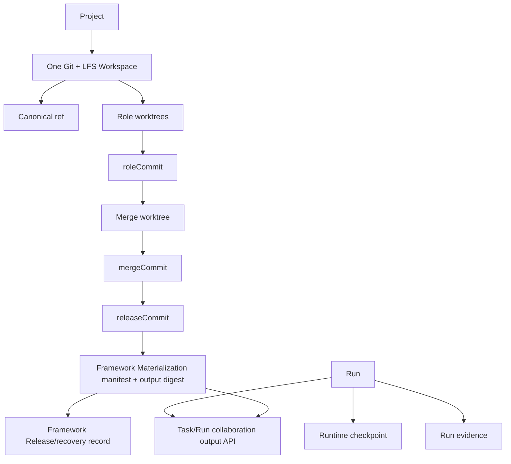
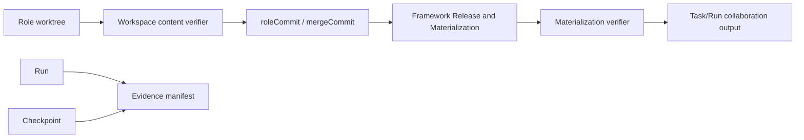
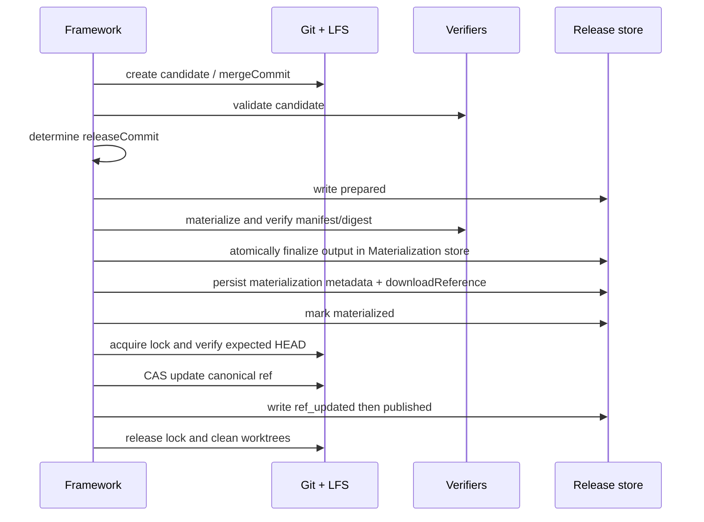

# V2 Workspace Collaboration Design and Acceptance

> **Status: V2 target design.** This document defines one Git + LFS Workspace
> for every Project, framework-managed parallel collaboration, runtime recovery, decision audit,
> and Framework-managed file materialization. It is the target behavior and Workspace-specific acceptance baseline;
> passing its gates requires implementation and execution evidence and must not be inferred from this
> document alone. V1 migration and compatibility behavior are out of scope.

The machine contract for Workspace fields, states, events, provenance, manifests, and APIs is
[`v2-workspace-contracts.md`](v2-workspace-contracts.md). This document must not define a second
schema. Implementation steps belong to [`v2-workspace-implementation-runbook.md`](v2-workspace-implementation-runbook.md).

TeamVersion training is a separate Studio lifecycle boundary. Structural validation and Sandbox
baselines are necessary but do not establish that a team is suitable for its target workflow. Before
training, the workflow operator records a representative task, attaches the current Sandbox
Simulation evidence for every required baseline, and reviews responsibilities, authority, inputs,
handoffs, tools, completion conditions, and collaboration outputs. The review is bound to the
current TeamVersion digest; changing the design or baseline invalidates it and requires a fresh
review. Project users see the resulting frozen TeamVersion and Task/Run collaboration outputs; they
do not see a Project publication lifecycle.

## 1. Scope and Invariants

V2 is a general ordered collaboration workspace. Software development is one use case; documents,
design files, images, audio, video, and other file-based work are also supported.

The product-level invariants are:

1. Each Project has exactly one Git + LFS Workspace.
2. Each Task and its Runs resolve their Workspace through the owning Project; each Studio Simulation
   uses one isolated Workspace.
3. Git commit is the only Workspace content version fact.
4. Git LFS stores large binary and media content referenced by Git commits.
5. Roles edit isolated worktrees. Only the Framework may mutate the canonical Workspace.
6. A Role never creates an unregistered commit or changes a shared ref directly.
7. Runtime checkpoints store workflow state and commit references; they do not define another
   content-version model.
8. The Workspace contract retains a Framework Release state machine for guarded canonical-ref
   updates and recovery. It is not a Project publication lifecycle. Project collaboration outputs
   are identified and read through their owning Task and Run.
9. Branch, Join, quorum, loop, review, conflict, and evidence transitions are surfaced as Workspace
   runtime events and evidence. Flow Business Events remain the routable Role-result values defined
   by the Role/Flow contracts. Model request events are not shown in either event list.

The Workspace must be file-based. Structured business data is represented as files in the Workspace;
live database state, external SaaS state, and caches are referenced or exported rather than treated
as an additional Workspace backend.

## 1.1 Four-layer architecture

| Layer | Responsibility |
| --- | --- |
| Business | Role, Flow, Join, Review, and Handoff semantics |
| Technical Binding | Harness, Backend, Model, `allowedTools`, and EnvironmentPolicy |
| Execution | Git, LFS, Worktree, canonical lock, CAS, and Materialization |
| Evidence | Checkpoint, events, provenance, Evidence manifest, and Release record |

`WorkspaceRef` is a cross-layer value object. It is not a fifth layer or a new business entity:
Business authorizes the projection, Execution resolves and validates the commit/path, and Evidence
records its producer and access facts.

## 2. Core Topology

```text
Project
  -> one Git + LFS Workspace
      -> canonical workspace/ref
      -> Role worktrees
      -> merge worktree
      -> mergeCommit
      -> Framework Release/Materialization records for guarded ref update, recovery,
         and generating/verifying files from the recorded Commit
      -> Task/Run-owned collaboration outputs for Project users
```

The Workspace has one canonical ref managed by the Framework. Branch names, worktree paths, Git
commands, LFS locks, cleanup, and checkpoint storage are framework details. They are not Role or
Flow configuration.

The same topology is used for a formal Project Run and for a Studio Simulation. A simulation has
one isolated simulation Workspace; it does not create a Workspace per Role or per output. The public
durable-record topology in the diagram below applies to formal Project Runs. A Simulation reuses the
Framework coordinator and internal shape, but its Workspace and materialization records remain in
the Simulation evidence boundary and are not Project Workspace or Task Run collaboration outputs.

### 2.1 Responsibility relationship



For a formal Project Run, `Project`, `Workspace`, and `Run` are durable product records. The
Workspace contract's Release state machine remains responsible for guarded ref updates and recovery.
Materialization records are Framework-private verification and recovery data used to generate and
verify files from a recorded Commit. Neither record type creates a Project publication lifecycle or
Project entity; Project users read collaboration outputs through their owning Task and Run. Worktrees,
merge trees, locks, and temporary materialization directories are Framework-managed execution state.
Simulation equivalents remain internal evidence records under the scope above.

## 3. Content and Collaboration Policies

All authoritative Workspace content enters Git. Git LFS is selected by repository policy for large
files; it does not create a second version system. Temporary builds, caches, and intermediate
renders do not enter the canonical Workspace.

| Content | Framework policy |
| --- | --- |
| Source, configuration, Markdown, text, and structured files | Git blobs and three-way merge where possible |
| Images, audio, video, design files, and large project files | Git LFS pointer plus immutable LFS object |
| Files that cannot be automatically merged | Worktree preparation followed by serial candidate integration; acquire the canonical Workspace lock only for the canonical ref update |
| Temporary build, cache, and intermediate render files | Kept outside the canonical Workspace |
| Task/Run collaboration output files | When file output is required, materialized from the recorded Workspace Commit and recorded by digest |

For a binary or media file, a newer version is a new commit pointing to a new LFS object. A previous
version remains recoverable by creating a new restore commit; history is never rewritten.

Different content types therefore use different policies on the same Git backend:

```text
text      -> parallel worktrees and merge
binary    -> parallel preparation, serial integration when the same path conflicts
media     -> LFS object upload, expected-head check, and whole-file replacement
release   -> materialize from an immutable commit
```

## 4. Collaboration Lifecycle

### 4.1 Parallel Role work

```text
architect
    |
    +-- backend Role --------+
    +-- frontend Role -------+--> Join --> QA --> Release
    +-- test Role -----------+
```

1. Framework fixes `baseCommit`.
2. Framework creates one worktree and branch per Role.
3. Role edits its worktree and submits a change description.
4. Framework validates the worktree and creates `roleCommit`.
5. Join creates a merge worktree and integrates candidate commits. This is an isolated operation and
   does not require the canonical Workspace lock.
6. A conflict creates `join_conflict` and pauses the flow; canonical content is unchanged.
7. The integrator resolves the conflict in the merge worktree and Framework creates `mergeCommit`.
8. Framework updates the canonical ref only after acquiring the canonical Workspace lock.

If every successful Role commit resolves to the fixed `baseCommit`, the Framework deduplicates the
candidate set to that existing commit and verifies integration against it. The Release may reference
the same immutable commit; no empty candidate set or synthetic content commit is created. Empty
`changedPaths` remains evidence that this Run introduced no Workspace content change. This is a
successful Harness Role with no content change (`resultCommit == baseCommit`), not a `noop` execution
mode or lifecycle and not a bypass of Harness resolution.

### 4.2 Serial changes to one path

```text
commit-11 -> Role A -> commit-12 -> Role B -> commit-13
```

The Framework checks the expected canonical commit before integrating a change. A stale expected
commit cannot overwrite newer content. For an LFS media file, automatic merge is not attempted;
the Framework requires serial integration or an explicit human resolution.

### 4.3 Canonical Workspace lock

Role worktrees may run in parallel. The following operations require the Workspace canonical lock:

- canonical ref update and the Release publication state transitions tied to that update;
- restore;
- canonical branch or tag update;
- cleanup that changes authoritative refs or LFS locks.

The canonical lock has the required fields and validation rules defined by the Workspace contract.

The canonical Workspace lock is the only Runtime concurrency control mechanism. An optional Git LFS
server lock is repository protection for a binary path; it does not create a second Flow or Runtime
lock model and is acquired or released only by the Framework.

Merge worktree creation and candidate integration do not use this lock. Release materialization is
prepared before the lock is acquired; the canonical-ref CAS and the publication state transitions
tied to that CAS then use a compare-and-swap check against `expectedCanonicalHead`. A stale head
fails closed and leaves the candidate commit available for retry or rebase.

Within the Framework-level Workspace Release state machine, the `published` transition records only
the canonical-ref CAS and its tied `ref_updated` state. Materialization preparation, verification,
and the pre-CAS Release record write are separate record operations; they require the canonical lock
only when they also mutate an authoritative ref or LFS lock.

All authoritative ref updates must pass through the Framework. Direct writes from an external Git
client are unsupported. The Framework detects an out-of-band ref change through
`expectedCanonicalHead` and fails closed before continuing a Run or Release; only a known Release
record failure window may enter the defined reconciliation path.

### 4.4 Worktree lifecycle and cleanup

Role and merge worktrees are temporary execution state. The Framework marks a worktree eligible for
cleanup only after its commit provenance is durable, no active Role, Join, Review, or recovery path
references it, and any required merge or Release record is persisted. Cleanup is idempotent and does
not depend on the original machine path.

```text
commit / merge / Release evidence durable
  -> lock released
  -> worktree eligible
  -> remove worktree directory and temporary outputs
  -> retain refs and objects according to retention policy
```

Failed or conflicted worktrees remain available until resolution, Run termination, or retention
expiry. Recovery recreates them from `worktreeId`, branch, and commit references. Worktree removal
releases checkout and temporary-file space; it does not immediately delete shared Git objects or LFS
objects. Branch/ref pruning and Git/LFS garbage collection are separate delayed cleanup operations and
must not remove content referenced by a checkpoint, Release record, or retained evidence.

## 5. Contract Boundary

Workspace collaboration does not add a parallel Role, Flow, Handoff, or Human Review configuration
model. Role contracts, Flow contracts, handoff projections, review gates, output schemas, and their
defaults remain defined by the Role Execution Architecture and the existing Role/Flow contract
sources. Validation and UAT documents define evidence, not another machine contract.

The Workspace-specific rule is simple: collaboration contracts carry control information, decision
background, evidence references, commit references, and explicitly authorized paths. Large documents,
source trees, media, and generated files remain in the single Git + LFS Workspace. The exact field
shape and validation rules are defined only in [`v2-workspace-contracts.md`](v2-workspace-contracts.md).

### WorkspaceRef

The public V2 reference for a Workspace file is the `WorkspaceRef` defined in
[`v2-workspace-contracts.md`](v2-workspace-contracts.md). Its immutable commit/path/digest
constraints, authorization boundary, and producer provenance rules are normative there. This section
describes only the collaboration behavior: Framework validates the reference against the committed
tree and projects only the paths allowed for the receiving Role.

WorkspaceRef transfer is empty by default. An explicit projection may use
`direct.workspaceRefs` or `source(<roleId>).workspaceRefs`; absent or unauthorized references are
omitted or rejected according to the existing required/optional selector rule. These selectors are
projection behavior and do not define another Workspace schema.

### Public concepts and implementation responsibilities

The Project-facing file boundary consists of `WorkspaceRef`, Run evidence, and collaboration outputs
owned by Task/Run. The Workspace contract also defines Framework-private Release and Materialization
records for canonical-ref recovery and for generating and verifying files from a recorded Commit.
Those records do not define Project publication or output identity. During the refactor, existing
implementation modules may be renamed in place rather than deleted prematurely:

```text
artifact-verifier.ts  -> workspace-content-verifier.ts
artifact-promotion.ts -> release-materialization-service.ts
```

Legacy names are never exposed through a public architecture, schema, API, checkpoint, or UI
surface. During implementation, a private internal transition symbol may remain behind the DTO/API
boundary; it is not a compatibility alias or a supported V2 contract and must never be exposed publicly.

The two verification boundaries remain separate:

```text
Workspace content verifier
  -> paths, symlinks, file size, Git content, and LFS pointers

Framework Materialization verifier
  -> file set and digest generated from a recorded Commit

Task/Run output projection
  -> Project-user file listing, verified read, and download
```

`Evidence manifest` describes Run events, checkpoints, logs, and verification evidence.
`Materialization manifest` describes the final files generated from `releaseCommit`. Their fields,
digests, references, owners, and recovery rules are defined only in
[`v2-workspace-contracts.md`](v2-workspace-contracts.md).



## 6. Framework Permission Boundary

The Framework owns:

- worktree and branch creation/removal;
- `baseCommit` selection;
- Role commit creation;
- LFS object validation and lock management;
- merge, restore, and release operations;
- canonical Workspace locking and compare-and-swap updates;
- checkpoint writes and post-failure reconciliation;
- changed-path, checksum, and commit provenance validation.

Roles may edit their assigned worktree, inspect history and diff, run approved read-only Git commands,
run approved build/test commands, and submit a change description. Framework operations perform all
repository mutations. A Role must be denied at least:

```text
git commit
git push
git update-ref
git branch -D
git tag
git lfs lock
git lfs unlock
git lfs push
```

Roles also may not force-push, hard-reset a shared ref, delete another Role's branch, delete LFS
objects, edit Runtime checkpoints, or create unregistered commits. Read-only inspection such as
`git status`, `git diff`, `git log`, `git show`, and `git lfs ls-files` may be allowed by the Harness
policy.

The Framework operation names and required inputs are defined in the Workspace API contract. This
design only requires that all repository mutations use those Framework operations.

## 7. Checkpoint and Provenance Contract

Checkpoint fields, contextual commit references, commit trailers, and bidirectional provenance are
defined in [`v2-workspace-contracts.md`](v2-workspace-contracts.md). The design requirement is that
workflow recovery uses those immutable commit references and never treats a local worktree path as a
durable identity.

The two audit directions are retained:

```text
Runtime checkpoint -> Git commit / LFS object
Git commit / LFS object -> Runtime checkpoint
```

## 8. Business Events and Decision Evidence

The Workspace event names and envelope are defined in [`v2-workspace-contracts.md`](v2-workspace-contracts.md).
The Runtime Workspace event registry remains the implementation registry and must match that contract.
These events are Runtime evidence events, not Flow Business Event values or routable edge labels. The
Flow Business Event registry remains the architecture and Flow-contract authority; this document does
not create a second Flow event list.

Release status transitions are projected from the Release record; they are not a second publication
fact or a required core event.

`workspace_claimed` and `workspace_released` may remain internal technical audit record kinds. They
are not `WorkspaceEventEnvelope.eventType` values, are not part of the 30-value Workspace event
registry, and must not be exposed as a second public event list. Low-level resource lock,
handoff, and restore operations are technical audit details rather than primary business events; the
business timeline uses the corresponding Join, integration, commit, and recovery facts.

`result_committed` carries the commit and provenance facts required by the canonical event contract.

Branch, quorum, and loop events must show the facts that affected the decision using the payloads
defined in the Workspace contract. For a quorum, the expanded detail combines the event's source
snapshot and quorum counts with the related Role execution and checkpoint records, including commit
and evidence links. The list view shows the decision background; it does not define another event or
payload schema.

Model request events, token events, and low-level transport notifications remain excluded from the
Workspace event list and from the Flow Business Event list.

## 9. Framework Release and Materialization

The Workspace contract retains a Release record and state machine for a committed candidate's
canonical-ref CAS, recovery, and verified Materialization. This is Framework state, not a Project
entity or publication lifecycle. By default, `releaseCommit = mergeCommit`; the Framework creates a
new commit only when it changes authoritative Workspace content.

```text
releaseCommit
  -> materialization
  -> output digest
  -> Release record
  -> download reference
```

The Release record and its field constraints are defined only in
[`v2-workspace-contracts.md`](v2-workspace-contracts.md). The design behavior follows that state
machine. Project users identify and access the resulting files only through the owning Task and Run.

Failure codes and retry behavior are defined only in the Workspace contract.

Framework Release materialization has an explicit visibility boundary from the Workspace contract:
prepared, materialized, and `ref_updated` outputs remain held; only a verified terminal record makes
the corresponding Task/Run output available; failed or unverified outputs are unavailable. The
Project output projection does not expose Release state or identity.

The materialized output may remain retained for reconciliation or operator inspection. Its internal
`downloadReference` is not a Project API field; Project downloads go through the owning Task/Run path
after verification.

`failureCode` is the only failure field persisted on Release. Retryability is derived from the
Framework policy and is not duplicated in every Release record.

Final collaboration files are generated and verified from the recorded Workspace Commit. Source,
configuration, and media Project files
remain in Git/LFS; temporary builds and intermediate renders do not enter the canonical Workspace.
Non-deterministic rendering records input paths, tool versions, parameters, random seed when used,
and the final output digest.

### 9.1 Release reconciliation behavior

Release transitions follow the state machine in the Workspace contract. The recoverable intermediate
state is retained when canonical ref advancement was recorded before the final Release write.

When the CAS succeeds, immutable Run evidence records the canonical ref update, release commit, and
timestamp required by the canonical provenance contract.

This provenance fact is retained even if the final Release status later becomes `failed`.

Publication order:

1. Select or create a candidate or merge commit. Use the existing immutable commit directly as
   `releaseCommit` when no release content changes are required; no synthetic empty commit is made.
2. Run QA and quality validation.
3. Determine `releaseCommit`; create a child commit only when release metadata or other
   authoritative content must change, then validate that commit.
4. Write a `prepared` Release record containing `releaseCommit` and `expectedCanonicalHead`.
5. Materialize from `releaseCommit` into a temporary directory.
6. Compute and verify `outputDigest` and the Materialization manifest.
7. Atomically finalize the output in the Materialization store, persist its metadata and
   `downloadReference` in the Release record, then mark the record `materialized`. These stores may be
   different systems; this step is not treated as one cross-system transaction.
8. Acquire the canonical Workspace lock.
9. Verify `expectedCanonicalHead`.
10. Update the canonical ref with a compare-and-swap operation.
11. Mark the record `ref_updated`.
12. Mark the record `published`.
13. Release the lock and clean temporary worktrees.



Git ref update and Release record persistence are not one cross-system transaction. Recovery
reconciles the Release record, candidate commit, canonical ref, and output digest:

- canonical ref remains `expectedCanonicalHead`: resume the normal Release operation, which acquires
  the canonical lock and performs the CAS; reconciliation must not perform this CAS;
- canonical ref updated and record incomplete: finish `ref_updated -> published` only when
  `canonicalRef == releaseCommit`, `status = materialized`, `outputDigest` is verified,
  `downloadReference` exists and resolves to the verified output, and the Release record is not
  `failed`; otherwise retain `ref_updated` and continue reconciliation;
- canonical ref differs from `expectedCanonicalHead`: mark `failed` with
  `failureCode = STALE_CANONICAL_HEAD`, then create a new candidate from the current head;
- materialization output was finalized but Release metadata was not persisted: reconcile by matching
  the stored output digest to the prepared Release record, then attach it or remove the orphaned output;
- digest mismatch: mark `failed` and never publish the candidate.

## 10. Recovery and Rollback

| Failure point | Recovery action |
| --- | --- |
| Role stopped before commit | Recreate its worktree from `baseCommit` and retry |
| Commit exists but checkpoint write failed | Scan branch and commit trailers, then reconcile the checkpoint |
| Role checkpoint completed | Skip that Role and continue from `roleCommit` |
| Join interrupted | Recreate the merge worktree from candidate commits |
| LFS upload interrupted | Verify or resume the object upload, then retry the pointer commit |
| Lock lease expired | Fence the old owner and reclaim the canonical lock |
| Stale canonical head | Mark `failed` with `failureCode = STALE_CANONICAL_HEAD`; create a new candidate from the current head |
| Release record write failed after ref update | Reconcile Git ref and complete the Release state |
| Materialization store finalized before Release metadata persisted | Match output digest to the prepared Release record; attach it or remove the orphaned output |
| Content must be reverted | Create a new restore commit from the earlier commit |

Rollback never rewrites shared history. Workflow rollback resumes from a Runtime checkpoint;
content rollback creates a new Git commit.

## 11. Workspace-Specific Acceptance

The general Role/Flow semantic scenarios, browser UAT, four-team Project Runs, and release gates are
defined by [`v2-validation-and-acceptance.md`](v2-validation-and-acceptance.md) and
[`release-uat-checklist.md`](release-uat-checklist.md). This document adds only the Workspace gates:

### Parallel and conflict behavior

- Two Roles can edit independent worktrees from the same `baseCommit` in parallel.
- A Role commit is traceable through the commit provenance defined by the Workspace contract.
- `WorkspaceRef` values pass the contract's immutable-reference and authorization checks; invalid,
  out-of-scope, or uncommitted content is rejected as a cross-Role reference.
- Merge worktree integration does not acquire the canonical lock.
- A same-path text conflict creates `join_conflict` and does not change the canonical ref.
- A same-path binary or media conflict is serialized or explicitly paused for human resolution.
- `mergeCommit` is produced only after the candidate set and conflict state are validated.

### Canonical lock and recovery

- Canonical ref updates, restore, and release use the canonical lock defined by the Workspace contract.
- A stale expected head rejects integration into the canonical ref and leaves the candidate recoverable.
- An external direct write to an authoritative ref is detected by `expectedCanonicalHead` and fails
  closed. Only a known Release record failure window may enter reconciliation.
- Role worktree paths are not required for recovery; Framework recreates them from identifiers and commits.
- A failed checkpoint write can be reconciled from branch, commit trailers, and commit provenance.
- A restore creates a new commit containing earlier Git/LFS content; shared history is not rewritten.

### Worktree cleanup and retention

- Completed Role and merge worktrees become eligible for automatic cleanup after durable commit,
  merge, and Release evidence is written.
- Active, conflicted, reviewed, or recoverable worktrees are retained until their lifecycle ends or
  the retention policy expires.
- Recovery recreates a worktree from identifiers and commit references without relying on its old path.
- Worktree cleanup removes checkout and temporary-file space without prematurely deleting shared Git or
  LFS objects.
- Branch/ref pruning and Git/LFS garbage collection never remove content referenced by a retained
  checkpoint, Release record, or evidence package.

### File-based collaboration scenarios

- The same Workspace contract supports source, document, design, image, audio, video, and other
  file-based workflows through Role/Flow profiles and Release materialization profiles.
- A new file-based scenario adds Role contracts, Flow edges, WorkspaceRef authorization, verification,
  and materialization rules; it does not add a new content-version or public delivery model.
- Live database state, external SaaS state, and caches remain outside the Workspace and must be
  exported or referenced through an explicit integration boundary.

### Git LFS

- Git capability probing accepts valid LFS configuration and rejects missing or unusable LFS support.
- LFS pointers match the uploaded object IDs and their recorded checksums.
- Interrupted LFS uploads can resume or be retried without corrupting the repository.
- Large files and media can be restored from an earlier commit and verified by checksum.
- Workspace content verification and Release materialization verification produce separate manifests.

### Release materialization

- `releaseCommit = mergeCommit` when Release does not modify Workspace content.
- A new release commit is created only when release metadata or other authoritative content changes.
- Materialization uses the recorded release commit and produces the recorded `outputDigest`.
- The output is finalized in the Materialization store and its verified manifest, digest, and
  `downloadReference` are persisted on the Release record before the record becomes `materialized`.
  These writes are not a cross-system transaction; a partial failure remains recoverable and must
  not expose an official download or advance the Release state prematurely.
- A stale expected head produces `failed` with `failureCode = STALE_CANONICAL_HEAD`; a new candidate
  is based on the current head.
- A crash between Git ref update and Release record persistence is reconciled to `published` only
  when the canonical ref, materialization, manifest, digest, and download reference all verify;
  otherwise reconciliation continues or marks `failed` with a defined `failureCode`. An unverified
  result is never silently published.
- Release output is traceable to the release commit, immutable materialization manifest, output digest,
  materialization metadata, and download reference.

### Event and provenance

- The event projection uses the registered Runtime event names and does not introduce aliases.
- `join_conflict` and `workspace_integrated` are registered before acceptance; Release status
  transitions are projected from the Release record.
- Decision events expose branch, quorum, loop, Role arrival, timing, commit, and evidence facts.
- Model request events and `agent_event` entries are absent from the Workspace event list and the
  Flow Business Event list.

### V2 cleanup gate

- Public schemas, checkpoints, APIs, and active documentation contain no legacy public content-reference concepts.
- Project-facing file boundaries are `WorkspaceRef`, Run evidence, and Task/Run-owned collaboration
  outputs. Workspace Release and Materialization remain Framework contract records for ref recovery
  and generation/verification of files from a Commit; they are not Project output identity.
- Legacy public modules are renamed or removed after their references are migrated. A private
  implementation transition symbol may remain only behind the DTO/API boundary and must not be
  serialized into a public schema, checkpoint, event, or UI.
- No compatibility alias, migration reader, dual-write path, or historical v1 data import remains.

## 12. Final Architecture

```text
Role / Flow
  -> one Project Git + LFS Workspace
  -> framework-managed Role worktrees
  -> roleCommit / mergeCommit
  -> Runtime checkpoint and decision evidence
  -> canonical lock and expected-head CAS
  -> Workspace Release and Materialization recovery/verification records
  -> Task/Run-owned collaboration output list, verified read, or download
```

Git commit is the content fact. Git LFS extends that fact to large files and media. Worktrees provide
parallel isolation, canonical locking provides stable integration, Runtime checkpoints and
Framework-private Release/Materialization records support recovery, and Materialization records
generate and verify files from a recorded Commit. Task/Run records provide Project users with the
collaboration process and resulting files. No Project-level publication lifecycle or additional
content-version model is introduced.
