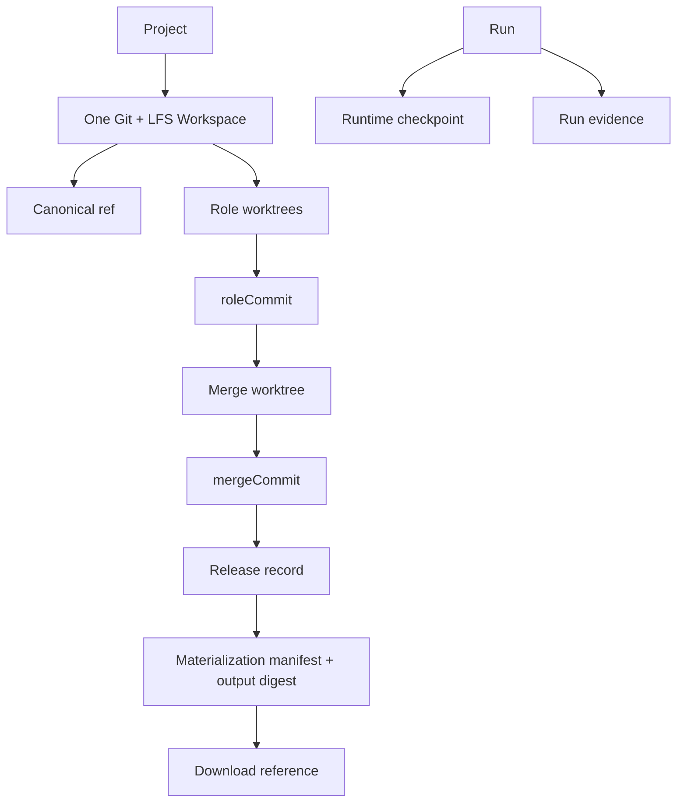
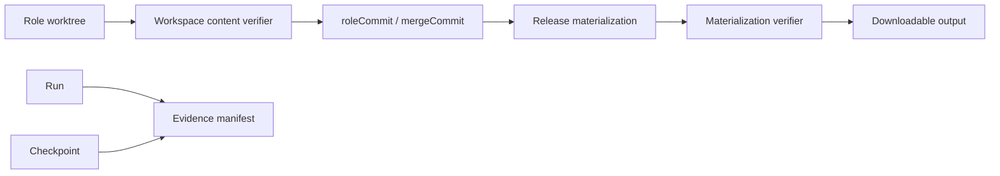
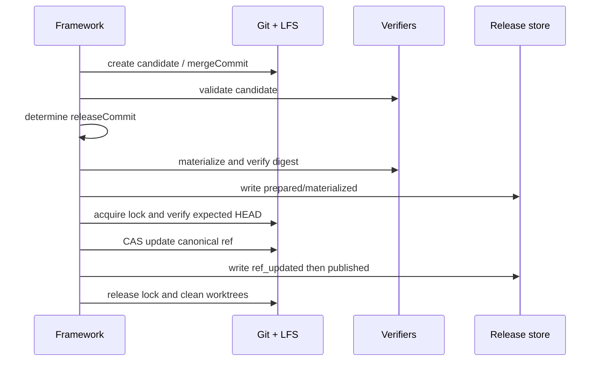

# V2 Workspace Collaboration Design and Acceptance

> **Status: V2 target design.** This document defines one Git + LFS Workspace
> for every Project, framework-managed parallel collaboration, runtime recovery, decision audit,
> and release materialization. It becomes an implementation acceptance baseline only after Git LFS
> support and the Workspace-specific gates in this document pass. V1 migration and compatibility
> behavior are out of scope.

## 1. Scope and Invariants

V2 is a general ordered collaboration workspace. Software development is one use case; documents,
design files, images, audio, video, and other file-based work are also supported.

The product-level invariants are:

1. Each Project has exactly one Git Workspace.
2. Every Task, Run, and Studio Simulation references exactly one Workspace.
3. Git commit is the only Workspace content version fact.
4. Git LFS stores large binary and media content referenced by Git commits.
5. Roles edit isolated worktrees. Only the Framework may mutate the canonical Workspace.
6. A Role never creates an unregistered commit or changes a shared ref directly.
7. Runtime checkpoints store workflow state and commit references; they do not define another
   content-version model.
8. A Release is a publication record and materialization result, not a second content version.
9. Branch, Join, quorum, loop, review, conflict, and evidence events are business events. Model
   request events are not shown in the business event list.

The Workspace must be file-based. Structured business data is represented as files in the Workspace;
live database state, external SaaS state, and caches are referenced or exported rather than treated
as an additional Workspace backend.

## 2. Core Topology

```text
Project
  -> one Git + LFS Workspace
      -> canonical workspace/ref
      -> Role worktrees
      -> merge worktree
      -> mergeCommit
      -> releaseCommit (= mergeCommit unless release metadata changes)
      -> materialization
      -> Release record and download reference
```

The Workspace has one canonical ref managed by the Framework. Branch names, worktree paths, Git
commands, LFS locks, cleanup, and checkpoint storage are framework details. They are not Role or
Flow configuration.

The same topology is used for a formal Project Run and for a Studio Simulation. A simulation has
one isolated simulation Workspace; it does not create a Workspace per Role or per output.

### 2.1 Responsibility relationship



`Project`, `Workspace`, `Run`, and `Release` are durable product records. Worktrees, merge trees,
locks, and temporary materialization directories are Framework-managed execution state.

## 3. Content and Collaboration Policies

All authoritative Workspace content enters Git. Git LFS is selected by repository policy for large
files; it does not create a second version system. Temporary builds, caches, and intermediate
renders do not enter the canonical Workspace.

| Content | Framework policy |
| --- | --- |
| Source, configuration, Markdown, text, and structured files | Git blobs and three-way merge where possible |
| Images, audio, video, design files, and large project files | Git LFS pointer plus immutable LFS object |
| Files that cannot be automatically merged | Worktree preparation followed by canonical Workspace lock and serial integration |
| Temporary build, cache, and intermediate render files | Kept outside the canonical Workspace |
| Final downloadable files | Materialized from the release commit and recorded by digest |

For a binary or media file, a newer version is a new commit pointing to a new LFS object. A previous
version remains recoverable by creating a new restore commit; history is never rewritten.

Different content types therefore use different policies on the same Git backend:

```text
text      -> parallel worktrees and merge
binary    -> parallel preparation, serial integration when the same path conflicts
media     -> LFS object upload, expected-head check, and whole-file replacement
release   -> materialize from an immutable commit
```

## 4. Collaboration Lifecycle

### 4.1 Parallel Role work

```text
architect
    |
    +-- backend Role --------+
    +-- frontend Role -------+--> Join --> QA --> Release
    +-- test Role -----------+
```

1. Framework fixes `baseCommit`.
2. Framework creates one worktree and branch per Role.
3. Role edits its worktree and submits a change description.
4. Framework validates the worktree and creates `roleCommit`.
5. Join creates a merge worktree and integrates candidate commits. This is an isolated operation and
   does not require the canonical Workspace lock.
6. A conflict creates `join_conflict` and pauses the flow; canonical content is unchanged.
7. The integrator resolves the conflict in the merge worktree and Framework creates `mergeCommit`.
8. Framework updates the canonical ref only after acquiring the canonical Workspace lock.

### 4.2 Serial changes to one path

```text
commit-11 -> Role A -> commit-12 -> Role B -> commit-13
```

The Framework checks the expected canonical commit before integrating a change. A stale expected
commit cannot overwrite newer content. For an LFS media file, automatic merge is not attempted;
the Framework requires serial integration or an explicit human resolution.

### 4.3 Canonical Workspace lock

Role worktrees may run in parallel. The following operations require the Workspace canonical lock:

- canonical ref update;
- restore;
- release publication;
- canonical branch or tag update;
- cleanup that changes authoritative refs or LFS locks.

The lock contains at least:

```text
owner
leaseUntil
fencingToken
expectedCanonicalHead
```

Merge worktree creation and candidate integration do not use this lock. Publication uses a
compare-and-swap check against `expectedCanonicalHead`. A stale head fails closed and leaves the
candidate commit available for retry or rebase.

All authoritative ref updates must pass through the Framework. Direct writes from an external Git
client are unsupported; the Framework must reject, fence, or reconcile an out-of-band ref change
before continuing a Run or Release.

## 5. Contract Boundary

Workspace collaboration does not add a parallel Role, Flow, Handoff, or Human Review configuration
model. Role contracts, Flow contracts, handoff projections, review gates, output schemas, and their
defaults remain defined by the existing V2 contract and Runtime acceptance documents.

The Workspace-specific rule is simple: collaboration contracts carry control information, decision
background, evidence references, commit references, and explicitly authorized paths. Large documents,
source trees, media, and generated files remain in the single Git + LFS Workspace.

### WorkspaceRef

The public V2 reference for a Workspace file is `WorkspaceRef`:

```json
{
  "workspaceId": "workspace-123",
  "commit": "40-character-commit-sha",
  "path": "docs/report.md",
  "digest": "sha256:...",
  "access": "read",
  "producer": {
    "runId": "run-123",
    "roleId": "writer"
  }
}
```

`commit` is an immutable commit SHA, never a branch name. `path` is a repository-relative path;
the Framework validates it against the committed tree, authorizes the requested access, and projects
only the paths allowed for the receiving Role. An uncommitted file cannot cross a Role boundary as a
`WorkspaceRef`.

### Public concepts and implementation responsibilities

V2 removes `Artifact`, `Final Artifact`, `ArtifactReference`, Artifact checkpoints, and Artifact
promotion from the product model, schemas, checkpoints, and public APIs. During the refactor, existing
implementation modules may be renamed in place rather than deleted prematurely:

```text
artifact-verifier.ts  -> workspace-content-verifier.ts
artifact-promotion.ts -> release-materialization-service.ts
```

After all references are migrated, the old names and compatibility aliases are removed. This is a
breaking V2 cleanup; no migration or historical compatibility path is required.

The two verification boundaries remain separate:

```text
Workspace content verifier
  -> paths, symlinks, file size, Git content, and LFS pointers

Release materialization verifier
  -> materialized file set, output digest, and downloadable content
```

`Evidence manifest` describes Run events, checkpoints, logs, and verification evidence.
`Materialization manifest` describes the final files generated from `releaseCommit`. They may share
hashing helpers, but they are different records with different owners and recovery rules.



## 6. Framework Permission Boundary

The Framework owns:

- worktree and branch creation/removal;
- `baseCommit` selection;
- Role commit creation;
- LFS object validation and lock management;
- merge, restore, and release operations;
- canonical Workspace locking and compare-and-swap updates;
- checkpoint writes and post-failure reconciliation;
- changed-path, checksum, and commit provenance validation.

Roles may edit their assigned worktree, inspect history and diff, run approved read-only Git commands,
run approved build/test commands, and submit a change description. Framework operations perform all
repository mutations. A Role must be denied at least:

```text
git commit
git push
git update-ref
git branch -D
git tag
git lfs lock
git lfs unlock
git lfs push
```

Roles also may not force-push, hard-reset a shared ref, delete another Role's branch, delete LFS
objects, edit Runtime checkpoints, or create unregistered commits. Read-only inspection such as
`git status`, `git diff`, `git log`, `git show`, and `git lfs ls-files` may be allowed by the Harness
policy.

Minimal framework operations are:

```text
workspace.prepare()
workspace.claim()
workspace.commit()
workspace.merge()
workspace.restore()
workspace.release()
```

## 7. Checkpoint and Provenance Contract

A checkpoint contains workflow state plus scalar Git references:

```json
{
  "runId": "run-123",
  "nodeId": "backend-implementer",
  "attempt": 1,
  "status": "completed",
  "worktreeId": "wt-run-123-backend",
  "branch": "ogs/run-123/backend",
  "baseCommit": "C10",
  "roleCommit": "C11",
  "changedPaths": ["src/api.ts"],
  "lfsObjects": [],
  "branchState": {},
  "decisionBackground": {},
  "evidenceRefs": []
}
```

Join and Release checkpoints use the corresponding references:

```text
roleCommit
mergeCommit
releaseCommit
```

Git commits include traceable trailers when supported:

```text
Run-Id: run-123
Node-Id: backend-implementer
Checkpoint-Id: cp-456
Base-Commit: C10
```

`worktreePath` is an internal local execution detail. It is not required to restore a Run; the
Framework recreates the worktree from `worktreeId`, `branch`, and the recorded commit references.

The two audit directions are retained:

```text
Runtime checkpoint -> Git commit / LFS object
Git commit / LFS object -> Runtime checkpoint
```

## 8. Business Events and Decision Evidence

The primary event list uses the existing Runtime event registry at
`apps/team-site/infrastructure/runtime-business-event-types.mjs`. This document does not rename or
duplicate registered events:

```text
start_dispatch_selected
route_decision
loop_budget_decision
failure_handled
join_activated
join_quorum_reached
join_late_arrival_ignored
join_timed_out
join_source_outcome_rejected
loop_exhausted
human_review_requested
human_review_approved
human_review_rework_requested
human_review_rejected
human_review_decision_rejected
human_review_paused
human_review_terminated
human_review_expired
run_waiting
run_stopping
run_stopped
run_terminated
result_committed
```

The Workspace-specific additions are:

```text
join_conflict
workspace_integrated
release_created
```

`workspace_claimed` and `workspace_released` may remain technical audit records. Low-level resource
lock, handoff, and restore operations are technical audit details rather than primary business
events; the business timeline uses the corresponding Join, integration, commit, and recovery facts.

`result_committed` includes:

```text
runId
nodeId
roleId
baseCommit
resultCommit
changedPaths
lfsObjectIds
decisionBackground
evidenceRefs
```

Branch, quorum, and loop events must show the facts that affected the decision. A quorum event, for
example, includes each arrived Role, node, arrival time, branch, result status, relevant commit,
evidence references, and the quorum calculation. The list view shows the decision background; the
expanded detail shows the full evidence and commit links.

Model request events, token events, and low-level transport notifications remain excluded from the
business event list.

## 9. Release Record and Materialization

Release is a publication record for a commit. By default, `releaseCommit = mergeCommit`; the Release
stage creates a new commit only when it changes release metadata or other authoritative Workspace
content.

```text
releaseCommit
  -> materialization
  -> output digest
  -> Release record
  -> download reference
```

The Release record contains at least:

```json
{
  "releaseId": "release-123",
  "runId": "run-123",
  "workspaceId": "workspace-123",
  "releaseCommit": "C20",
  "expectedCanonicalHead": "C10",
  "outputDigest": "sha256:...",
  "materializationMetadata": {},
  "profileDigest": "sha256:...",
  "toolchainDigest": "sha256:...",
  "commandDigest": "sha256:...",
  "downloadReference": "...",
  "status": "published",
  "createdAt": "...",
  "updatedAt": "..."
}
```

Final delivery is materialized from `releaseCommit`. Source, configuration, and media project files
remain in Git/LFS; temporary builds and intermediate renders do not enter the canonical Workspace.
Non-deterministic rendering records input paths, tool versions, parameters, random seed when used,
and the final output digest.

### 9.1 Release state machine

```text
prepared
  -> materialized
  -> ref_updated
  -> published
```

Failure states are `failed` and `partially_published`.

Publication order:

1. Create a candidate or merge commit. Use it directly as `releaseCommit` when no release content
   changes are required.
2. Run QA and quality validation.
3. Determine `releaseCommit`; create a child commit only when release metadata or other
   authoritative content must change, then validate that commit.
4. Materialize from `releaseCommit` into a temporary directory.
5. Compute and verify `outputDigest` and the Materialization manifest.
6. Write the `prepared` or `materialized` Release record.
7. Acquire the canonical Workspace lock.
8. Verify `expectedCanonicalHead`.
9. Update the canonical ref with a compare-and-swap operation.
10. Mark the record `ref_updated`.
11. Mark the record `published`.
12. Release the lock and clean temporary worktrees.



Git ref update and Release record persistence are not one cross-system transaction. Recovery
reconciles the Release record, candidate commit, canonical ref, and output digest:

- canonical ref unchanged: retry the CAS update;
- canonical ref updated and record incomplete: finish `ref_updated -> published`;
- expected head changed: stop and create a new candidate from the current head;
- digest mismatch: mark `failed` and never publish the candidate.

## 10. Recovery and Rollback

| Failure point | Recovery action |
| --- | --- |
| Role stopped before commit | Recreate its worktree from `baseCommit` and retry |
| Commit exists but checkpoint write failed | Scan branch and commit trailers, then reconcile the checkpoint |
| Role checkpoint completed | Skip that Role and continue from `roleCommit` |
| Join interrupted | Recreate the merge worktree from candidate commits |
| LFS upload interrupted | Verify or resume the object upload, then retry the pointer commit |
| Lock lease expired | Fence the old owner and reclaim the canonical lock |
| Release record write failed after ref update | Reconcile Git ref and complete the Release state |
| Content must be reverted | Create a new restore commit from the earlier commit |

Rollback never rewrites shared history. Workflow rollback resumes from a Runtime checkpoint;
content rollback creates a new Git commit.

## 11. Implementation Plan

The implementation remains limited to one Git + LFS Workspace backend:

1. Align runtime types and the collaboration adapter with `baseCommit`, `roleCommit`, `mergeCommit`,
   and `releaseCommit`.
2. Make Framework operations the only path for commit, merge, restore, LFS, and canonical ref writes.
3. Add canonical lock fencing, expected-head checks, and idempotent recovery.
4. Split Workspace content verification from Release materialization verification; keep Evidence and
   Materialization manifests separate.
5. Add Release records and the `prepared -> materialized -> ref_updated -> published` reconciliation.
6. Replace public Artifact fields with `WorkspaceRef`, Run evidence, and Release materialization
   fields. Rename implementation modules before deleting the old names.
7. Project the compact business event list with branch, quorum, loop, decision background, evidence,
   conflict, commit, and release details.
8. Keep Studio authoring limited to business Role/Flow fields; generate technical Git metadata.
9. Clear old runtime history, worktrees, branches, locks, unreferenced objects, old public Artifact
   names, and compatibility aliases before V2 release.

No migration, dual-write, compatibility read, alternate content backend, or separate delivery
version is required.

## 12. Workspace-Specific Acceptance

The general Role/Flow semantic scenarios, browser UAT, four-team Project Runs, and release gates are
defined by [`v2-validation-and-acceptance.md`](v2-validation-and-acceptance.md) and
[`release-uat-checklist.md`](release-uat-checklist.md). This document adds only the Workspace gates:

### Parallel and conflict behavior

- Two Roles can edit independent worktrees from the same `baseCommit` in parallel.
- A Role commit is traceable to `runId`, `nodeId`, `roleId`, `worktreeId`, `branch`, and `baseCommit`.
- A `WorkspaceRef` contains a 40-character commit SHA, repository-relative path, digest, access,
  Workspace ID, and producer provenance.
- A branch name, absolute path, or uncommitted file is rejected as a cross-Role `WorkspaceRef`.
- Merge worktree integration does not acquire the canonical lock.
- A same-path text conflict creates `join_conflict` and does not change the canonical ref.
- A same-path binary or media conflict is serialized or explicitly paused for human resolution.
- `mergeCommit` is produced only after the candidate set and conflict state are validated.

### Canonical lock and recovery

- Canonical ref updates, restore, and release require `owner`, `leaseUntil`, `fencingToken`, and
  `expectedCanonicalHead`.
- A stale expected head rejects integration into the canonical ref and leaves the candidate recoverable.
- An external direct write to an authoritative ref is rejected, fenced, or detected during reconciliation.
- Role worktree paths are not required for recovery; Framework recreates them from identifiers and commits.
- A failed checkpoint write can be reconciled from branch, commit trailers, and commit provenance.
- A restore creates a new commit containing earlier Git/LFS content; shared history is not rewritten.

### Git LFS

- Git capability probing accepts valid LFS configuration and rejects missing or unusable LFS support.
- LFS pointers match the uploaded object IDs and their recorded checksums.
- Interrupted LFS uploads can resume or be retried without corrupting the repository.
- Large files and media can be restored from an earlier commit and verified by checksum.
- Workspace content verification and Release materialization verification produce separate manifests.

### Release materialization

- `releaseCommit = mergeCommit` when Release does not modify Workspace content.
- A new release commit is created only when release metadata or other authoritative content changes.
- Materialization uses the recorded release commit and produces the recorded `outputDigest`.
- A crash between Git ref update and Release record persistence is reconciled to `published` or
  marked `failed` without silently publishing an unverified result.
- Release output is traceable to the release commit, profile, toolchain, command, digest, and download reference.

### Event and provenance

- The event projection uses the registered Runtime event names and does not introduce aliases.
- `join_conflict`, `workspace_integrated`, and `release_created` are registered before acceptance.
- Decision events expose branch, quorum, loop, Role arrival, timing, commit, and evidence facts.
- Model request events and `agent_event` entries are absent from the business event list.

### V2 cleanup gate

- Public schemas, checkpoints, APIs, and active documentation contain no Artifact concepts.
- `WorkspaceRef`, Run evidence, Release, and Materialization are the only public file and delivery
  boundaries.
- Legacy implementation modules are renamed or removed after their references are migrated.
- No compatibility alias, migration reader, dual-write path, or historical runtime import remains.

## 13. Final Architecture

```text
Role / Flow
  -> one Project Git + LFS Workspace
  -> framework-managed Role worktrees
  -> roleCommit / mergeCommit
  -> Runtime checkpoint and decision evidence
  -> canonical lock and expected-head CAS
  -> releaseCommit
  -> materialization and Release record
  -> downloadable content
```

Git commit is the content fact. Git LFS extends that fact to large files and media. Worktrees provide
parallel isolation, canonical locking provides stable integration, Runtime checkpoints provide
workflow recovery, and Release records provide publication and download audit without introducing
another content-version model.
