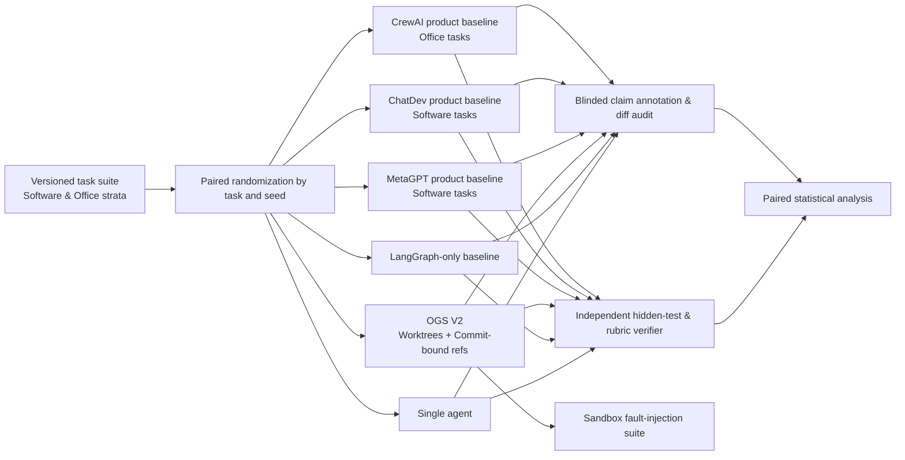

# OGSystem V2 Empirical Validation Plan / OGS V2 实证验证方案

> **Status / 状态:** Research protocol proposal only. No results below have been measured. Do not cite the hypotheses or proposed sample sizes as findings. / 仅为研究方案，以下数据均未实测。不得将假设或建议样本量表述为研究结果。

## 1. Research Objective / 研究目标

The experiment should test whether OGSystem V2's explicit Role contracts, field-scoped handoffs, commit-addressed Workspace references, state-aware Join, and verified Release protocol improve observable collaboration outcomes. It must distinguish those effects from the benefits of role decomposition, model choice, prompting, and test infrastructure.

实验检验 OGS V2 的 Role 合同、字段级交接、commit 寻址的 Workspace 引用、状态感知 Join 和 Release 校验协议，是否能改善可观察的协作结果。实验必须把这些效果与角色拆分、模型选择、提示词和测试设施的影响区分开。

The current engineering evidence establishes implementation paths, not improved model accuracy or reduced hallucination. The hypotheses below are therefore prospective and falsifiable.

现有工程材料能说明实现路径，不足以证明模型准确率提高或幻觉减少。以下均为待检验、可被证伪的假设。

### 1.1 Organizational Management Lens / 组织管理视角

The management analogy is bounded to operational controls in multi-role collaboration projects with explicit deliverables, including office and knowledge work as well as software tasks. Role Contracts express responsibility differentiation; Harness/tool policy expresses delegated authority; events, projections, Join, and Review express coordination and supervision; Evidence and Release records support after-the-fact accountability. This reflects organization-design and principal-agent concerns such as role differentiation, delegation, information asymmetry, and monitoring [Mintzberg](https://books.google.com/books?id=kw1HAAAAMAAJ), [Eisenhardt](https://doi.org/10.2307/258191). It does not make an AI Role a legal agent or move ultimate responsibility away from the deploying organization and human decision-makers.

该管理类比限定于具有明确交付物的多角色协作项目运行控制，既包括办公和知识工作，也包括软件任务：Role Contract 表达职责分化，Harness/工具策略表达授权，事件、投影、Join 和 Review 表达协调与监督，Evidence/Release 记录支持事后问责。这与组织设计及委托代理研究中的职责分化、授权、信息不对称和监督问题相关 [Mintzberg](https://books.google.com/books?id=kw1HAAAAMAAJ)、[Eisenhardt](https://doi.org/10.2307/258191)。它不把 AI Role 等同于法律主体，也不转移部署组织和人类决策者的最终责任。

NIST AI RMF 1.0 organizes risk work under Govern, Map, Measure, and Manage; its Generative AI Profile adds GenAI-specific context [AI RMF](https://doi.org/10.6028/NIST.AI.100-1), [GenAI Profile](https://doi.org/10.6028/NIST.AI.600-1). OGS can be evaluated against selected runtime controls and evidence needs within this scope, but it is not a complete governance program or a conformance implementation.

NIST AI RMF 1.0 将风险工作组织为 Govern、Map、Measure、Manage，生成式 AI Profile 补充 GenAI 风险背景 [AI RMF](https://doi.org/10.6028/NIST.AI.100-1)、[GenAI Profile](https://doi.org/10.6028/NIST.AI.600-1)。OGS 可在本文范围内针对部分运行控制和证据需求开展评测，但它不是完整治理方案，也不声称符合该框架。

## 2. Hypotheses / 研究假设

| ID | Hypothesis / 假设 | Observable outcome / 可观测结果 |
| --- | --- | --- |
| H1 | OGS V2 increases verified end-to-end delivery success over a matched LangGraph-only multi-agent implementation. / 相比匹配的纯 LangGraph 多 Agent 实现，OGS V2 提高可验证的端到端交付成功率。 | Task acceptance plus valid commit, provenance, manifest, and published Release. / 任务验收通过，且 commit、provenance、manifest 和 published Release 均有效。 |
| H2 | OGS V2 reduces unsupported claims about handoffs, tests, and delivered artifacts. / OGS V2 减少关于交接、测试和交付物的无证据陈述。 | Unsupported atomic factual claims per 100 verifiable claims and false-completion rate. / 每百条可验证事实陈述中的无支持陈述数，以及虚报完成率。 |
| H3 | OGS V2 reduces coordination faults and makes failures more recoverable. / OGS V2 减少协作故障并提高失败后的可恢复性。 | Invalid/stale handoffs, silent state downgrade, unsafe publication, recovery success, and data-leak rates. / 无效或过期交接、状态静默降级、不安全发布、恢复成功率和数据泄漏率。 |
| H4 | Multi-role collaboration may improve task quality on tasks that benefit from independent implementation and review, with additional latency and token cost. / 在适合独立实现与审查的任务上，多角色协作可能改善质量，但会增加时延和 token 成本。 | Acceptance and regression results alongside wall time and token/API cost. / 同时报任务验收、回归结果、耗时和 token/API 成本。 |
| H5 (exploratory) | Governance controls remain inspectable across repeated Runs and declared policy/model revisions. / 多次 Run 和声明的策略/模型变更后，治理控制仍可核验。 | Policy-violation escape rate, evidence-reconstruction completeness, audit time, and drift across pinned versions. / 策略违规逃逸率、Evidence 还原完整度、审计时间及固定版本间的策略漂移。 |

H1–H3 are the primary systems hypotheses. H4 and H5 are exploratory: null or negative results are publishable and must not be reframed as success. H5 tests operational continuity within versioned, bounded collaboration projects, not enterprise governance maturity. A fall in unsupported claims supports only a claim-grounding result; it does not prove a reduction in latent or general-purpose LLM hallucination. H4 directly reflects recent empirical findings on agent sustainability (Astekin et al. 2026, arXiv:2610.03010), which demonstrated that multi-agent workflows consume 6.36× more energy and run 6.07× longer than single-agent baselines, necessitating explicit Pareto efficiency and Cost-per-Verified-Success accounting.

H1–H3 是主要系统假设，H4 和 H5 为探索性假设；无效果或负效果同样应如实报告，不能改写为成功。H5 只检验固定版本、有界协作项目中的运行连续性，不代表企业治理成熟度。无支持陈述减少，只能支持“可核验陈述更有依据”这一结果，不能证明模型内部或通用意义上的幻觉下降。H4 直接呼应了 2026 年关于智能体能效与开销的前沿实测（Astekin et al. 2026, arXiv:2610.03010：实测多 Agent 比单 Agent 平均能耗增加 6.36 倍、耗时延长 6.07 倍），因而必须统计 Pareto 效率与“每次可验证成功成本”。

## 3. Conditions and Controls / 实验组与控制变量

| Arm / 组别 | Configuration / 配置 |
| --- | --- |
| A: Single agent | One agent receives the task, repository, tools, and the same independent verifier. / 单 Agent 接收任务、仓库和工具，并使用同一独立验证器。 |
| B: LangGraph-only matched multi-agent | Implement the same role graph directly in LangGraph. Match role prompts, backend/model, tools, isolated worktrees, Git commit procedure, and verifier. Use ordinary typed application state and message handoffs without OGS's Context Map, WorkspaceRef validation, Join source contract, canonical lock/CAS, or Release gate. / 直接用 LangGraph 实现相同角色图；匹配角色提示词、后端/模型、工具、隔离 worktree、Git commit 步骤及验证器；使用普通应用状态和消息交接，不接入 OGS 的 Context Map、WorkspaceRef 校验、Join 源状态合同、canonical lock/CAS 或 Release 门禁。 |
| C: OGS V2 | Full V2 contracts and runtime path, including explicit projections, commit-bound WorkspaceRefs, Join policies, canonical lock/CAS, Evidence, and Release verification. / 完整 V2 合同和运行路径，包括显式投影、commit 绑定的 WorkspaceRef、Join 策略、canonical lock/CAS、Evidence 和 Release 校验。 |
| D: MetaGPT product baseline (software stratum) | Pin a reproducible release/commit and run the common software-project tasks with the same model where supported. Record native SOP/role behavior and any settings that cannot be matched. / 固定可复现的 release/commit，在共同软件项目任务上运行，并在产品支持时使用相同模型；记录其原生 SOP/角色行为及无法匹配的设置。 |
| E: ChatDev product baseline (software stratum) | Pin a reproducible release/commit and run the same software-project tasks, matching model and verifier where supported. Record native role-play/communication behavior and unmatched settings. / 固定可复现的 release/commit，在相同软件项目任务上运行，并在产品支持时匹配模型和验证器；记录其原生角色协作/通信行为及无法匹配的设置。 |
| F: CrewAI product baseline (office & knowledge stratum) | Pin a reproducible release/commit and run the common office and knowledge-work tasks with the same model where supported. Record native role-playing, hierarchical/sequential processes, file-writing behavior, and unmatched settings. / 固定可复现的 release/commit，在共同办公与知识工作任务上运行，并在产品支持时使用相同模型；记录其原生角色扮演、层级/顺序流程、文件写入行为及无法匹配的设置。 |

The primary causal comparison is B versus C across all task strata: both use LangGraph, the same role graph, and the same execution budget, so the contrast isolates OGS contracts, the Context Map, and its Workspace/Join/Release protocol. A versus C estimates the combined value and cost of role decomposition plus OGS. D and E are external product comparisons limited to the software-project stratum; F is an external product comparison limited to the office and knowledge-work stratum. They test practical system-level performance, not the isolated causal effect of OGS contracts. Run and report these product arms separately from the all-task A/B/C analysis. Before inclusion, verify that each product version can execute the frozen tasks; report unsupported tasks and unmatched settings explicitly. Keep model/version, task input, verifier, and budgets aligned where possible; preserve each product's native workflow and report unavoidable prompt/tool differences. Randomize arm order within each task/model/seed block and retain exact prompts, configs, commits, outputs, costs, and immutable implementation versions.

B 对 C 是跨全任务层的主要因果比较：两者使用 LangGraph、相同角色图和执行预算，差异集中于 OGS 合同、Context Map 及 Workspace/Join/Release 协议。A 对 C 估计角色拆分与 OGS 的合并收益和成本。D、E 是仅限软件项目任务的外部产品比较；F 是仅限办公与知识工作任务的外部产品比较，用于观察系统级实际表现，不用于隔离 OGS 合同的因果效应。产品对照与覆盖全部任务的 A/B/C 分析分开运行和报告。纳入前先确认固定版本能运行冻结任务；明确报告产品不支持的任务及无法匹配的设置。尽可能对齐模型/版本、任务输入、验证器和预算，同时保留各产品原生流程，并披露无法统一的提示词/工具差异。按任务/模型/随机种子分块随机化，保存提示词、配置、commit、输出、成本和不可变实现版本。

### 3.1 High-Citation Multi-Agent Comparators / 高引用多智能体对照研究

This shortlist retains highly cited studies directly about multi-agent collaboration across software engineering and office/knowledge workflows. Among them, MetaGPT and ChatDev are the primary software product comparators, while CrewAI represents the industry standard for business and office process automation. Citation counts below are OpenAlex cited_by_count snapshots recorded on 2026-11-19, not Google Scholar counts; they are time-sensitive signals of reach, not measures of quality or novelty.

| Prior study / 先行研究 | Published comparison / 已有比较 | Transfer to OGS / 对 OGS 的借鉴 | Limitation / 使用边界 |
| --- | --- | --- | --- |
| [AutoGen (2023)](https://arxiv.org/abs/2308.08155) | OpenAlex cited_by_count 4,086. Establishes a configurable multi-agent conversation framework with handoffs and tool use. / OpenAlex 引用数 4,086；提出可配置的多 Agent 对话框架，包含交接和工具调用。 | Retain as a high-impact framework reference; it is not required as a separate product arm because reproducing a framework example would not isolate OGS's shared Workspace/Release contracts. / 作为高影响力框架参照保留；不单列产品实验组，因为复现框架示例不能隔离 OGS 的共享 Workspace/Release 合同效应。 | Framework configurations vary substantially; published examples are not a matched OGS governance benchmark. / 框架配置差异较大，论文示例不是与 OGS 匹配的治理基准。 |
| [MetaGPT (ICLR 2024)](https://arxiv.org/abs/2308.00352) | OpenAlex cited_by_count 2,831. Evaluates HumanEval/MBPP and introduces a 70-task SoftwareDev set; its direct product comparison reports seven representative tasks against ChatDev, AutoGPT, AgentVerse, and LangChain, with executability, time, token use, code size, and revision cost. / OpenAlex 引用数 2,831。在 HumanEval/MBPP 上评测并提出 70 项 SoftwareDev 任务集；其直接产品比较选取 7 项代表任务，与 ChatDev、AutoGPT、AgentVerse、LangChain 对照，报告可执行性、耗时、token、代码规模及修订成本。 | Reproduce as an external product arm on a shared, frozen software-task subset; borrow multi-dimensional quality and cost measures. / 在共同冻结的软件任务子集上复现为外部产品组；借鉴多维质量与成本指标。 | Software-focused; direct product comparison uses only seven selected tasks; lacks physical branch isolation and fine-grained checkpoints (acknowledged in Appendix D.1). / 聚焦软件；直接产品比较只使用七项选定任务；缺少物理分支隔离与细粒度检查点（论文附录 D.1 自承局限）。 |
| [ChatDev (ACL 2024)](https://aclanthology.org/2024.acl-long.810/) | OpenAlex cited_by_count 1,589. Directly compares with GPT-Engineer and MetaGPT using common software tasks/settings, automated quality measures, and pairwise GPT-4/human judgments; reports duration, tokens, files, and lines. / OpenAlex 引用数 1,589。基于共同软件任务/设置直接比较 GPT-Engineer 和 MetaGPT，采用自动质量指标及 GPT-4/人工成对评审，并报告耗时、token、文件数和代码行数。 | Reproduce as an external product arm alongside MetaGPT where versions and dependencies remain runnable; borrow paired blinded review and operational cost reporting. / 在版本和依赖仍可运行时，与 MetaGPT 一并复现为外部产品组；借鉴成对盲评和运行成本报告。 | Operates on a single flat directory using conversational consensus; prone to false-completion claims and destructive file overwrites. / 基于单一平铺目录和会话共识；易产生虚假完成宣称与破坏性文件覆盖。 |
| [CrewAI (2024–2026)](https://docs.crewai.com/) | Industry benchmark for role-playing business and office process automation (research, document synthesis, market/financial analysis). / 工业界角色扮演型业务与办公自动化标杆（调研、文档综合、市场与财务分析）。 | Reproduce as an external product arm on the office/knowledge-work stratum; evaluate multi-role document drafting, role handoffs, and operational cost. / 在办公与知识工作任务层复现为外部产品组；评测多角色文档起草、交接与运行成本。 | Relies on in-memory dictionary handoffs and destructive in-place file mutations; lacks commit-addressed workspace history, four-valued Join semantics, and cryptographic release gates. / 依赖内存字典交接与破坏性原地文件覆写；缺少 commit 寻址的工作区历史、四值 Join 语义与密码学发布门禁。 |
| [Magentic-One (2024)](https://arxiv.org/abs/2411.04468) | Microsoft Research generalist multi-agent system evaluated on GAIA for complex multi-modal web and file tasks. / 微软研究院通用多智能体系统，在 GAIA 基准上评测复杂多模态网页与文件任务。 | Reference for multi-modal web and file tool integration in office problem-solving. / 作为办公与复杂文件任务中网页与文件工具集成的技术参照。 | Centralized orchestrator dispatching subservient tool agents; lacks peer responsibility contracts, formal Join calculus, and provenance manifests. / 中心化主控调度从属工具 Agent；缺乏对等责任契约、形式化 Join 演算与 provenance 清单。 |

The MetaGPT, ChatDev, and CrewAI platforms provide useful examples of same-task product comparisons and measurement design across software and office strata. Their published scores remain historical context, not OGS control results: a new comparison must rerun all included systems on the same frozen task subset and report model, prompt, tool, budget, and verifier mismatches. The smaller custom samples in those papers also argue for a preregistered OGS task set and per-task reporting.

MetaGPT、ChatDev 与 CrewAI 平台提供了跨软件与办公任务层同任务产品比较及测量设计的可借鉴实例。但公开分数只是历史参照，不能充当 OGS 对照组结果：新比较必须在同一冻结任务子集上重新运行所有纳入系统，并报告模型、提示词、工具、预算和验证器不匹配项。自建任务样本较小，也说明 OGS 应预注册任务集并逐任务报告。

### 3.2 Mitigating Destructive In-Place Mutations in File-Based Collaboration / 解决文件协作中的破坏性原地写入问题

A pervasive vulnerability in existing multi-agent collaboration frameworks (including ChatDev, MetaGPT, CrewAI, and AutoGen) is their reliance on **destructive in-place mutation (破坏性原地写入)** across a shared file system directory:

1. **Failure of Intermediate Auditability:** When an Editor, Reviewer, or downstream Specialist agent updates an artifact (whether a source code module, a multi-chapter consulting report, or a financial analysis spreadsheet), the modification destructively overwrites the existing file on disk. Intermediate drafts and individual role contributions are instantly wiped out. In regulated enterprise environments, this eliminates the audit trail: stakeholders cannot identify which agent introduced an erroneous claim, hallucinated statistic, or policy violation.
2. **Irreversible Content Loss and Silent Regressions:** In iterative multi-agent loops, downstream agents frequently hallucinate or over-prune previous work. Under destructive in-place writes, paragraphs, formulas, or code written by upstream specialists are permanently deleted without warning, and the framework lacks the version metadata required to compute diffs or perform rollbacks.
3. **Concurrent Dirty Writes:** When multiple roles operate concurrently on interdependent files, flat-directory writes suffer from uncoordinated race conditions, where the last agent to finish silently obliterates earlier concurrent contributions.

OGSystem V2 resolves this structural flaw by establishing a **single Git + LFS Project Workspace with immutable, commit-addressed Role Worktrees**:
- Every Role begins its assignment from a fixed `baseCommit` within a physically isolated Git Worktree.
- Intermediate drafts produced by a Role MUST be captured as immutable Git commits before any reference can be formed; a local uncommitted file path is strictly non-shareable.
- Handoffs convey read-only, cryptographically bound `WorkspaceRef` values containing `workspaceId`, the exact commit ID, path, and content digest.
- Integration occurs strictly within a dedicated **Merge Worktree** governed by four-valued Join calculus ($pending, arrived, skipped, failed$).
- Full commit provenance and Evidence records persist every intermediate state, enabling granular line-by-line diff inspection, exact historical rollbacks, and tamper-evident auditability in enterprise production workflows.

This directly addresses the core tension highlighted in recent 2026 multi-agent code collaboration studies (e.g., STORM, Liu & Dong et al. 2026, arXiv:2605.20563): while naive worktree isolation defers merge conflicts to an expensive post-hoc integration phase, OGS pro-actively constrains write scope through Role contracts, serializes canonical mutations via expected-head CAS locks, and isolates concurrent reconciliation within an unauthoritative Merge Worktree, ensuring that conflict states fail closed without corrupting the canonical ref.

该设计直接回应了 2026 年多智能体代码协同前沿研究的关切（如 STORM, Liu & Dong et al. 2026, arXiv:2605.20563）：朴素 worktree 隔离若缺少写时约束，易将冲突推迟至代价高昂的事后合并阶段；OGS 通过 Role 契约约束写范围、expected-head CAS 串行化权威变更、以及在非权威 Merge Worktree 中隔离冲突，保证了冲突发生时安全 fail-closed 而不污染权威主干。

For mechanism attribution, run controlled sandbox ablations after the main comparison: (1) disable field-level projection while preserving other V2 behavior; (2) replace commit-bound references with message-only handoffs; (3) disable the Join/Release validation gate. Each ablation changes one mechanism. Do not expose production credentials or external publication targets in these arms.

为识别各机制的作用，可在主对照后做沙箱消融：(1) 保留其余 V2 行为、关闭字段级投影；(2) 将 commit 绑定引用替换为纯消息交接；(3) 关闭 Join/Release 校验门禁。每次只改变一个机制；所有消融均使用沙箱，不接入生产凭据或外部发布目标。

## 4. Tasks and Sample Size / 任务集与样本量

Use a preregistered OGS task suite with two complementary strata: (a) office and knowledge-work projects with file-based deliverables, including document/report drafting, structured analysis, and discussion synthesis; and (b) software-project collaboration tasks that require multiple roles to produce, review, and deliver changes across files. Evaluate office/knowledge tasks against frozen requirements and blinded review rubrics, and software tasks against frozen acceptance tests plus blinded review. The software stratum may include a licensed, runnable subset adapted from the published MetaGPT SoftwareDev or ChatDev task sets, as well as multi-file repository evolution tasks informed by SWE-EVO (which measures multi-file changes across an average of 21 files and comprehensive regression suites), to enable direct product and baseline comparison; record task provenance and adaptation. The office/knowledge-work stratum may draw from standardized office productivity suites such as OfficeBench (covering Word, Excel, PPT, PDF) and GAIA, evaluated under frozen requirements and RAGTruth-style factuality extraction. Run the MetaGPT and ChatDev product arms only on the software stratum, and CrewAI on the office stratum. Do not use their published scores as controls, and do not treat a software-only benchmark as evidence for office-work performance. Across strata, include explicit handoffs, independent review, stale-state or recovery scenarios, and Release materialization where task-appropriate. Freeze task inputs, tests/rubrics, expected invariants, and acceptance criteria before runs; report strata separately before any aggregate estimate.

使用预注册的 OGS 任务集，覆盖两类互补任务：(a) 办公和知识工作项目，交付物包括文档/报告、结构化分析和讨论总结；(b) 需要多个角色跨文件产出、审查并交付变更的软件项目协作任务。办公/知识任务按冻结需求和盲法评审量表验收；软件任务使用冻结验收测试及盲法评审。软件任务层可纳入从 MetaGPT SoftwareDev 或 ChatDev 已发表任务集中改编、且许可允许并可运行的子集，以及借鉴 SWE-EVO（评测平均跨 21 个文件的长周期演化与全套回归测试）的多文件代码演进任务，以支持直接产品与基准比较；记录任务来源和改编情况。办公与知识工作任务层可借鉴 OfficeBench（覆盖 Word、Excel、PPT、PDF 跨应用操作）与 GAIA 标准任务集，按冻结需求量表与 RAGTruth 式事实性陈述抽取进行双盲评估。MetaGPT、ChatDev 产品组仅运行软件任务层，CrewAI 仅运行办公任务层。不得将论文公布分数作为对照结果，也不得用软件专用基准证明办公任务表现。两类任务按需覆盖显式交接、独立审查、过期状态/恢复及 Release 物化。运行前冻结任务输入、测试/量表、预期不变量及验收标准；先分层报告，再决定是否汇总估计。

Recommended sequence:

1. **Pilot:** 20–30 tasks across the full suite for A/B/C, with two independent seeds per task. Run D/E on the shared software subset if both products pass the reproducibility check. Use the pilot to estimate discordant outcomes, variance, run cost, and annotation time; do not use it as confirmatory evidence. Power the primary B–C comparison and the software product comparisons separately.
2. **Power analysis:** Choose the smallest practically meaningful effect before the main study. For the paired binary primary outcome, calculate sample size from pilot discordance and target at least 80% power at two-sided alpha 0.05. Account for task clustering; repetitions of one task are not independent tasks.
3. **Main study:** As an illustration, for a paired binary outcome, if the discordant-pair probability is about 0.25 and the target difference is 10 percentage points, the normal approximation for McNemar's test gives about 196 independent task pairs for 80% power at two-sided alpha 0.05: `n ≈ (1.96 + 0.84)^2 × 0.25 / 0.10^2`. This is a planning example, not a final sample-size result. Estimate discordance from the pilot, use task-level clustering, then set the confirmatory sample before running the main study. Run two or more seeds per task if budget permits; repeated seeds improve robustness estimates but do not count as additional independent tasks. Report all exclusions and failed runs.

建议按以下顺序推进：

1. **Pilot：**A/B/C 覆盖全任务集中的 20–30 个任务，每个任务运行两个独立种子；若 MetaGPT、ChatDev 通过可复现性检查，则在共同软件任务子集上运行 D/E。Pilot 用于估计配对差异、方差、运行成本和标注时间，不作为确认性结论。B–C 主比较与软件产品比较分别进行功效分析。
2. **功效分析：**正式实验前确定最小有实践意义的效应。对配对二元主要指标，根据 pilot 的不一致配对比例计算样本量，目标双侧 alpha=0.05、统计功效至少 80%，并考虑任务聚类；同一任务的重复运行不等同于独立任务。
3. **正式实验：**例如，对配对二元指标，若不一致配对比例约为 0.25、希望检出 10 个百分点的差异，则 McNemar 检验的正态近似估算为双侧 alpha=0.05、功效 80% 时约需 196 个独立任务配对：`n ≈ (1.96 + 0.84)^2 × 0.25 / 0.10^2`。这只是规划示例，不是最终样本量结论。应从 pilot 估计不一致率，考虑任务聚类，再于正式运行前冻结确认性样本量。预算允许时，每个任务运行至少两个种子；重复种子用于稳健性估计，不算作新的独立任务。报告所有排除项和失败运行。

If only one model is affordable, make claims about that model/backend configuration. A cross-model replication is a separate study, not an assumption. Use a blinded task set where feasible and prevent agents from seeing hidden tests or gold labels.

若预算只支持一个模型，结论必须限定于该模型/后端配置。跨模型复现应作为独立实验，不能预设成立。条件允许时使用盲测任务，并阻止 Agent 读取隐藏测试和标准答案。

## 5. Outcomes and Operational Definitions / 指标及操作定义

### 5.1 Task quality and accuracy / 任务质量与准确性

**Primary outcome: verified delivery success.** A run succeeds only when the frozen acceptance rubric passes, hidden tests pass, no pre-existing tests regress, the final commit is the intended commit, provenance resolves to the actual Role commits, the Release manifest and digest verify, and publication state is `published`. Report the numerator and denominator and a 95% confidence interval. Also report task-level functional test pass rate and requirement-completeness score separately; do not collapse them into an unqualified “accuracy” number.

**主要指标：可验证交付成功。**只有同时满足冻结的验收标准、隐藏测试通过、既有测试无回归、最终 commit 符合预期、provenance 指向实际 Role commits、Release manifest/digest 校验通过且发布状态为 `published`，才计为成功。报告成功数/总数及 95% 置信区间。功能测试通过率和需求完整度评分也分别报告，不合并成含义不清的“准确率”。

Define `verified delivery success rate = successful runs / all assigned runs`. Define `false-completion rate = runs claiming completion that fail the independent oracle / runs claiming completion`. Report both with task-clustered confidence intervals; do not remove timeouts, invalid outputs, or coordination failures from the denominator.

定义 `可验证交付成功率 = 成功运行数 / 全部分配运行数`。定义 `虚报完成率 = 声称完成但未通过独立验收器的运行数 / 声称完成的运行数`。两者都报告按任务聚类的置信区间；超时、无效输出和协作失败不得从分母中剔除。

### 5.2 Evidence-grounded claims / 有 Evidence 支持的事实陈述

Extract atomic factual claims from role handoffs and final reports, limited to observable claims such as files changed, tests run/passed, commits created, references consumed, conflicts resolved, and artifacts released. Two trained annotators, blinded to arm, label each claim `supported`, `contradicted`, `not verifiable`, or `not applicable` against raw run logs, Git objects, test output, and Release records. Resolve disagreements through a third adjudicator. Report inter-rater agreement (Cohen's kappa or Krippendorff's alpha), unsupported claims per 100 verifiable claims, contradiction rate, and false-completion rate. LLM-based judging may be reported only as a secondary analysis and must be calibrated against human labels.

从角色交接和最终报告中抽取原子事实陈述，只评价可观察内容，例如变更文件、执行/通过的测试、创建的 commit、消费的引用、解决的冲突和发布的产物。两名不知道实验组别的受训标注员，对照原始运行日志、Git 对象、测试输出和 Release 记录，标记为 `supported`、`contradicted`、`not verifiable` 或 `not applicable`；分歧交由第三人裁决。报告标注一致性（Cohen's kappa 或 Krippendorff's alpha）、每百条可验证陈述中的无支持陈述数、矛盾率和虚报完成率。LLM 判分只能作为次要分析，并须以人工标签校准。

This measures verifiability of emitted claims, not all hallucinations in generated code, reasoning, or natural language. Report claim counts and category definitions so the metric cannot be improved merely by producing shorter reports.

该指标测量生成陈述的可核验性，不覆盖代码、推理或自然语言中的所有幻觉。必须公开陈述数量和类别定义，避免通过缩短报告来“改善”指标。

### 5.3 Collaboration, safety, and cost / 协作、安全与成本

| Dimension / 维度 | Metric / 指标 |
| --- | --- |
| Integration & Versioning / 集成与版本控制 | Merge-conflict frequency, conflict recovery success, duplicate/overlapping edits, regression count, and destructive in-place overwrite rate across role iterations. / 冲突频率、冲突恢复成功率、重复或重叠修改、回归缺陷数，以及跨角色迭代中的破坏性原地覆写率。 |
| State correctness / 状态正确性 | Stale-reference rejection, invalid Join transition count, silent `failed` to `skipped` downgrade count, CAS rejection correctness, published-but-invalid Release count. / 过期引用拒绝数、无效 Join 转移、`failed` 静默降为 `skipped` 的次数、CAS 正确拒绝率、已发布但无效 Release 数。 |
| Information boundary / 信息边界 | Canary-field leakage rate and unauthorized WorkspaceRef exposure rate in sandboxed tasks. / 沙箱任务中 canary 字段泄漏率和未授权 WorkspaceRef 暴露率。 |
| Intermediate Auditability & Recovery / 中间过程可审计性与恢复 | Independent annotator reconstruction score of intermediate role drafts from commit history, rollback success rate to historical commits, recovery success after each declared injected fault, canonical-head integrity, and evidence completeness. / 独立评审员基于 commit 历史还原各角色中间草稿的完整度评分、向历史 commit 回滚成功率、每类预设故障后的恢复成功率、canonical head 完整性和 Evidence 完整度。 |
| Cost / 成本 | Wall-clock latency, input/output tokens, model/API cost, tool calls, retries, and human review time. / 墙钟时延、输入/输出 token、模型/API 成本、工具调用、重试和人工审查时间。 |

Compute **cost per verified success = total run cost / number of verified successful runs**, and report its confidence interval. Set acceptable overhead or safety thresholds with intended users before the main run; do not select thresholds after seeing results.

计算**每次可验证成功交付成本 = 总运行成本 / 可验证成功运行数**，并给出置信区间。任何可接受的成本增幅或安全阈值，都应在正式实验前由目标使用方确定，不能在看到结果后再挑选阈值。

### 5.4 Repeated-Run Governance / 重复运行中的治理连续性

For the exploratory H5 track, freeze three role/policy/model configurations (baseline, approved policy revision, and a model/backend revision) and rerun a stratified subset of tasks plus sandboxed unauthorized-action attempts. Give independent reviewers only the Run Evidence bundle and ask them to reconstruct Role, Harness/policy version, base and result commits, verification outcome, and Release state. Measure unauthorized-action escape rate, correct-denial rate, evidence-reconstruction accuracy/completeness, reviewer time, and change-related regression/drift. A six-month field study would be stronger evidence of durable organizational benefit; the versioned regression study is only an initial engineering proxy.

在探索性 H5 轨道中，冻结三种 Role/策略/模型配置（基线、经批准的策略修订、模型/Backend 修订），对分层抽样任务和沙箱越权动作尝试重新运行。独立评审人员只获取 Run Evidence 包，并还原 Role、Harness/策略版本、base/result commit、验证结果和 Release 状态。测量越权动作逃逸率、正确拒绝率、Evidence 还原准确度/完整度、评审耗时和变更引起的回归/漂移。六个月现场研究才更能支持持久的组织收益；版本化回归实验只是初步工程代理指标。

## 6. Analysis and Reporting / 统计分析与结果报告

Preregister hypotheses, primary outcome, task sampling, exclusions, model settings, and analysis before the main run. For paired task outcomes, use McNemar's test or a mixed-effects logistic model with task and seed effects; use task-clustered bootstrap confidence intervals for rates and cost distributions. Report absolute percentage-point differences, relative risk, 95% confidence intervals, and exact denominators. Correct secondary comparisons for multiplicity (e.g., Holm). Publish null results and protocol deviations. Keep benchmark acceptance, human-scored requirements, claim support, reliability, and cost as separate outcomes.

正式实验前预注册假设、主要指标、任务抽样、排除规则、模型参数和分析方法。配对任务结果采用 McNemar 检验或含任务/随机种子效应的混合效应逻辑回归；比例和成本分布使用按任务聚类的 bootstrap 置信区间。报告绝对百分点差、相对风险、95% 置信区间和精确分母。次要比较进行多重检验校正（如 Holm）。公开无效结果和方案偏离。基准验收、人工需求评分、陈述支持度、可靠性和成本应分别报告。

Present results as an outcome table, not a single composite score. A useful conclusion may be: “V2 did not materially change software-task pass rate, but it lowered false completion claims and invalid publication events at X additional cost per successful task.” Fill X only from measured data and include uncertainty. This would support an evidence/delivery-reliability value claim, not a general claim that V2 makes the model more accurate. If task success improves, report that difference separately and test whether the gain justifies the extra cost.

结果应以多指标表格呈现，不压缩成单一综合分。一个有价值的结论可能是：“V2 未明显改变软件任务通过率，但减少了虚报完成和无效发布；每次成功任务增加成本 X。”只有实测后才能填入 X，并同时给出不确定区间。这支持的是 Evidence/交付可靠性价值，不是模型普遍更准确的结论。若任务成功率提高，应单独报告差值并评估收益是否抵消额外成本。

## 7. Relevant Literature and Public Addresses / 实验相关文献与公开地址

| Work / 文献 | Why it is relevant / 用途 | Public address / 公开地址 |
| --- | --- | --- |
| Wu et al., *AutoGen: Enabling Next-Gen LLM Applications via Multi-Agent Conversation* (2023) | Highly cited multi-agent framework and collaboration prior work; not a separate product arm in this protocol. / 高引用多 Agent 框架及协作先行工作；本方案不将其单列为产品实验组。 | [arXiv](https://arxiv.org/abs/2308.08155) |
| Hong et al., *MetaGPT: Meta Programming for A Multi-Agent Collaborative Framework* (ICLR 2024) | Role-based software collaboration and direct product comparisons; candidate software-stratum product arm. / 角色化软件协作及直接产品比较；软件任务层候选产品组。 | [OpenReview](https://openreview.net/forum?id=VtmBAGCN7o) · [arXiv](https://arxiv.org/abs/2308.00352) |
| Qian et al., *Communicative Agents for Software Development* (ACL 2024) | ChatDev product comparison with GPT-Engineer and MetaGPT; candidate software-stratum product arm. / ChatDev 与 GPT-Engineer、MetaGPT 的产品比较；软件任务层候选产品组。 | [ACL Anthology](https://aclanthology.org/2024.acl-long.810/) · [DOI](https://doi.org/10.18653/v1/2024.acl-long.810) |
| Moura et al., *CrewAI: Collaborative AI Agents* (2024–2026) | Role-playing business and office process automation baseline; candidate office-stratum product arm. / 角色扮演型业务与办公自动化基线；办公任务层候选产品组。 | [Documentation](https://docs.crewai.com/) · [GitHub](https://github.com/crewAIInc/crewAI) |
| Fourney et al., *Magentic-One: A Generalist Multi-Agent System for Solving Complex Web and File-Based Tasks* (2024) | Microsoft Research generalist web and file-based multi-agent reference on GAIA. / 微软研究院基于 GAIA 的通用多模态网页与文件任务多智能体参照。 | [arXiv](https://arxiv.org/abs/2411.04468) |
| Zhang et al., *MetaAgent: Automatically Constructing Multi-Agent Systems Based on Finite State Machines* (ICML 2025) | FSM-based multi-agent construction and state traceback; peer theoretical validation for state-machine orchestration. / 基于有限状态机（FSM）构建多智能体系统与状态回溯；状态机多智能体编排的前沿理论佐证。 | [arXiv](https://arxiv.org/abs/2410.07505) · [ICML 2025](https://icml.cc/) |
| Wu et al., *StateFlow: Enhancing LLM Task-Solving through State-Driven Workflows* (COLM 2024) | FSM-driven task solving boosting success rates by 13%–28% and cutting token waste. / FSM 驱动的大模型任务求解，提升 13%–28% 成功率并减少 Token 浪费。 | [arXiv](https://arxiv.org/abs/2403.08632) · [COLM 2024](https://openreview.net/forum?id=V8o6tG5w9V) |
| *SWE-EVO: Benchmarking Coding Agents on Long-Horizon Software Evolution* (2024–2025) | Multi-file long-horizon software evolution benchmark (average 21 files, ~874 regression tests). / 跨多文件（平均 21 文件、约 874 项测试）长周期软件演进基准。 | [arXiv](https://arxiv.org/abs/2412.21159) |
| Wang et al., *OfficeBench: Benchmarking Language Agents across Multiple Applications for Office Automation* (2024) | Standardized multi-application office automation benchmark (Word, Excel, PPT, PDF). / 跨 Word、Excel、PPT、PDF 多应用通用办公自动化基准。 | [arXiv](https://arxiv.org/abs/2407.19056) |
| Mialon et al., *GAIA: A Benchmark for General AI Assistants* (ICLR 2024 Oral) | Multimodal office and file assistant benchmark (466 tasks). / 466 个多模态通用办公与文件助手任务基准。 | [arXiv](https://arxiv.org/abs/2311.12983) · [OpenReview](https://openreview.net/forum?id=fibV0Ls2Ij) |
| Liu et al., *Multi-agent Collaboration with State Management* (STORM, 2026) | Analyzes naive git worktree isolation limitations and proposes state-oriented management for concurrent code editing. / 分析朴素 git worktree 隔离局限性并提出面向状态管理的代码并发编辑。 | [arXiv](https://arxiv.org/abs/2605.20563) |
| Astekin et al., *Engineering Sustainable Agents: A Systematic Comparison of Agentic LLMs for Developer Workflows* (2026) | Empirical study showing multi-agent workflows consume 6.36× energy and 6.07× latency; motivates Cost-per-Verified-Success. / 实测多 Agent 增加 6.36 倍能耗与 6.07 倍延迟，佐证成本效益指标。 | [arXiv](https://arxiv.org/abs/2610.03010) |
| Li et al., *HEXIS: Compiling Agent Skills into Extended Finite State Machines* (2026) | Compiles agent skills into EFSMs to decouple task knowledge from control flow; peer support for state-machine orchestration. / 将 Agent Skill 编译为 EFSM 状态机以解耦知识与控制流，佐证状态机编排前沿趋势。 | [arXiv](https://arxiv.org/abs/2609.30123) |
| *NeuralFSM: Adaptive Multi-Agent Coordination via Learning Finite-State Execution Policy* (ACL 2026) | Models multi-agent problem-solving as a finite-state execution process with learned transition policies. / ACL 2026 录用；将多智能体协作建模为有限状态执行过程，佐证 FSM 在自适应多智能体协同中的核心价值。 | [ACL 2026](https://aclanthology.org/) |
| Cho et al., *Automata from Agent Traces: Failure and Next-Step Prediction* (2026) | Compresses agent traces into compact FSMs (fitness >= 0.997) for runtime failure prediction and safety auditing. / 将多步执行轨迹压缩为紧凑 FSM 进行故障预测（AUROC 0.94）与运行时审计。 | [arXiv](https://arxiv.org/abs/2608.23670) |
| Guo et al., *Agent-SAMA: State-Aware Mobile Assistant* (AAAI 2026) | Multi-agent framework maintaining real-time FSM for planning, verification, and state-traceback error recovery. / AAAI 2026 录用；多 Agent 协同构建与维护 FSM，利用状态回溯实现故障自愈。 | [AAAI 2026](https://aaai.org/) |
| Nian et al., *Auditable Agents* (2026) | Formalizes 5 dimensions of agent auditability (recoverability, integrity, attribution); reports 617 vulnerabilities in existing frameworks. / 形式化智能体可审计性五大维度（恢复、完整性、责任归属等），实测 617 项安全漏洞，强力佐证可审计性工程底座。 | [arXiv](https://arxiv.org/abs/2604.05485) |
| Chen et al., *TraceDev: A Traceability-Driven Multi-agent Framework for Requirement-to-Code Development* (ISSTA 2026) | Employs a Validator Agent maintaining an artifact traceability graph to prevent drift in complex software development. / ISSTA 2026 录用论文；通过维护制品可追溯图防止软件工程智能体长流程偏离，佐证制品可追溯性前沿价值。 | [arXiv](https://arxiv.org/abs/2607.18886) |
| Du et al., *Improving Factuality and Reasoning in Language Models through Multiagent Debate* (2023 preprint) | Prior work for multi-agent debate; motivates testing rather than presuming gains. / 多 Agent 辩论先行工作，说明须实测而非预设收益。 | [arXiv](https://arxiv.org/abs/2305.14325) |
| Huang et al., *A Survey on Hallucination in Large Language Models* (2023 preprint) | Taxonomy and evaluation cautions for hallucination claims. / 幻觉分类与评估注意事项。 | [arXiv](https://arxiv.org/abs/2311.05232) |
| Niu et al., *RAGTruth: A Hallucination Corpus for Developing Trustworthy Retrieval-Augmented Language Models* (ACL 2024) | Span-level hallucination annotation precedent; not a direct software-agent benchmark. / 片段级幻觉标注参照，不是直接的软件 Agent 基准。 | [ACL Anthology](https://aclanthology.org/2024.acl-long.585/) · [DOI](https://doi.org/10.18653/v1/2024.acl-long.585) · [arXiv](https://arxiv.org/abs/2401.00396) |
| Cohen, *A Coefficient of Agreement for Nominal Scales* (1960) | Inter-rater reliability method. / 标注员一致性方法。 | [DOI](https://doi.org/10.1177/001316446002000104) |
| Mintzberg, *The Structuring of Organizations* (1979) | Responsibility differentiation and coordination mechanisms. / 职责分化与协调机制。 | [Google Books record](https://books.google.com/books?id=kw1HAAAAMAAJ) |
| Eisenhardt, *Agency Theory: An Assessment and Review* (1989) | Delegation, information asymmetry, and monitoring as an organization-design lens. / 授权、信息不对称与监督的组织设计视角。 | [DOI](https://doi.org/10.2307/258191) |
| NIST, *AI Risk Management Framework 1.0* (2023) | Governance lifecycle reference (Govern, Map, Measure, Manage); not an academic paper or OGS conformance claim. / 治理生命周期参照，不是学术论文或 OGS 符合性声明。 | [DOI](https://doi.org/10.6028/NIST.AI.100-1) · [PDF](https://nvlpubs.nist.gov/nistpubs/ai/NIST.AI.100-1.pdf) |
| NIST, *Generative Artificial Intelligence Profile* (2024) | GenAI risk-management context. / GenAI 风险管理背景。 | [DOI](https://doi.org/10.6028/NIST.AI.600-1) · [PDF](https://nvlpubs.nist.gov/nistpubs/ai/NIST.AI.600-1.pdf) |
| Wang et al., *A Survey on Large Language Model Based Autonomous Agents* (2024) | High-coverage survey of agent architecture and evaluation. / Agent 架构与评估综述。 | [DOI](https://doi.org/10.1007/s11704-024-40231-1) · OpenAlex cited_by_count 5,383 (2026-11-19) |
| Xi et al., *The Rise and Potential of Large Language Model Based Agents: A Survey* (2025) | Recent agent capability, architecture, and research survey. / Agent 能力、架构与研究方向综述。 | [DOI](https://doi.org/10.1007/s11432-024-4222-0) · OpenAlex cited_by_count 3,314 (2026-11-19) |

The matched Arm B is an implementation control built with [LangGraph](https://docs.langchain.com/oss/python/langgraph/overview); its testing guidance is documented [here](https://docs.langchain.com/oss/python/langgraph/test). These are framework documentation sources, not peer-reviewed task-quality baselines.

匹配的 B 组是基于 [LangGraph](https://docs.langchain.com/oss/python/langgraph/overview) 构造的实现对照；其测试指南见[此处](https://docs.langchain.com/oss/python/langgraph/test)。这些是框架文档，不是同行评审的任务质量基线。

These sources motivate benchmark and measurement choices; they do not establish an expected OGS effect. Citation counts are dynamic and should be retrieved from the named index on the retrieval date if reported.

这些文献用于说明基准和测量方法的来源，不构成 OGS 效果预期的证据。如报告引用量，应标明所用索引和检索日期；引用量会动态变化。
