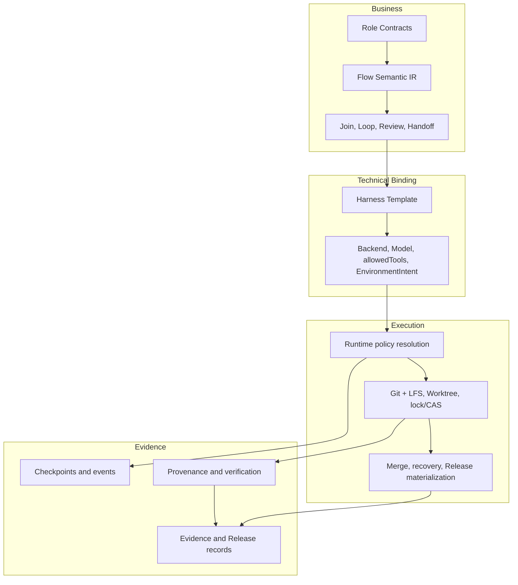
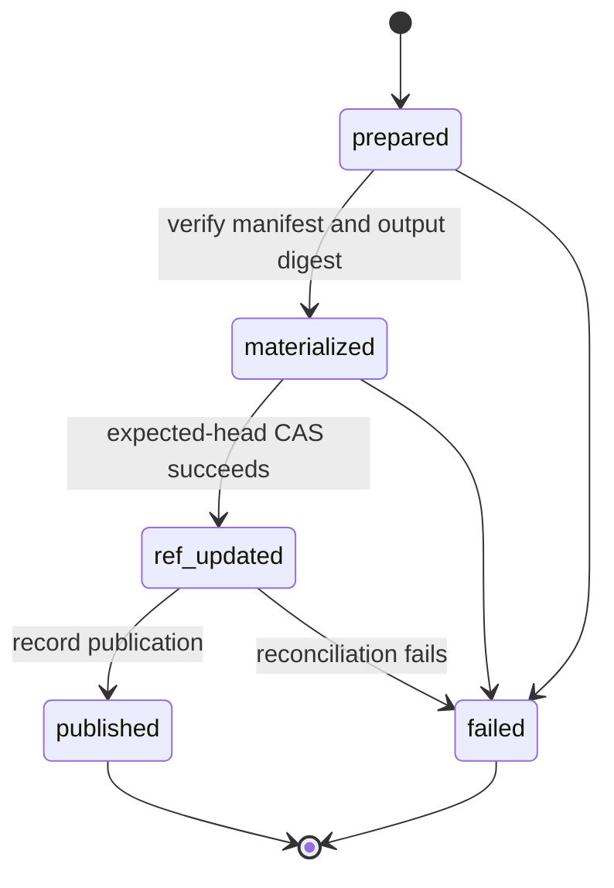

# OGS: A Transactional Single-Workspace Contract for Verifiable Multi-Role AI Delivery

**Authors:** [Author name], [Co-author names]
**Affiliation:** [Institution / Independent Researcher]
**Corresponding author:** [Email]
**Status:** Submission draft; bibliographic and author metadata require final editorial review.

## Abstract

Multi-role AI collaboration spans software engineering, office-document production, consulting analysis, and structured debate. Across these file-based workflows, failures rarely stem from models lacking single-step reasoning ability; instead, concurrent edits, unverified handoffs, and hallucinated *false completion declarations* (FCR) corrupt delivery integrity when completion is judged by natural-language self-assessment. This paper presents **OGS** (*Outcome-Governed Substrate*), an open-source runtime implementing Contract Set v2 (packaged as `ogsystem` / `ogs`), which transforms probabilistic multi-role claims into independently verifiable, fail-closed physical delivery facts.

OGS separates workflow governance into four layers over a single Git + LFS Workspace per Project. Responsibility Roles are bound to least-privilege execution Harnesses (`allowedTools ∩ verifiedTools`); compiled Extended Finite-State Machine (EFSM) rules, discrete LTS business events, and fail-closed Context Maps govern control and field-level data transfer; Roles execute in isolated Git Worktrees anchored to fixed base commits and expose outputs only via immutable, digest-checked `WorkspaceRef` values; and Framework-owned four-valued sticky-fail Joins (`pending`, `arrived`, `skipped`, `failed`), fencing-token expected-head compare-and-swap (CAS) canonical locks, and four-stage Release materialization (`prepared → materialized → ref_updated → published`) gate authoritative integration and publication. As a bounded operational lens, OGS maps organizational responsibility differentiation, delegated authority, coordination, and accountability to runtime contracts and evidence records, while leaving ultimate accountability with deploying organizations and human decision-makers.

Empirical validation combines a 40-unit controlled study across five frozen multi-file software tasks, one fixed model, two seeds, and four arms (`A`, `B1`, `B2`, `C`) with post-arm hidden `pytest` evaluation, a six-scenario zero-LLM deterministic invariant ablation, and a 596-test automated verification suite. In the matched Git Worktree comparison, naive worktree isolation (`B2`) suffered `5/10` FCR and achieved only `3/10` `VerifiedDelivery`, whereas OGS (`C`) reduced FCR to `0/10` and raised `VerifiedDelivery` to `9/10` (failing closed on the single remaining merge conflict). In the deterministic ablation, the imperative baseline violated `6/6` target safety invariants while OGS violated `0/6` in `168.3 ms`. While underlying primitives such as EFSMs, Git Worktrees, locks, and provenance are established foundations, OGS contributes their cohesive integration into an executable, fail-closed Single-Workspace Contract for verifiable multi-role AI delivery.

**Keywords:** multi-role AI collaboration; AI runtime governance; transactional workspace contract; false completion rate; EFSM; Git Worktree provenance; fail-closed release; verifiable delivery

## 1. Introduction

Multi-role AI collaboration operates across several boundaries. A model-facing Role requires a defined responsibility, a constrained tool set, an isolated execution environment, and a controlled mechanism to transfer results to downstream Roles. Parallel execution adds integration and concurrency hazards, while publication introduces a further boundary between candidate edits, canonical project files, verified outputs, and downloadable deliverables. A fluent natural-language claim of completion does not establish any of these states.

**From distributed data systems to multi-agent collaboration: a structural analogy and a fundamental divergence.** The evolution of distributed data engineering offers a structural analogy to the current trajectory of multi-agent systems. Classic big-data frameworks overcame single-machine capacity limits through distributed divide-and-conquer (MapReduce [51]) and iterative graph computation (Pregel/BSP [50]). Yet distributed storage without schema enforcement quickly degraded into ungoverned "data swamps"; the modern data stack resolved this through data contracts, ACID lakehouse transactions, and end-to-end data lineage. Multi-agent AI collaboration recapitulates this structural evolution—single-model context and reasoning budgets drive task decomposition across multiple Roles—but exhibits a fundamental divergence in the nature of its compute nodes:

1. **Deterministic transformation versus probabilistic exploration.** Traditional data-processing nodes (MapReduce tasks, Spark RDD transformations) obey strict determinism and idempotency: $f(X) = Y$. Node failures are physical or systemic (OOM, network partition, machine crash) and are recoverable through lineage-based recomputation. LLM agent nodes, by contrast, are stochastic exploratory units whose outputs vary with sampling temperature, prompt phrasing, and context truncation.
2. **Explicit crash versus covert semantic corruption.** Because agents possess natural-language generation fluency, their most dangerous failures are not process crashes but *semantic-level corruptions*: goal drift, cascading hallucinations [24, 25], and—most critically—**false completion declarations (FCR)**, where an agent confidently asserts task completion while the actual artifact fails to compile, misses requirements, or was never persisted. Unlike mere non-determinism (which can be mitigated by majority voting or temperature control), hallucination constitutes a *systematic factual error that the model itself cannot detect or self-correct*. Under challenge, the model may reinforce its erroneous output with more elaborate justification rather than correct it.

This divergence means that multi-agent collaboration cannot rely on inter-agent self-assessment (such as free-form natural-language debate [23] or self-review) as its trust anchor. External, model-independent physical facts—commit SHAs, sandbox test exit codes, cryptographic digests, and atomic ref checks—must serve as the sole basis for delivery judgments. The more flexible and open-ended the agent execution layer becomes, the more indispensable external runtime governance and machine-verifiable evidence chains become—not as an optional wrapper, but as a structural prerequisite for reliable delivery.

Prior research and software systems supply mature individual building blocks: labeled transition systems (LTS) and extended finite-state machines (EFSM) [19, 20], design by contract [21], workflow synchronization and exception patterns [1, 2, 10], durable execution [11, 12], Git Worktrees [22], distributed locking [16], supply-chain provenance [8, 9], multi-agent platforms [3–6], and graph stepping runtimes such as LangGraph [7]. Yet recent 2024–2026 literature remains split across two disconnected layers: *control-flow FSM frameworks* (e.g., StateFlow [35], MetaAgent [36], HEXIS [42], Executable-FSM [43], NeuralFSM [46]) govern prompt turns without governing concurrent file mutations or publication integrity, whereas *workspace and audit studies* (e.g., STORM [40], Auditable Agents [44], TraceDev [45]) diagnose naive worktree merge failures and audit vulnerabilities without providing an executable, fail-closed transaction and release substrate.

**Core engineering problem and OGS approach.** This paper addresses the integration gap between those two layers: *how can responsibility boundaries, delegated tool authority, concurrent file mutations, state recovery, evidence, and publication be unified into one executable contract that turns stochastic agent claims into verifiable physical delivery facts?* **OGS** (*Outcome-Governed Substrate*, distributed in the accompanying replication artifact as `ogsystem` / `ogs`, Contract Set v2) treats one Project as the owner of one Git + LFS Workspace. Every Role begins from a fixed commit in a Framework-managed Worktree; Role outputs become committed repository facts before an immutable, read-only `WorkspaceRef` can cross a Role boundary; and Framework-owned operations execute four-valued Joins, fencing-token expected-head CAS canonical updates, recovery, and staged Release materialization.

**Protocol generality versus empirical scope.** Because Git Worktrees and content-addressed commits operate over arbitrary files rather than source code alone, OGS's workspace contract is designed to support general file-based collaboration (the repository includes software, management-consulting, and structured-debate configurations). In our controlled evaluation, however, we deliberately focus on multi-file software engineering tasks because they provide an objective, automated, post-arm hidden `pytest` oracle that enables unambiguous measurement of `FCR` and `VerifiedDelivery` without subjective rubric noise.

We also frame OGS through an operational lens of **runtime governance for bounded AI work processes**. Organization design motivates separating responsibility from execution, while agency theory highlights delegation, information asymmetry, and monitoring [28, 29]. OGS maps these concerns to Role Contracts, Harness/tool authority, explicit coordination, and Run Evidence/Release records, aligning conceptually with the Govern/Map/Measure/Manage functions of NIST AI RMF 1.0 and its Generative AI Profile [30, 31]. This analogy is strictly operational: an AI Role is not a legal or moral person, and OGS does not claim to constitute a full organizational governance program or regulatory certification.

**Summary of contributions.** Grounded in an implemented TypeScript/Node.js runtime and reproducible evaluation artifacts, this paper makes three bounded systems contributions:

1. **Layered Contract Governance above Graph Execution:** OGS decouples invariant Business responsibility seats, restricted Semantic IR compilation, discrete LTS events, bounded loop budgets, and least-privilege Technical Bindings (`allowedTools ∩ verifiedTools`) from underlying graph stepping (delegated to LangGraph) and agent backends.
2. **Fail-Closed Single-Workspace Delivery Protocol:** OGS unifies isolated Role Worktrees, immutable commit-and-digest-bound `WorkspaceRef` projections, four-valued sticky-fail Join semantics, fencing-token expected-head CAS canonical locking, and four-stage Release materialization (`prepared → materialized → ref_updated → published`) into one machine-checkable delivery contract.
3. **Causal Empirical Evidence and Reusable Evaluation Harness:** Through a 40-unit controlled live-LLM experiment with post-arm hidden oracle separation and a six-scenario zero-LLM invariant ablation, we demonstrate that worktree isolation alone is insufficient (`B2`: `5/10` FCR, `3/10` `VerifiedDelivery`), whereas enforcing OGS's Single-Workspace Contract eliminates FCR (`0/10`) and achieves `9/10` `VerifiedDelivery` alongside `0/6` invariant violations.

This study evaluates an implemented runtime design and its reproducible engineering evidence rather than claiming model-intelligence gains or broad superiority over external agent platforms. It addresses three research questions:

| Research question | Focus |
| --- | --- |
| **RQ1.** Does the Single-Workspace Contract make multi-role completion claims correspond to independently verifiable delivery facts? | Five-task controlled experiment (`A`/`B1`/`B2`/`C`): hidden `RawPass`, `FCR`, four protocol-independent audit dimensions, and `VerifiedDelivery`, with matched causal focus on `B2` vs. `C`. |
| **RQ2.** Which contract mechanisms prevent unsafe integration and publication under representative failures? | Zero-LLM deterministic ablation across six fault traces: stale-head TOCTOU, crash-resume replay, sticky failed Join, illegal transitions/references, loop-budget exhaustion, and post-digest-failure republishing. |
| **RQ3.** What runtime overhead and validity boundaries remain? | Wall-clock time, recorded LLM calls (including bounded conflict reconciliation), failure/timeout denominators, and explicit scope limits across one model and one task family. |

Throughout the paper, prior mechanisms are attributed to their established sources, implemented OGS behavior is tied directly to executable code and artifacts, and all empirical claims remain bounded by the evaluated tasks and fault traces.

## 2. Related Work and Attribution

### 2.1 Workflow, joins, and durable execution

Workflow Patterns catalogs control-flow structures including synchronization, multi-choice, discriminator, and quorum patterns [1]. Workflow exception research studies how failures and exceptional conditions are detected and handled [2]. The Saga model decomposes long-running transactions into subtransactions and discusses compensation after failure [10]. Therefore, OGS does not claim general Join, exception handling, staged publication, or failure recovery as new concepts.

Durable Functions formalizes execution semantics for stateful serverless functions [11]; transaction processing literature establishes write-ahead logging and recovery foundations [12]. Temporal and Cadence are contemporary durable workflow systems. OGS uses a WAL-backed runtime and a compare-and-swap snapshot for its own execution state. These mechanisms provide engineering context, but the paper does not compare OGS recovery behavior with Temporal, LangGraph, or other products under matched faults.

### 2.2 Multi-agent software engineering as one application area

AutoGen studies programmable multi-agent conversation and control transfer [3]. MetaGPT organizes software production around roles and standardized procedures [4]. ChatDev studies communicative agents for software development [5]. OpenHands presents an open platform and runtime for software-development agents [6], while Magentic-One explores generalist multi-agent execution across web and file-based tasks [34]. StateFlow [35] demonstrates that modeling LLM task-solving as an explicit finite-state machine improves procedural control and mitigates unconstrained reasoning loops, while subsequent works such as MetaAgent [36], NeuralFSM [46], HEXIS [42], executable-FSM controllers [43], trace-derived automata [47], and state-aware agent architectures [48] further establish state-driven orchestration as a recognized design direction. However, task-level FSM control over prompt turns does not by itself govern concurrent multi-role file mutations, merge conflicts, crash recovery, or publication integrity; similarly, open-source developer control planes and harnesses (such as Orca, T3 Code, and OMP) primarily target interactive multi-worktree supervision or local editor/debugger execution rather than a formal cross-role delivery contract. OGS builds on this state-driven foundation by coupling an Extended FSM (EFSM) with a transactional Single-Workspace Contract—carrying typed guards, bounded loop budgets, four-valued sticky-fail Join states, fencing-token expected-head CAS, and fail-closed Release gates—so that transitions govern independently verifiable repository facts rather than conversational turns alone. Unlike StateFlow's cost-efficiency focus, the present study evaluates this contract specifically for delivery verifiability and fail-closed behavior under matched conditions, without claiming token-cost reductions, a new FSM theory, or general superiority over external systems.

SWE-agent studies the Agent-Computer Interface for software engineering [14], while SWE-bench and SWE-bench Verified evaluate issue resolution against real GitHub repositories [15, 27]. Recently, SWE-EVO extends repository evaluation to long-horizon software evolution spanning an average of 21 files [37]. For office and knowledge-work workflows, OfficeBench benchmarks multi-application office suites (Word, Excel, PPT, PDF) [38], complementing multimodal assistant benchmarks such as GAIA [39]. They are relevant to tool interaction, repository-level evaluation, and productivity suites, but none constitutes empirical evidence for OGS. OGS does not use these benchmarks in the reported exploratory evaluation.

LangGraph is the graph execution engine currently used by OGS [7], adopting a Pregel-inspired superstep model [50] for cyclic state transitions, conditional routing, and node-level checkpointing. OGS compiles a restricted workflow description into a plan and delegates graph stepping to LangGraph while retaining its own Role contracts, event vocabulary, Context Map projections, Git/LFS Workspace state, and fail-closed Release protocol above the graph engine. The implementation has not validated replacing LangGraph with a different graph engine. Codex and OpenCode in the reported run are Agent Backends/Harnesses, not graph engines.

**Scheduling-topology parallels with distributed data paradigms.** Two foundational big-data computation models offer a structural analogy—limited to scheduling topology, not to their full computation semantics—for the two dominant multi-agent orchestration patterns:

1. *MapReduce [51] and agent fan-out/fan-in.* MapReduce parallelizes work by distributing side-effect-free map functions across data partitions and aggregating results through deterministic reduce functions. Multi-agent fan-out/fan-in follows the same divide-and-conquer topology: a parent task dispatches subtasks to parallel child Roles, then aggregates their outputs. However, MapReduce mappers operate on disjoint data partitions under a share-nothing assumption; agent Roles that concurrently modify files in a shared project workspace violate this assumption and risk destructive in-place overwrites and merge conflicts. Fan-in therefore cannot be a simple textual concatenation; it requires branch-isolated execution (Git Worktrees from fixed base commits) and transactional integration with four-valued state awareness (State-Aware Join), as implemented in OGS.
2. *Pregel/BSP [50] and agent graph orchestration.* Pregel establishes the Bulk Synchronous Parallel model for iterative graph computation: vertices execute local updates within supersteps separated by global barriers, exchange messages along edges, and terminate via `VoteToHalt()` when a mathematically verifiable convergence condition (such as residual below threshold or empty message queue) is satisfied. LangGraph and similar agent-graph engines adopt an analogous topology—nodes represent agents or tools, directed edges carry state, and cycles support multi-round reflection or review—but the convergence properties diverge fundamentally. Agent "halting" typically depends on a model-generated token (e.g., routing to an `END` node or producing a natural-language completion claim), which is subject to hallucination: an agent may declare convergence while its artifact contains compilation errors, or two reviewing agents may enter an unbounded politeness loop without reaching substantive resolution.

This analogy is limited to scheduling-level topology (nodes execute in parallel, pass state along edges, iterate until a stopping condition). Pregel is a vertex-centric graph-data computation model; LangGraph is a workflow orchestration engine; they are not instances of the same computation model. The analogy highlights that graph topology governs *scheduling and connectivity* but cannot inherently enforce *semantic correctness or state convergence* when nodes are probabilistic and capable of systematic factual error. This boundary motivates OGS's layered design: LangGraph provides graph stepping; OGS provides the EFSM governance layer above it, with Role contracts, loop budgets, guard conditions, and fail-closed Release gates that require model-independent evidence before allowing state progression or publication. LangGraph's own `recursion_limit` provides a graph-engine-level iteration cap; OGS's loop budgets operate at the business-semantic level, binding iteration limits to Role contracts, guard predicates, and four-valued Join state rather than to raw graph-step counts.

### 2.3 Version control, locking, and provenance

Git Worktree provides isolated working directories over repository history [22]. Chubby describes distributed locking and sequencer-based coordination [16]. in-toto and SLSA define provenance and attestation approaches for software supply chains [8, 9]. Recent 2026 research highlights the critical importance of runtime auditability and artifact provenance in multi-agent systems: Nian et al. formalize five key dimensions of agent auditability (action recoverability, lifecycle coverage, policy checkability, responsibility attribution, and evidence integrity), revealing 617 security/audit vulnerabilities across existing open-source frameworks [44]. Concurrently, TraceDev demonstrates at ISSTA 2026 that constructing explicit artifact traceability graphs across requirements, designs, and code is essential to prevent drift and inconsistency in complex repository workflows [45]. OGS uses Git commits as its only Workspace content-version facts, LFS for large objects, canonical locking and expected-head checks for authoritative updates, and evidence/manifests for traceability. Building on these established mechanisms, OGS integrates them into Role-scoped execution and its fail-closed publication contract, providing an executable implementation for selected auditability and artifact-traceability checks.

### 2.4 Organizational governance lens

Classical management concepts are used to explain the engineering problem, not claimed as OGS inventions. Mintzberg's organization-design work distinguishes differentiated responsibilities from mechanisms that coordinate work; Eisenhardt's agency-theory review explains why delegated authority, information asymmetry, and monitoring matter [28, 29]. A recent survey of autonomous agents maps the expanding architecture, tool, evaluation, and risk space [13]; Xi et al.'s 2025 survey provides a newer synthesis [32]. NIST AI RMF 1.0 and its GenAI Profile provide public governance references [30, 31]. These sources motivate an operational mapping:

| Management concern | OGS control point | Claim boundary |
| --- | --- | --- |
| Responsibility differentiation | Business-layer Role Contracts | A Role is a workflow assignment, not an employee, legal person, or final accountable authority. |
| Delegated authority | Technical Binding: Harness, `allowedTools`, EnvironmentIntent, resolved policy | The implementation enforces selected tool/environment boundaries; it does not prove elimination of misuse or organizational risk. |
| Coordination and supervision | Business events, Context Maps, Join/Loop/Review policies | These structures constrain declared handoffs; they do not make model behavior deterministic. |
| Accountability and release control | Evidence, commit provenance, canonical mutations, Release verification | Records support reconstruction for a Run; they are not inherently tamper-proof and do not establish regulatory compliance. |

The proposed long-term value is operational continuity across repeated Runs: stable responsibility definitions, explicit authority snapshots, and evidence that can be compared after policy or model revisions. That is a falsifiable hypothesis, not a measured result. OGS does not currently provide a complete organizational policy lifecycle or an automatic learning loop.

### 2.5 Differentiation Against Peer Literature and Attribution

Recent multi-agent engineering literature largely divides into two disconnected tracks. **Control-flow FSM frameworks** (StateFlow [35], MetaAgent [36], HEXIS [42], Executable-FSM [43], NeuralFSM [46]) formalize prompt-level or skill-level state transitions but leave shared-workspace concurrency, merge safety, and artifact publication unmanaged. Conversely, **workspace and auditability studies** (STORM [40], Auditable Agents [44], TraceDev [45], OpenHands [6]) highlight naive worktree integration failures, audit vulnerabilities, and traceability requirements but do not supply an executable, fail-closed transaction and release protocol binding role transitions to repository facts. OGS sits specifically at the intersection of these two tracks:

| Literature track | Representative works | Primary focus | Unaddressed delivery gap | OGS integration response |
| --- | --- | --- | --- | --- |
| Control-flow / FSM orchestration | StateFlow [35], MetaAgent [36], HEXIS [42], Executable-FSM [43], NeuralFSM [46], GraphFlow [49] | Prompt-turn transitions, skill compilation to FSM/EFSM, and serving throughput | Does not govern concurrent file writes, branch merge races, content digests, or release integrity | Couples EFSM guards, bounded loops, and four-valued sticky-fail Joins to a single Git + LFS Workspace state $\mathcal{X}_{\text{ws}}$ |
| Workspace isolation & auditability | STORM [40], OpenHands [6], Auditable Agents [44], TraceDev [45] | Isolated worktree execution, audit vulnerability taxonomy, and requirement-to-code traceability | Lacks a unified fail-closed protocol preventing silent merge regressions, stale-head overwrites, and false completion publications | Enforces immutable `WorkspaceRef` handoffs, fencing-token expected-head CAS locking, and four-stage verified Release materialization |

Within this positioning, OGS builds explicitly on established computer-science foundations and scopes its integration contribution as follows:

| OGS integration component | Established foundation | Implemented scope and boundary |
| --- | --- | --- |
| Responsibility seats separated from runtime Backend/Harness bindings, connected to LTS events and field projections | LTS, design by contract, least-privilege principles, typed tool interfaces, and role-based multi-agent design [3–7, 17, 19–21] | Implemented governance and policy boundary above the graph engine; delegates graph stepping to LangGraph rather than proposing a new graph engine. |
| Transactional Single-Workspace model joining isolated Role commits, read-only `WorkspaceRef` values, Evidence, and Release | Git/Worktree, locking/CAS, provenance, and durable workflow practices [8–12, 16, 22] | Implemented executable protocol under Contract Set v2 (`workspace-contracts`, `workspace-coordinator`, `workspace-lock`, `workspace-release`). Matched cross-platform benchmarking against OpenHands, Orca, and CrewAI remains future work. |
| Four-valued sticky-fail Join and staged Release protocol with declared failure/timeout actions | Workflow synchronization, quorum, exception, Saga, and publication patterns [1, 2, 10] | Implemented and formally specified in [`formal-model-and-proofs.md`](formal-model-and-proofs.md), with sticky-failure absorption and staged release invariants verified by deterministic tests and ablation. |

## 3. Study Method and System Scope

This is an artifact-centered software-architecture and empirical-verification study. The normative specification for Workspace fields, states, events, provenance records, and APIs is the Contract Set v2 Workspace specification [18].

The evidence presented comprises: (1) a five-task, four-arm controlled live-LLM core experiment (40 task/seed/arm units) with strict post-arm hidden `pytest` evaluation isolating delivery verifiability (`B2` vs. `C`) alongside unversioned baselines (`A`, `B1`); (2) a zero-LLM deterministic invariant ablation across six representative failure traces; (3) the repository-wide 596-test automated verification suite plus targeted deterministic workspace/coordination checks; and (4) end-to-end feasibility and cross-backend adapter smoke runs. While the file-based workspace protocol is domain-agnostic across software, consulting, and structured-debate projects, our controlled evaluation intentionally targets multi-file software tasks because automated hidden test suites provide an unambiguous ground-truth oracle for measuring `FCR` and `VerifiedDelivery`. No statistical hypothesis test, cross-model generalization study, or matched external-platform benchmark is claimed here.

The evaluated system boundary covers workflow compilation and runtime governance, execution binding, Framework-managed Git/LFS workspace transactions, and evidence/release verification. Underlying foundation-model quality, provider availability, distributed multi-host scheduling, and external publication targets lie outside the evaluated boundary.

## 4. Architecture

### 4.1 Four product layers

OGS assigns product ownership to four layers under Contract Set v2. Studio, Team Site, and CLI are configuration and operational projections across these layers; they are not additional layers.

**Business** defines responsibility seats and workflow semantics: Role contracts, the restricted Semantic IR, discrete business events, Join policies, bounded loops, review, and handoff. A Role represents an invariant responsibility rather than a particular model session; explicit contracts draw on established design-by-contract concepts [21].

**Technical Binding** binds a Role to a Harness Template. The template configures Backend, Model, `allowedTools`, `EnvironmentIntent`, and applicable limits. Runtime resolves `verifiedTools` and freezes an `EffectiveEnvironmentPolicy`; the executable tool set is `allowedTools ∩ verifiedTools`. The Adapter maps the resolved policy into backend-native configuration. Thus the environment intent is configuration input, while effective policy is a runtime result.

**Execution** owns process and repository mutations: Git/LFS, isolated Worktrees, canonical lock, expected-head compare-and-swap, merge, restore, recovery, and Release materialization. Roles cannot directly update canonical refs or operate LFS locks.

**Evidence** records execution state, checkpoints, events, commit provenance, reviews, verification, Evidence manifests, and Release records. Evidence is a record of the implemented workflow; it is not claimed to be tamper-proof storage or a formal causal proof.

### 4.2 Role and transition model

OGS represents a collaboration graph with a set of responsibility seats, directed handoffs, runtime bindings, transition semantics, contracts/projections, and governance policy. An LTS event vocabulary constrains control transitions. The restricted Mermaid input compiles to Semantic IR; `SemanticIR.version` is distinct from the outer `ogsContractVersion: 2`.

Compilation checks that graph nodes map to responsibility seats, directed cycles have finite iteration budgets and exhaustion routes, and Join prerequisites are statically declared. These checks are implementation rules. They do not prove that an arbitrary model action will terminate or that every external side effect is reversible.

Context Maps explicitly project approved data between Roles. Undeclared fields are rejected. `WorkspaceRef` is not projected by default; an authorized `HandoffProjection` can expose selected read-only references. This applies fail-safe defaults and least-privilege design [17], but the study does not measure reductions in prompt injection or information leakage.

### 4.3 Shared Workspace state

Each Project has exactly one Git + LFS Workspace, and the full Git commit ID is its sole content-version fact. LFS stores objects referenced by Git commits; it is not a second version system. A Role begins from a fixed `baseCommit` in an isolated Worktree. The Framework creates Role commits and records provenance. A local Worktree path is not a durable identity.

`WorkspaceRef` is an immutable, read-only value containing `workspaceId`, a full commit ID, a repository-relative path, and a digest. It cannot name uncommitted content, branch names, tags, or symbolic refs. The path must be normalized and contained in the committed tree; symlink escapes, traversal, and digest mismatches are rejected. LFS content is resolved and verified. The reference grants no write permission and crosses a Role boundary only through an explicit authorized projection.

| Object | State or fields | Contract role |
| --- | --- | --- |
| Project / Workspace | `workspaceId`, canonical ref, canonical HEAD | Single Workspace and one content history. |
| Role work | `baseCommit`, `worktreeId`, `branch`, `roleCommit` | Isolated work; a reference can be formed only after a commit. |
| Handoff | `workspaceRefs[]`, `WorkspaceRef` | Empty by default; explicit read-only transfer. |
| Checkpoint / Evidence | Run state, lineage, round, iteration, state version, commit refs | Workflow recovery and evidence indexing. |
| Canonical lock | owner, lease, fencing token, expected head | Serializes authoritative ref mutations; stale heads fail closed. |
| Join | candidate commits, merge commit, conflict evidence | Integrates candidates in a separate merge Worktree; conflicts leave canonical ref unchanged. |
| Release | release commit, manifest, output digest, status | Publication record; does not create a second content history. |

This design keeps content, workflow recovery, authorization, and publication as related but distinct records. In the file-based tasks studied here, a shared writable directory can create a **destructive in-place mutation** risk. The paper does not evaluate ChatDev, MetaGPT, CrewAI, or AutoGen under matched conditions, so it does not attribute this risk universally to those systems. In the controlled baseline, overlapping edits can overwrite intermediate drafts and create three observable risks:
1. **Loss of Intermediate Auditability:** Individual role contributions are wiped out, making it impossible to determine which agent introduced an erroneous claim, hallucinated statistic, or policy violation.
2. **Irreversible Content Loss and Silent Regressions:** In iterative review loops, downstream agents frequently hallucinate or over-prune previous work. Under in-place file overwrites, paragraphs or code written by upstream specialists are permanently deleted without diff inspection or rollback capability.
3. **Concurrent Dirty Writes:** Parallel roles operating on overlapping files suffer from uncoordinated race conditions, silently overwriting each other's outputs.

By isolating each Role in a dedicated Git Worktree, requiring intermediate changes to be committed, and passing read-only `WorkspaceRef` records through a dedicated Merge Worktree, OGS retains role-level commits, content digests, and publication status for the studied tasks. These records support inspection and rollback; they are not claimed to be tamper-proof evidence. The design addresses a specific risk of naive worktree integration: conflicts can be deferred to post-hoc merging without a canonical update guard. OGS scopes role writes through Context Map contracts, checks expected-head CAS for authoritative updates, and records concurrent reconciliation in a separate Merge Worktree. The controlled results support fail-closed behavior on the specified conflict and stale-head traces, not universal safety across collaboration systems.

### 4.4 Join and Release protocol

For a Join scope identified by Run, lineage, and loop iteration, each declared source has one of four outcomes:

$$
S_{src} \in \{pending, arrived, skipped, failed\}.
$$

`all_of` requires each configured source outcome to satisfy the declared policy. `quorum_of(K)` is satisfied by the required number of unique arrived sources; late outcomes do not rewrite a committed result. Source failure policy (`wait`, `fail`, `quorum_continue`) is separate from timeout action (`fail`, `quorum_continue`, `pause`, `terminate`). A required skipped source blocks `all_of`; `quorum_continue` applies only to quorum and fails if the threshold is unmet. The implementation preserves `failed` as a sticky absorbing outcome rather than silently converting it to `skipped` (formally specified in [`formal-model-and-proofs.md`](formal-model-and-proofs.md) §3 and exhaustively asserted across all 4×4 state transitions in `tests/join-source-snapshot.test.mjs`).

Candidate commits are integrated in a Merge Worktree. A conflict is recorded as `join_conflict`, and the canonical ref remains unchanged. Canonical ref updates, restore, and Release publication use a canonical lock and expected-head CAS. Materialization itself occurs before the CAS. A stale expected head fails closed and leaves the candidate available for recovery or rebase.

Release binds an immutable `releaseCommit` to a materialized file set. Its normal state path is:

Only a `published` Release exposes a public download reference. A Release failure stores one `failureCode`; retryability is Framework policy. A known post-CAS record failure can enter reconciliation. This staged protocol has clear parallels with workflow exception handling and Saga-style compensation [2, 10]; this paper does not claim those general patterns as original.

## 5. Engineering Implementation

OGS is implemented in TypeScript/Node.js. Runtime transitions are appended to `events.ndjson` before a compare-and-swap update to `state.json`. Resume verifies the frozen plan fingerprint against the current definition. Specified crash windows are covered by deterministic fault-injection tests. These properties describe the implementation and tests; they do not imply deterministic model behavior or universal crash safety.

The Framework manages the Workspace lifecycle. Role preparation creates a Worktree from a base commit. Result commit records its origin and checkpoint association. Join validates candidates and creates a merge commit in an isolated integration Worktree. Release materialization verifies the final manifest and output digest. The canonical lock includes owner, lease expiration, fencing token, and expected canonical HEAD. Mutations with stale state fail closed.

Contract Set v2 excludes legacy v1 fields and compatibility paths such as `allowedToolsByRoleId` and `constraints.allowedTools`. The allowed tool source is `allowedTools`; `verifiedTools` are independently resolved facts. Unknown, dynamic, unavailable, or unenforceable capabilities are rejected. This is a contract boundary and is not a measured security outcome.

## 6. Empirical Evaluation and Engineering Evidence

### 6.1 Controlled Core Experiment (RQ1 and RQ3)

The core controlled experiment (`benchmarks/run-live-pilot.mjs`) evaluates five frozen multi-file Python tasks in `benchmarks/live-pilot/tasks/` (`task-01-ledger-engine`, `task-02-config-merger`, `task-03-task-scheduler`, `task-04-review-rework-loop`, and `task-05-cross-module-contract`) across one fixed model (`gpt-6-luna` via Codex CLI), fixed reasoning effort (`low`), fixed 900-second per-role timeout, two paired seeds, and four arms (40 task/seed/arm units total). Each task provides visible tests that an arm may use as an internal development gate, alongside an independent hidden `pytest` oracle executed strictly *after* all four arms have finished and persisted delivery snapshots, preventing oracle leakage into release logic. Timeouts, runner errors, failed merges, and blocked releases remain in the denominator.

The four arms separate raw model capability, unversioned directory concurrency, worktree isolation alone, and the OGS Single-Workspace Contract:

- **Arm A (Single Agent, unversioned):** one agent operating directly in a shared working directory.
- **Arm B1 (Concurrent Shared Directory, unversioned):** parallel Roles writing concurrently into the same flat directory.
- **Arm B2 (Naive Git Worktrees):** parallel Roles executing in isolated Git Worktrees with immutable role commits, followed by naive post-hoc `git merge` on `main`.
- **Arm C (OGS Single-Workspace Contract):** parallel Roles governed by `GitCollaboration`, `WorkspaceCoordinator` (`prepare`, `commit`, isolated Merge Worktree integration, and a bounded reconciler over immutable upstream diffs upon conflict), visible-gate verification, and fail-closed `WorkspaceReleaseService` publication (`publishRelease`). To isolate the causal effect of the workspace and release contract without confounding from graph-engine scheduling overhead, `run-live-pilot.mjs` invokes the OGS workspace coordination and release runtime directly rather than stepping through the full Mermaid-to-LangGraph runner; EFSM compilation, Context Maps, four-valued Joins, and loop budgets are verified separately in §6.2 and §6.3.

The primary cross-arm outcomes are hidden `RawPass`, `claimedComplete`, `FCR = claimedComplete && !hiddenOracle.rawPass`, four protocol-independent audit dimensions (`RoleAttribution`, `CanonicalIntegrity`, `VerifiedArtifactDigest`, and `FailClosedOnError`), their conjunction `VerifiedDelivery`, mean wall-clock time, and mean recorded LLM calls (including bounded conflict reconciliation calls in Arm C so recovery cost remains explicit). The OGS-specific Release status is logged as a diagnostic rather than used as a privileged scoring criterion.

Across 5 tasks × 2 seeds, the results are:

| Arm | RawPass | Claimed | FCR | VerifiedDelivery | Role attribution | Canonical integrity | Verified digest | Fail-closed | Mean wall time | Mean LLM calls |
| --- | ---: | ---: | ---: | ---: | ---: | ---: | ---: | ---: | ---: | ---: |
| A | 10/10 | 10/10 | 0/10 | 0/10 | 0/10 | 0/10 | 10/10 | 10/10 | 112.8 s | 1.00 |
| B1 | 10/10 | 10/10 | 0/10 | 0/10 | 0/10 | 0/10 | 10/10 | 10/10 | 184.6 s | 2.40 |
| B2 | 5/10 | 10/10 | 5/10 | 3/10 | 10/10 | 10/10 | 3/10 | 3/10 | 183.4 s | 2.40 |
| C | 9/10 | 9/10 | 0/10 | 9/10 | 10/10 | 9/10 | 9/10 | 10/10 | 190.3 s | 3.00 |

We interpret this table on two distinct levels:

1. **Unversioned capability baselines (`A` and `B1`):** Both arms pass `10/10` hidden tests, confirming that the underlying model possesses sufficient coding capability to solve all five tasks. Their `RoleAttribution = 0/10` and `CanonicalIntegrity = 0/10` scores do not indicate code failures; rather, they reflect that direct working-directory mutations leave uncommitted, unattributed workspace state without an auditable canonical delivery snapshot.
2. **Matched causal Git Worktree comparison (`B2` vs. `C`):** Both `B2` and `C` isolate Roles in Git Worktrees and persist immutable role-level commits (`RoleAttribution = 10/10` for both). Nevertheless, `B2` suffers **`5/10` FCR** and achieves only **`3/10` `VerifiedDelivery`** because naive post-hoc merges drop conflicting changes or silently allow broken integrations to be declared complete. By enforcing isolated merge reconciliation, visible-gate verification, and fail-closed staged Release publication, **`C` eliminates FCR (`0/10`) and raises `VerifiedDelivery` to `9/10`**. On the single remaining unit (`1/10`), `C` encountered an unresolved merge conflict, left the canonical ref untouched, and correctly withheld publication rather than emitting a false completion. This reliability gain incurs modest overhead relative to `B2`—important to account for explicitly given multi-agent latency and resource costs [41]: mean wall time increases from `183.4 s` to `190.3 s` (+3.8%) and mean LLM calls increase from `2.40` to `3.00` due to bounded conflict reconciliation.

### 6.2 Deterministic Zero-LLM Invariant Ablation (RQ2)

To isolate individual contract controls without model stochasticity, `benchmarks/run-efsm-ablation.mjs` executes six deterministic fault scenarios against both an unguarded imperative path (real local Git, filesystem, map, and loop operations without OGS guards) and the compiled OGS runtime modules (`acquireCanonicalWorkspaceLock`, `createWorkspaceReleaseService`, `assertWorkspaceRef`, `validateEventCandidate`, `mergeJoinSourceStatus`, and `wouldExceedLoopBudget`). All six scenarios execute in `168.3 ms` (`benchmarks/results/efsm-ablation.json`):

| Scenario ID | Target failure mode | Unguarded imperative path | OGS contract runtime | Outcome |
| --- | --- | --- | --- | --- |
| `toctou-stale-head` | Concurrent canonical update after stale HEAD read | Unconditional `update-ref` silently overwrites external commit (`staleHeadOverwrite = true`) | Rejects lock/update with `WORKSPACE_LOCK_STALE_HEAD`; canonical ref preserved | Prevented |
| `crash-resume-replay` | Process restart replaying publication side effects | Appends duplicate publication record (`publishedRecords = 2`) | Idempotent state machine preserves single `published` release (`publishedRecords = 1`) | Prevented |
| `sticky-failed-join` | Late `skipped` branch overwriting prior `failed` source | Two-state map downgrades `failed → skipped` (`downstreamReady = true`) | Four-valued `mergeJoinSourceStatus` absorbs as `failed` (`downstreamReady = false`) | Prevented |
| `illegal-transition-and-reference` | Out-of-order publish event and `../secret` path escape | Accepts illegal state jump and escaped path | Rejects path (`WORKSPACE_PATH_INVALID`) and undeclared event (`eventError = true`) | Prevented |
| `review-loop-budget` | Unbounded review/rework retry cycle | Exhausts loop cap (`100` attempts, `terminated = false`) | Enforces compiled loop budget (`2` attempts, `terminated = true`) | Prevented |
| `digest-failure-repeat-release` | Repeated release publication after manifest/output mismatch | Second attempt publishes and pollutes canonical state (`canonicalPolluted = true`) | Fails closed with `OUTPUT_DIGEST_MISMATCH`; canonical state remains unpolluted | Prevented |

Across all six traces, the imperative baseline violated `6/6` safety invariants while OGS violated `0/6` with `6/6` complete evidence records. Raw JSON reports, delivery snapshots, and fixed offline verification commands are documented in [`benchmarks/CORE-EXPERIMENT-REPRO.md`](../../benchmarks/CORE-EXPERIMENT-REPRO.md).

### 6.3 Automated Verification Suite and Adapter Smoke Checks

Beyond the controlled study and ablation, the open-source artifact provides broad automated verification and end-to-end adapter smoke checks:

- **Repository-wide test suite:** Running `pnpm test` executes 596 automated tests covering Mermaid compilation, Semantic IR validation, Context Map projection closure, four-valued Join snapshots (`tests/join-source-snapshot.test.mjs`), loop budgets, WAL/CAS snapshots, `WorkspaceRef` validation, Worktree isolation, merge conflicts, canonical locking, Release materialization failures, and workbench projections: 488 core tests pass, 1 Windows-specific test is skipped, 107 Team Site tests pass, and 0 fail. Targeted deterministic suites further confirm 40 Workspace/coordination checks (stale-head rejection, conflict handling, materialization failures, digest checks, and post-CAS reconciliation) and 11 projection checks.
- **End-to-end feasibility and cross-backend smoke runs:** Prior to freezing the five-task benchmark, repository records verify real-model Codex (`gpt-6-luna`) execution on a multi-role Python calculator workflow (`dispatch → parallel implementation/tests → join`), confirming four Role commits, isolated merge integration, and passing unit tests, as well as boundary runs rejecting same-path conflicts and stale canonical heads. A cross-Agent-Backend smoke run further verified invoking Codex for planning and OpenCode (`codex-gateway/gpt-6-luna`) for implementation through to a published Release; because the OpenCode Role produced no file modifications in that run, it confirms adapter invocation and Release plumbing rather than downstream `WorkspaceRef` consumption or cross-model generalization.

## 7. Discussion: Scope of Contribution and Attribution

OGS composes established computer-science foundations rather than inventing standalone state-machine or version-control theory. LTS and EFSM [19, 20], workflow joins and Saga compensation [1, 2, 10], LangGraph graph execution [7], Git Worktrees [22], fencing-token locks and CAS [16], WAL recovery [12], least-privilege defaults [17], supply-chain provenance [8, 9], and role-based agent design [3–6, 33] all have rich prior art.

OGS's distinct systems contribution lies in **bridging control-plane orchestration with transactional workspace delivery**: binding responsibility seats, explicit data projections, immutable commit-and-digest-addressed `WorkspaceRef` values, four-valued sticky-fail Joins, expected-head CAS locking, and fail-closed Release materialization into one executable Single-Workspace Contract. Connecting formal EFSM invariants ([`formal-model-and-proofs.md`](formal-model-and-proofs.md)) with an auditable Git + LFS repository state model directly operationalizes the gap identified by recent worktree and auditability studies [40, 44, 45]. The matched `B2` vs. `C` experiment demonstrates why this integration matters in practice: isolating branches without a fail-closed integration and release contract still leaves half of the runs emitting false completions (`5/10` FCR), whereas the full contract eliminates FCR (`0/10`) and triples verified deliveries (`3/10 → 9/10`).

The relationship between established foundations and OGS's implemented integration is summarized below:

| System aspect | Established foundation | OGS integration contribution and current boundary |
| --- | --- | --- |
| Four-layer governance architecture | Layered software design and design by contract [21] | Cleanly separates Business seats, Technical Binding (`allowedTools ∩ verifiedTools`), Execution, and Evidence under Contract Set v2. |
| Graph stepping and checkpointing | LangGraph cyclic state execution [7] | Reused as the swappable graph-stepping backend beneath OGS's Semantic IR and contract layer; alternative graph engines have not yet been benchmarked. |
| Role-based task division | Multi-agent frameworks [3–6, 33] | Decouples durable responsibility seats from transient model sessions and constrains handoffs via fail-closed Context Maps. |
| Transactional Single-Workspace protocol | Git/Worktree, locks/CAS, provenance, durable execution [8–12, 16, 22] | Unified into executable modules (`workspace-contracts`, `workspace-coordinator`, `workspace-lock`, `workspace-release`) and empirically validated (`B2` vs. `C`, plus 6-trace ablation). |
| Four-valued sticky-fail Join & staged Release | Workflow synchronization, exception, and Saga patterns [1, 2, 10] | Formally specified lattice invariants and fail-closed four-stage publication (`prepared → materialized → ref_updated → published`), verified exhaustively in tests and ablation. |
| Cross-backend adapter layer | CLI and server-backed coding harnesses | Verified for Codex and OpenCode invocation; broader cross-model and multi-backend file-handoff interoperability remain future validation targets. |

Direct empirical comparison against external platforms such as OpenHands, Orca, and CrewAI—matching tasks, models, permission budgets, merge policies, and fault schedules—remains important future work before making comparative cross-platform claims.

## 8. Threats to Validity and Limitations

**Construct validity.** Our four audit dimensions (`RoleAttribution`, `CanonicalIntegrity`, `VerifiedArtifactDigest`, `FailClosedOnError`) are operational software-delivery criteria rather than universal proxies for code quality or organizational compliance. Because `A` and `B1` mutate files in place without version-controlled commits, their `CanonicalIntegrity = 0/10` score reflects the absence of canonical snapshot hygiene rather than test failure; accordingly, our primary causal evidence rests on the matched Git Worktree comparison (`B2` vs. `C`). The related-work survey is curated rather than an exhaustive systematic literature review, and public documentation of external systems may omit private capabilities.

**Internal validity.** The controlled live-LLM experiment covers 10 paired `(task, seed)` units across five author-constructed Python tasks using one fixed model (`gpt-6-luna`, `reasoning=low`); results are reported descriptively rather than via statistical hypothesis tests. Arm C's bounded conflict reconciler adds recorded LLM calls on conflict tasks (mean `3.00` vs. `2.40` for `B1`/`B2`). Furthermore, `benchmarks/run-live-pilot.mjs` exercises `WorkspaceCoordinator`, `GitCollaboration`, and `WorkspaceReleaseService` directly to isolate the Single-Workspace Contract's causal effect without graph-scheduler confounding, while full EFSM compilation, Context Maps, sticky-fail Joins, and loop budgets are verified via `benchmarks/run-efsm-ablation.mjs` and the 596-test suite rather than inside the live-LLM driver itself.

**External validity.** Current evaluation targets local single-host Git repositories and multi-file Python tasks. While the Git + LFS contract is file-type agnostic and repository configurations cover consulting and debate scenarios, controlled non-code evaluations (requiring human rubrics), distributed multi-host scheduling, multi-tenant production deployments, and external publication compensation remain future work.

**Reliability and security scope.** Automated regression tests and the six-trace ablation verify specified invariants and crash/replay windows, not formal safety under every OS interleaving, prompt-injection resistance, cryptographic tamper-proofing of local disk storage, or regulatory compliance. Legacy v1 crash-injection suites archived under `tests/archive/v1/` are excluded from active `pnpm test` counts.

**Comparison validity.** OGS was evaluated against controlled internal baselines (`A`, `B1`, `B2`, and the imperative ablation path) rather than matched external deployments of OpenHands, Orca, CrewAI, or Temporal. No claim of general speed, token-cost, or cross-platform superiority is made.

## 9. Conclusion and Future Work

This paper presented **OGS** (*Outcome-Governed Substrate*), an open-source runtime that turns stochastic multi-role AI collaboration claims into independently verifiable, fail-closed physical delivery facts via a transactional Single-Workspace Contract. By unifying layered responsibility contracts, fail-closed Context Maps, isolated Git Worktrees, immutable `WorkspaceRef` handoffs, four-valued sticky-fail Joins, fencing-token expected-head CAS locking, and four-stage verified Release materialization, OGS addresses the execution-and-delivery gap between prompt-level FSM controllers and post-hoc workspace auditing.

Across five frozen multi-file software tasks and two seeds, our matched Git Worktree study demonstrates that branch isolation alone is insufficient (`B2`: `5/10` FCR, `3/10` `VerifiedDelivery`), whereas OGS (`C`) eliminates false completion declarations (`0/10` FCR) and achieves `9/10` `VerifiedDelivery` while failing closed on an unresolved merge conflict—at modest coordination overhead (`190.3 s` vs. `183.4 s` mean wall time). Complementary zero-LLM ablation (`0/6` vs. `6/6` invariant violations in `168.3 ms`) and 596 passing automated tests further substantiate the runtime's safety boundaries.

Future work will extend the frozen replication harness along four directions: (1) wiring end-to-end live benchmarks through the full Mermaid-to-LangGraph `graph-runner` stack alongside `WorkspaceCoordinator`; (2) replicating the controlled protocol across multiple foundation models and larger repository suites; (3) running matched head-to-head comparisons against external agent runtimes (e.g., OpenHands, Orca, and CrewAI); and (4) evaluating non-code office and consulting workflows using blinded human acceptance rubrics with inter-annotator agreement [26].

## References

1. van der Aalst, W. M. P., ter Hofstede, A. H., Kiepuszewski, B., & Barros, A. P. “Workflow Patterns.” *Distributed and Parallel Databases*, 14(1), 5–51, 2003. [DOI: 10.1023/A:1022883727209](https://doi.org/10.1023/A:1022883727209).
2. Russell, N., van der Aalst, W. M. P., & ter Hofstede, A. H. “Workflow Exception Patterns.” *Advanced Information Systems Engineering (CAiSE 2006)*, LNCS Vol. 4001, pp. 288–302, 2006. [DOI: 10.1007/11767138_20](https://doi.org/10.1007/11767138_20); Luo, Z., Sheth, A., Kochut, K., & Miller, J. “Exception Handling in Workflow Systems.” *Applied Intelligence*, 13(2), 125–147, 2000. [DOI: 10.1023/A:1008388412284](https://doi.org/10.1023/A:1008388412284).
3. Wu, Q., et al. “AutoGen: Enabling Next-Gen LLM Applications via Multi-Agent Conversation.” 2023. [arXiv:2308.08155](https://arxiv.org/abs/2308.08155).
4. Hong, S., et al. “MetaGPT: Meta Programming for A Multi-Agent Collaborative Framework.” ICLR 2024. [OpenReview](https://openreview.net/forum?id=VtmBAGCN7o).
5. Qian, C., et al. “ChatDev: Communicative Agents for Software Development.” ACL 2024, pp. 15174–15186. [DOI: 10.18653/v1/2024.acl-long.810](https://doi.org/10.18653/v1/2024.acl-long.810).
6. Wang, X., et al. “OpenHands: An Open Platform for AI Software Developers as Generalist Agents.” ICLR 2025; preprint 2024. [arXiv:2407.16741](https://arxiv.org/abs/2407.16741).
7. LangChain. “LangGraph Documentation.” [Official documentation](https://docs.langchain.com/oss/python/langgraph/overview).
8. Torres-Arias, S., et al. “in-toto: Providing Farm-to-Table Guarantees for Bits and Bytes.” USENIX Security 2019. [USENIX](https://www.usenix.org/conference/usenixsecurity19/presentation/torres-arias).
9. OpenSSF. “SLSA Provenance Specification, v1.0.” [Specification](https://slsa.dev/spec/v1.0/provenance).
10. Garcia-Molina, H., & Salem, K. “Sagas.” SIGMOD 1987, 249–259. [DOI: 10.1145/38713.38742](https://doi.org/10.1145/38713.38742).
11. Burckhardt, S., et al. “Durable Functions: Semantics for Stateful Serverless.” *Proceedings of the ACM on Programming Languages*, 5(OOPSLA), Article 133, 2021. [DOI: 10.1145/3485510](https://doi.org/10.1145/3485510).
12. Gray, J., & Reuter, A. *Transaction Processing: Concepts and Techniques*. Morgan Kaufmann, 1992.
13. Wang, L., et al. “A Survey on Large Language Model Based Autonomous Agents.” *Frontiers of Computer Science*, 18(6), 2024. [DOI: 10.1007/s11704-024-40231-1](https://doi.org/10.1007/s11704-024-40231-1).
14. Yang, J., et al. “SWE-agent: Agent-Computer Interfaces Enable Automated Software Engineering.” NeurIPS 2024. [arXiv:2405.15793](https://arxiv.org/abs/2405.15793).
15. Jimenez, C. E., et al. “SWE-bench: Can Language Models Resolve Real-World GitHub Issues?” ICLR 2024. [arXiv:2310.06770](https://arxiv.org/abs/2310.06770).
16. Burrows, M. “The Chubby Lock Service for Loosely-Coupled Distributed Systems.” OSDI 2006. [USENIX paper](https://www.usenix.org/legacy/event/osdi06/tech/full_papers/burrows/burrows.pdf).
17. Saltzer, J. H., & Schroeder, M. D. “The Protection of Information in Computer Systems.” *Proceedings of the IEEE*, 63(9), 1278–1308, 1975. [DOI: 10.1109/PROC.1975.9939](https://doi.org/10.1109/PROC.1975.9939).
18. OGS Project. “V2 Workspace Contracts.” Normative project contract, 2026. [`docs/development/v2-workspace-contracts.md`](../development/v2-workspace-contracts.md).
19. Milner, R. *Communication and Concurrency*. Prentice-Hall, 1989. [ACM record](https://dl.acm.org/doi/book/10.5555/63442).
20. Cheng, K. T., & Krishnakumar, A. S. “Automatic Functional Test Generation Using the Extended Finite State Machine Model.” DAC 1993, 86–91. [DOI: 10.1145/157485.164585](https://doi.org/10.1145/157485.164585).
21. Meyer, B. “Applying ‘Design by Contract’.” *IEEE Computer*, 25(10), 40–51, 1992. [DOI: 10.1109/2.161279](https://doi.org/10.1109/2.161279).
22. Git Project. “git-worktree: Manage multiple working trees.” *Git Reference Manual*. [Official documentation](https://git-scm.com/docs/git-worktree).
23. Du, Y., et al. “Improving Factuality and Reasoning in Language Models through Multiagent Debate.” arXiv preprint, 2023. [arXiv:2305.14325](https://arxiv.org/abs/2305.14325).
24. Huang, L., et al. “A Survey on Hallucination in Large Language Models: Principles, Taxonomy, Challenges, and Open Questions.” arXiv preprint, 2023. [arXiv:2311.05232](https://arxiv.org/abs/2311.05232).
25. Niu, C., et al. “RAGTruth: A Hallucination Corpus for Developing Trustworthy Retrieval-Augmented Language Models.” ACL 2024. [ACL Anthology](https://aclanthology.org/2024.acl-long.585/); [DOI: 10.18653/v1/2024.acl-long.585](https://doi.org/10.18653/v1/2024.acl-long.585); [arXiv:2401.00396](https://arxiv.org/abs/2401.00396).
26. Cohen, J. “A Coefficient of Agreement for Nominal Scales.” *Educational and Psychological Measurement*, 20(1), 37–46, 1960. [DOI: 10.1177/001316446002000104](https://doi.org/10.1177/001316446002000104).
27. OpenAI. “Introducing SWE-bench Verified.” 2024. [Official benchmark description](https://openai.com/index/introducing-swe-bench-verified/).
28. Mintzberg, H. *The Structuring of Organizations: A Synthesis of the Research*. Prentice-Hall, 1979. [Bibliographic record](https://books.google.com/books?id=kw1HAAAAMAAJ).
29. Eisenhardt, K. M. “Agency Theory: An Assessment and Review.” *Academy of Management Review*, 14(1), 57–74, 1989. [DOI: 10.2307/258191](https://doi.org/10.2307/258191).
30. NIST. *Artificial Intelligence Risk Management Framework (AI RMF 1.0)*, 2023. [DOI: 10.6028/NIST.AI.100-1](https://doi.org/10.6028/NIST.AI.100-1); [PDF](https://nvlpubs.nist.gov/nistpubs/ai/NIST.AI.100-1.pdf).
31. NIST. *Artificial Intelligence Risk Management Framework: Generative Artificial Intelligence Profile*, 2024. [DOI: 10.6028/NIST.AI.600-1](https://doi.org/10.6028/NIST.AI.600-1); [PDF](https://nvlpubs.nist.gov/nistpubs/ai/NIST.AI.600-1.pdf).
32. Xi, Z., et al. “The Rise and Potential of Large Language Model Based Agents: A Survey.” *Science China Information Sciences*, 68(2), 2025. [DOI: 10.1007/s11432-024-4222-0](https://doi.org/10.1007/s11432-024-4222-0). OpenAlex cited_by_count: 3,314 (retrieved 2026-11-19); index coverage only.
33. Moura, J., et al. “CrewAI: Collaborative AI Agents.” CrewAI Inc., 2024. [Documentation](https://docs.crewai.com/).
34. Fourney, A., et al. “Magentic-One: A Generalist Multi-Agent System for Solving Complex Web and File-Based Tasks.” Microsoft Research, arXiv preprint arXiv:2411.04468, 2024. [arXiv:2411.04468](https://arxiv.org/abs/2411.04468).
35. Wu, Y., Yue, T., Zhang, S., Wang, C., & Wu, Q. “StateFlow: Enhancing LLM Task-Solving through State-Driven Workflows.” *First Conference on Language Modeling (COLM 2024)*, 2024. [arXiv:2403.11322](https://arxiv.org/abs/2403.11322).
36. Zhang, Y., Liu, X., & Xiao, C. “MetaAgent: Automatically Constructing Multi-Agent Systems Based on Finite State Machines.” *Proceedings of the 42nd International Conference on Machine Learning (ICML 2025)*, 2025. [arXiv:2507.22606](https://arxiv.org/abs/2507.22606).
37. Le, T., Thai, M. V. T., Manh, D. N., Nhat, H. P., & Bui, N. D. Q. “SWE-EVO: Benchmarking Coding Agents in Long-Horizon Software Evolution Scenarios.” arXiv preprint arXiv:2512.18470, 2024–2025. [arXiv:2512.18470](https://arxiv.org/abs/2512.18470).
38. Wang, Z., et al. “OfficeBench: Benchmarking Language Agents across Multiple Applications for Office Automation.” arXiv preprint arXiv:2407.19056, 2024. [arXiv:2407.19056](https://arxiv.org/abs/2407.19056).
39. Mialon, G., et al. “GAIA: A Benchmark for General AI Assistants.” *ICLR 2024 Oral*, 2024. [arXiv:2311.12983](https://arxiv.org/abs/2311.12983).
40. Liu, M., Dong, Y., et al. “Multi-agent Collaboration with State Management.” arXiv preprint arXiv:2605.20563, May 2026. [arXiv:2605.20563](https://arxiv.org/abs/2605.20563).
41. Astekin, M., et al. “Engineering Sustainable Agents: A Systematic Comparison of Agentic LLMs for Developer Workflows.” arXiv preprint arXiv:2610.03010, Oct 2026. [arXiv:2610.03010](https://arxiv.org/abs/2610.03010).
42. Li, M., & WorldBuilder013. “HEXIS: Compiling Agent Skills into Extended Finite State Machines.” arXiv preprint arXiv:2609.30123, Sep 2026. [arXiv:2609.30123](https://arxiv.org/abs/2609.30123).
43. Sun, Y., et al. “Keeping LLM Agents on Procedure: Executable Finite-State Control for Long-Horizon Instruction Fidelity.” arXiv preprint arXiv:2611.10884, Nov 2026. [arXiv:2611.10884](https://arxiv.org/abs/2611.10884).
44. Nian, Y., Yuan, A., Zhang, H., Li, J., Li, L., Hu, X., Wei, H., Xiao, X., Xiao, C., & Zhao, Y. “Auditable Agents.” arXiv preprint arXiv:2604.05485, Apr 2026. [arXiv:2604.05485](https://arxiv.org/abs/2604.05485).
45. Chen, M., Zhang, Y., Xie, Z., Luo, Y., Xu, J., Gao, C., Zhao, K., & Ye, Y. “TraceDev: A Traceability-Driven Multi-agent Framework for Requirement-to-Code Development.” In *Proceedings of the 35th ACM SIGSOFT International Symposium on Software Testing and Analysis (ISSTA 2026)*, 2026. [arXiv:2607.18886](https://arxiv.org/abs/2607.18886).
46. Wang, J., Wang, Y., Li, J., Yang, S., Guo, K., & Zhao, Y. “NeuralFSM: Adaptive Multi-Agent Coordination via Learning Finite-State Execution Policy.” In *Proceedings of the 64th Annual Meeting of the Association for Computational Linguistics (ACL 2026)*, Volume 1: Long Papers, 2026. [ACL Anthology](https://aclanthology.org/).
47. Cho, S., Fernandez, F. C., Mohammed, U., Wu, Z., Da Costa, K., Wicaksono, I., & Koshiyama, A. “Automata from Agent Traces: Failure and Next-Step Prediction.” In *Proceedings of the 40th Conference on Neural Information Processing Systems (NeurIPS 2026)*, 2026. [arXiv:2608.23670](https://arxiv.org/abs/2608.23670).
48. Guo, L., Liu, W., He, Y., Chen, T.-H., & Wang, Y. “Agent-SAMA: State-Aware Mobile Assistant.” In *Proceedings of the 40th AAAI Conference on Artificial Intelligence (AAAI 2026)*, 2026. [arXiv:2505.23596](https://arxiv.org/abs/2505.23596).
49. Li, A., Yang, S., Chen, F., Xu, T., Li, P., & Su, Z. “GraphFlow: A Graph-Based Workflow Management for Efficient LLM-Agent Serving.” In *Proceedings of the 43rd International Conference on Machine Learning (ICML 2026)*, 2026. [arXiv:2605.22566](https://arxiv.org/abs/2605.22566).
50. Malewicz, G., Austern, M. H., Bik, A. J. C., Dehnert, J. C., Horn, I., Leiser, N., & Czajkowski, G. “Pregel: A System for Large-Scale Graph Processing.” In *Proceedings of the 2010 ACM SIGMOD International Conference on Management of Data (SIGMOD '10)*, pp. 135–146, 2010. [DOI: 10.1145/1807167.1807184](https://doi.org/10.1145/1807167.1807184).
51. Dean, J., & Ghemawat, S. “MapReduce: Simplified Data Processing on Large Clusters.” In *Proceedings of the 6th USENIX Symposium on Operating Systems Design and Implementation (OSDI '04)*, pp. 137–150, 2004. [USENIX](https://www.usenix.org/legacy/event/osdi04/tech/full_papers/dean/dean.pdf).

## Required Software Metadata (Elsevier SCICO OSP Track)

| Nr. | Code metadata description | Please fill in this column |
| --- | --- | --- |
| C1 | Current code version | v2.0.0 |
| C2 | Permanent link to code/repository used of this code version | Peer review replication package under evaluation; permanent public repository and Zenodo archive DOI will be assigned upon formal publication |
| C3 | Permanent link to Reproducible Capsule | N/A (local execution environment) |
| C4 | Legal Code License | Apache License 2.0 |
| C5 | Code versioning system used | Git (with Git LFS support) |
| C6 | Software code languages, tools, and services used | TypeScript, Node.js (v20+), pnpm, Git, Git LFS |
| C7 | Compilation requirements, operating environments & dependencies | Node.js >= 20.0, pnpm >= 9.0, Git >= 2.34; macOS / Linux / Windows |
| C8 | If available, link to developer documentation/manual | [`docs/development/v2-workspace-contracts.md`](../development/v2-workspace-contracts.md) |
| C9 | Support email for questions | Author correspondence email |

## Declarations

* **Funding:** This research did not receive any specific grant from funding agencies in the public, commercial, or not-for-profit sectors.
* **Conflict of interest / Competing interests:** The author declares no known competing financial interests or personal relationships that could have appeared to influence the work reported in this paper.
* **Availability of data and materials:** The test suites, configuration templates, benchmark protocols, two v3 seed JSON reports, delivery snapshots, deterministic EFSM ablation, summarizer, and offline verification script (`pnpm run reproduce:paper-evidence`) are provided in the peer-review replication package and will be permanently archived on Zenodo upon formal publication. The offline script verifies recorded evidence and does not call the live model. An independent rerun of the 40 live task/seed/arm units requires access to a working `gpt-6-luna` Codex endpoint; because model execution is stochastic, byte-identical traces are not promised. Supplementary execution logs, downloaded reference PDFs with SHA-256 digests, and bibliographic metadata are archived in [`traceable-references.md`](traceable-references.md) and [`references/README.md`](references/README.md) (OpenAlex counts recorded there reflect time-sensitive index coverage only).
* **Code availability:** The formal contracts, EFSM runtime, Context Map, Git WorkspaceRef/Join/Release protocol, and replication harness are prepared for open-source release under the Apache 2.0 license. The commercial Team Site collaboration suite and proprietary domain roles are maintained under proprietary commercial licenses and are omitted as they do not affect formal protocol verification or empirical replication.
