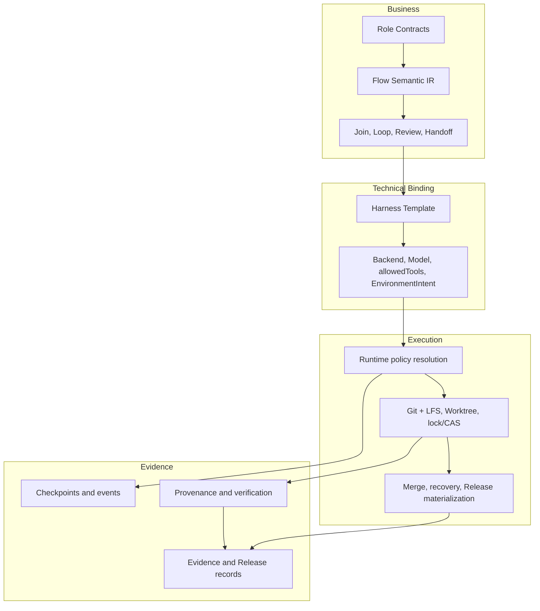
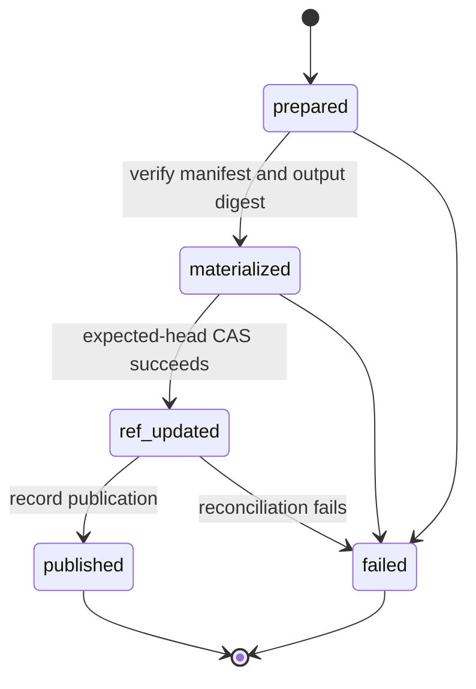

# Contract-Based Runtime Governance for Multi-Role AI Collaboration: OGSystem V2 Design and Engineering Evidence

**Authors:** [Author name], [Co-author names]
**Affiliation:** [Institution / Independent Researcher]
**Corresponding author:** [Email]
**Status:** Submission draft; bibliographic and author metadata require final editorial review.

## Abstract

Multi-role AI collaboration spans tasks such as office-document production, consulting analysis, structured discussion, and software development. These workflows combine task routing, tool authorization, concurrent file changes, recovery, and artifact delivery. This paper presents OGSystem (OGS) Contract Set V2, an implemented runtime design that connects these concerns through four product layers and one file-based Git + LFS Workspace per Project. Stable responsibility Roles are bound to execution Harnesses; declared events and field projections constrain control and data transfer; isolated Role Worktrees begin from immutable commits; and Framework-owned Join and Release operations integrate and publish verified content. Git Worktrees provide isolated views over commit-addressed project files, supporting consistent state boundaries, recovery, and rollback; they are not limited to source-code collaboration.

The paper asks how V2 expresses these boundaries, how it relates collaboration state to Join and Release state, and what current engineering evidence supports. As a bounded management lens, it maps responsibility differentiation, delegated authority, coordination, and accountability to Role contracts, Harness policy, workflow controls, and Evidence/Release records. This is an operational engineering mapping, not a complete governance program; ultimate responsibility remains with the deploying organization and human decision-makers. The design uses a four-valued Join source state (`pending`, `arrived`, `skipped`, `failed`) with separate failure and timeout policies. A read-only `WorkspaceRef` identifies committed content by Workspace, full commit, path, and digest. Release publication progresses through `prepared`, `materialized`, `ref_updated`, and `published`, or terminates as `failed`; only a published Release exposes a download reference. These are engineering compositions of established ideas, not claims that state machines, joins, Git, durable execution, or provenance are novel.

Reported evidence includes a current repository-wide run of 596 automated tests (488 core passed, one Windows-specific skip, 107 Team Site passed, zero failed; the earlier 587 count reflected the 2026-11-19 checkpoint, while the historical 819 count predated archiving legacy v1 tests to `tests/archive/v1/`), a deterministic command with 40 Workspace/coordination tests plus 11 projection tests, recorded same-model Python-calculator runs, and Project Run/Release records covering software, management-consulting, and structured-debate workflows. These records support implementation feasibility across file-based project types, not comparative task-quality claims. The separate Scenario 19 engineering audit covers ten cases and remains open; cleanup/retention has one live completed-run record while unmerged-candidate companion Runs and sign-off remain incomplete. One Codex-to-OpenCode run did not demonstrate that the downstream Role consumed the upstream `WorkspaceRef`. No controlled product comparison, performance study, cross-model generalization, bidirectional interoperability, or graph-engine portability study is claimed. The candidate contribution is the V2 system integration; its academic novelty remains subject to broader prior-art review and matched comparison.

**Keywords:** multi-role AI collaboration; AI runtime governance; responsibility contracts; delegated authority; workflow coordination; Workspace provenance; state recovery; evidence-based release

## 1. Introduction

Multi-role AI collaboration operates across several boundaries. A model-facing Role may need a defined responsibility, a tool set, an execution environment, and a controlled way to transfer results to another Role. Parallel work adds integration concerns. Publication adds a separate boundary between candidate changes, canonical project files, verified outputs, and available deliverables. A correct text response alone does not represent all of these states.

Research and products provide substantial building blocks. Labeled transition systems and extended finite-state machines formalize state and transitions [19, 20]. Design by contract provides a foundation for explicit preconditions, postconditions, and invariants [21]. Workflow research catalogs synchronization, quorum, and exception patterns [1, 2]. Durable workflow systems persist progress across failures. Git supplies immutable commit history and isolated worktrees [22]. Multi-agent systems such as AutoGen, MetaGPT, ChatDev, and OpenHands explore conversational, role-based, or software-development workflows [3–6]. LangGraph supplies graph execution, routing, cycles, and checkpoint facilities [7]. Provenance systems such as in-toto and SLSA address attestations and build origin [8, 9]. These sources establish that the underlying mechanisms are not new to OGS.

The engineering question addressed here is narrower: how can responsibility, execution authority, shared file state, evidence, and release state be represented as one explicit contract for a multi-role collaboration project? OGS V2 treats one Project as the owner of one Git + LFS Workspace. A Role starts from a fixed commit in a Framework-created Worktree. A Role result becomes a committed repository fact before a read-only reference can cross a Role boundary. Framework operations perform joins, canonical ref changes, recovery, and release materialization. The protocol applies to file-based deliverables; current records include software, management-consulting, and structured-debate Projects, while other file types require task-specific acceptance criteria.

Crucially, while systems such as LangGraph and Temporal provide robust engineering foundations for graph execution, checkpointing, and time-travel auditability, **the principal conceptual and academic contribution of OGSystem lies in formalizing an Extended Finite-State Machine (EFSM) runtime specifically designed for multi-agent socio-technical collaboration**. In generic graph runtimes (including LangGraph), states are weakly typed dictionaries and transitions are unconstrained code blocks without organizational or invariant boundaries. In contrast, OGS formalizes multi-agent collaboration as an EFSM over Labeled Transition Systems: (1) **invariant responsibility seats** are decoupled from transient model sessions; (2) transitions are constrained by an **LTS discrete-event vocabulary and statically verified Semantic IR** (enforcing bounded loop budgets and finite exhaustion routes); (3) **fail-closed Context Maps** act as formal guard conditions on state transitions; (4) **four-valued Join calculus** ($pending, arrived, skipped, failed$) provides deterministic synchronization over stochastic agent outcomes; and (5) state changes are **atomically bound to physical Git repository commits (`WorkspaceRef`) and cryptographic Release materialization**. Concurrently, at the engineering layer, OGS balances this formal EFSM design with full-lifecycle traceability and crash-recoverable WAL/CAS persistence.

We frame this as **runtime governance for a bounded AI work process**. Organization design motivates separating responsibility from execution; agency theory highlights delegation, information asymmetry, and monitoring [28, 29]. OGS maps these concerns to Role Contracts, Harness/tool authority, explicit coordination, and Run Evidence/Release records. The analogy is operational: an AI Role is not a legal or moral person, and accountability remains with the deploying organization and human decision-makers. The design is related to the Govern/Map/Measure/Manage functions in NIST AI RMF 1.0 and its Generative AI Profile [30, 31], but OGS implements neither a full organizational governance program nor a claim of standards conformance.

This study reports an implemented design and its engineering evidence. It is not a controlled comparison against other agent platforms. The research questions are:

| Research question | Focus |
| --- | --- |
| **RQ1.** How does Contract Set V2 express responsibility, technical binding, execution, and evidence boundaries? | Four product layers, Role contracts, Harness configuration, tool authorization, and environment-policy resolution. |
| **RQ2.** How does V2 connect multi-Role Workspace state with Join, Evidence, and Release state? | Immutable commit facts, `WorkspaceRef`, Join source outcomes, canonical updates, and Release publication. |
| **RQ3.** Which runtime claims are supported by available engineering evidence, and which remain untested? | Invariant tests, fault injection, real-model runs, one cross-Agent-Backend run, and explicit limits on generalization. |

The paper makes three distinctions throughout. First, prior mechanisms are attributed to their sources. Second, implemented OGS behavior is reported as engineering evidence. Third, candidate system-level contributions are not presented as confirmed academic novelty.

## 2. Related Work and Attribution

### 2.1 Workflow, joins, and durable execution

Workflow Patterns catalogs control-flow structures including synchronization, multi-choice, discriminator, and quorum patterns [1]. Workflow exception research studies how failures and exceptional conditions are detected and handled [2]. The Saga model decomposes long-running transactions into subtransactions and discusses compensation after failure [10]. Therefore, OGS does not claim general Join, exception handling, staged publication, or failure recovery as new concepts.

Durable Functions formalizes execution semantics for stateful serverless functions [11]; transaction processing literature establishes write-ahead logging and recovery foundations [12]. Temporal and Cadence are contemporary durable workflow systems. OGS uses a WAL-backed runtime and a compare-and-swap snapshot for its own execution state. These mechanisms provide engineering context, but the paper does not compare OGS recovery behavior with Temporal, LangGraph, or other products under matched faults.

### 2.2 Multi-agent software engineering as one application area

AutoGen studies programmable multi-agent conversation and control transfer [3]. MetaGPT organizes software production around roles and standardized procedures [4]. ChatDev studies communicative agents for software development [5]. OpenHands presents an open platform and runtime for software-development agents [6]. The autonomous-agent survey by Wang et al. reviews agent architectures, planning, memory, tools, and evaluation [13]. Recent studies further corroborate the necessity of finite-state machine (FSM) control in language models: StateFlow establishes that structuring agent execution into explicit FSM states improves task-solving success by 13%–28% while cutting token overhead [35], while MetaAgent formalizes multi-agent architecture synthesis and runtime state backtracking via FSMs [36]. At ACL 2026, NeuralFSM formulates multi-agent coordination as a finite-state execution process, learning adaptive transition policies and inter-agent communication weights [46]. At AAAI 2026, Agent-SAMA models interactive app workflows as FSMs, deploying collaborative agents for planning, execution verification, and state-traceback recovery [48]. At ICML 2026, GraphFlow introduces unified operation graphs and topology-aware state management for dynamic workflow generation [49]. Furthermore, Cho et al. demonstrate that multi-agent execution traces can be compressed into compact FSMs (7–43 states, fitness ≥ 0.997) to predict runtime failure with 0.94 AUROC, proving empirically that an agent's behavioral topology is primarily governed by its environmental harness and state machine rather than the base LLM [47]. In skill compilation, HEXIS compiles agent skills into Extended Finite State Machines (EFSM) to decouple task knowledge from control flow [42], while Sun et al. develop executable FSM runtimes to ensure instruction fidelity over long horizons [43]. These works make role-based collaboration, agent communication, and state-driven agent execution established research topics; OGS extends this trajectory from prompt-level or single-agent state machines to socio-technical organizational contracts over isolated Git Worktrees.

SWE-agent studies the Agent-Computer Interface for software engineering [14], while SWE-bench evaluates issue resolution against real GitHub repositories [15]. Recently, SWE-EVO extends repository evaluation to long-horizon software evolution spanning an average of 21 files [37]. For office and knowledge-work workflows, OfficeBench benchmarks multi-application office suites (Word, Excel, PPT, PDF) [38], complementing multimodal assistant benchmarks such as GAIA [39]. They are relevant to tool interaction, repository-level evaluation, and productivity suites, but none constitutes empirical evidence for OGS. OGS does not use these benchmarks in the reported exploratory evaluation.

LangGraph is the graph execution engine currently used by OGS [7]. OGS compiles a restricted workflow description into a plan and delegates graph execution to LangGraph while retaining its own Role, event, projection, Workspace, and Release contracts. The implementation has not validated replacing LangGraph with a different graph engine. Codex and OpenCode in the reported run are Agent Backends/Harnesses, not graph engines.

### 2.3 Version control, locking, and provenance

Git Worktree provides isolated working directories over repository history [22]. Chubby describes distributed locking and sequencer-based coordination [16]. in-toto and SLSA define provenance and attestation approaches for software supply chains [8, 9]. Recent 2026 research highlights the critical importance of runtime auditability and artifact provenance in multi-agent systems: Nian et al. formalize five key dimensions of agent auditability (action recoverability, lifecycle coverage, policy checkability, responsibility attribution, and evidence integrity), revealing 617 security/audit vulnerabilities across existing open-source frameworks [44]. Concurrently, TraceDev demonstrates at ISSTA 2026 that constructing explicit artifact traceability graphs across requirements, designs, and code is essential to prevent drift and inconsistency in complex repository workflows [45]. OGS uses Git commits as its only Workspace content-version facts, LFS for large objects, canonical locking and expected-head checks for authoritative updates, and evidence/manifests for traceability. These underlying mechanisms are prior art. The paper's candidate contribution concerns their integration with Role-scoped work and the OGS publication contract, directly realizing full-lifecycle auditability and artifact traceability.

### 2.4 Organizational governance lens

Classical management concepts are used to explain the engineering problem, not claimed as OGS inventions. Mintzberg's organization-design work distinguishes differentiated responsibilities from mechanisms that coordinate work; Eisenhardt's agency-theory review explains why delegated authority, information asymmetry, and monitoring matter [28, 29]. A recent survey of autonomous agents maps the expanding architecture, tool, evaluation, and risk space [13]; Xi et al.'s 2025 survey provides a newer synthesis [32]. NIST AI RMF 1.0 and its GenAI Profile provide public governance references [30, 31]. These sources motivate an operational mapping:

| Management concern | V2 control point | Claim boundary |
| --- | --- | --- |
| Responsibility differentiation | Business-layer Role Contracts | A Role is a workflow assignment, not an employee, legal person, or final accountable authority. |
| Delegated authority | Technical Binding: Harness, `allowedTools`, EnvironmentIntent, resolved policy | The implementation enforces selected tool/environment boundaries; it does not prove elimination of misuse or organizational risk. |
| Coordination and supervision | Business events, Context Maps, Join/Loop/Review policies | These structures constrain declared handoffs; they do not make model behavior deterministic. |
| Accountability and release control | Evidence, commit provenance, canonical mutations, Release verification | Records support reconstruction for a Run; they are not inherently tamper-proof and do not establish regulatory compliance. |

The proposed long-term value is operational continuity across repeated Runs: stable responsibility definitions, explicit authority snapshots, and evidence that can be compared after policy or model revisions. That is a falsifiable hypothesis, not a measured result. OGS does not currently provide a complete organizational policy lifecycle or an automatic learning loop.

### 2.5 Candidate contribution boundary

| Candidate OGS integration | Established ideas or capabilities used | Current status |
| --- | --- | --- |
| Responsibility contracts separated from runtime Backend/Harness bindings, connected to declared events and field projections | LTS, design by contract, least-privilege principles, typed tool interfaces, and multi-role agent design [3–7, 17] | Implemented domain and policy boundary; not a new graph execution engine and not a demonstrated portability layer. |
| One Project Workspace state model joining isolated Role commits, read-only references, evidence, and Release | Git/Worktree, locking/CAS, provenance, and durable workflow practices [8–12, 16] | Implemented V2 engineering integration. Direct comparison with OpenHands, Orca, and durable workflow products remains incomplete. |
| Join and Release protocol with four source outcomes and declared failure/timeout actions | Workflow synchronization, quorum, exception, Saga, and publication patterns [1, 2, 10] | Source code and selected tests implement the constraints. The four-value enum and general Join/failure handling are not claimed as novel. |

No exhaustive systematic literature review has been completed. The terms “candidate integration” and “engineering contribution” are used deliberately: existing work may contain a similar composition, and the evidence here does not establish priority or superiority.

## 3. Study Method and System Scope

This is an artifact-centered system-design and engineering-verification report. The normative source for Workspace fields, states, events, provenance records, and APIs is the V2 Workspace contract [18]. It specifies a target contract and does not itself establish that release gates or user-acceptance sign-off have passed.

The evidence considered comprises: (1) V2 contracts and architecture documents; (2) implementation inspection of Join, Workspace, lock/CAS, and Release modules; (3) recorded automated regression and fault-injection results; and (4) recorded real-model calculator runs and one formal cross-Agent-Backend Project Run. The reported 596-test result and run records are repository engineering evidence rather than controlled experiments. No hypothesis test, randomized trial, matched baseline, or statistical reliability estimate is performed.

The system boundary includes workflow compilation and runtime control, execution binding, Framework-managed Git/LFS operations, and evidence/release records. Model quality, general task success, provider availability, and external publication systems are outside the evaluated boundary.

## 4. V2 Architecture

### 4.1 Four product layers

V2 assigns product ownership to four layers. Studio, Team Site, and CLI are configuration and operational projections across these layers; they are not additional layers.

**Business** defines responsibility seats and workflow semantics: Role contracts, the restricted Semantic IR, discrete business events, Join policies, bounded loops, review, and handoff. A Role represents an invariant responsibility rather than a particular model session; explicit contracts draw on established design-by-contract concepts [21].

**Technical Binding** binds a Role to a Harness Template. The template configures Backend, Model, `allowedTools`, `EnvironmentIntent`, and applicable limits. Runtime resolves `verifiedTools` and freezes an `EffectiveEnvironmentPolicy`; the executable tool set is `allowedTools ∩ verifiedTools`. The Adapter maps the resolved policy into backend-native configuration. Thus the environment intent is configuration input, while effective policy is a runtime result.

**Execution** owns process and repository mutations: Git/LFS, isolated Worktrees, canonical lock, expected-head compare-and-swap, merge, restore, recovery, and Release materialization. Roles cannot directly update canonical refs or operate LFS locks.

**Evidence** records execution state, checkpoints, events, commit provenance, reviews, verification, Evidence manifests, and Release records. Evidence is a record of the implemented workflow; it is not claimed to be tamper-proof storage or a formal causal proof.

### 4.2 Role and transition model

OGS represents a collaboration graph with a set of responsibility seats, directed handoffs, runtime bindings, transition semantics, contracts/projections, and governance policy. An LTS event vocabulary constrains control transitions. The restricted Mermaid input compiles to Semantic IR; `SemanticIR.version` is distinct from the outer `ogsContractVersion: 2`.

Compilation checks that graph nodes map to responsibility seats, directed cycles have finite iteration budgets and exhaustion routes, and Join prerequisites are statically declared. These checks are implementation rules. They do not prove that an arbitrary model action will terminate or that every external side effect is reversible.

Context Maps explicitly project approved data between Roles. Undeclared fields are rejected. `WorkspaceRef` is not projected by default; an authorized `HandoffProjection` can expose selected read-only references. This applies fail-safe defaults and least-privilege design [17], but the study does not measure reductions in prompt injection or information leakage.

### 4.3 Shared Workspace state

Each Project has exactly one Git + LFS Workspace, and the full Git commit ID is its sole content-version fact. LFS stores objects referenced by Git commits; it is not a second version system. A Role begins from a fixed `baseCommit` in an isolated Worktree. The Framework creates Role commits and records provenance. A local Worktree path is not a durable identity.

`WorkspaceRef` is an immutable, read-only value containing `workspaceId`, a full commit ID, a repository-relative path, and a digest. It cannot name uncommitted content, branch names, tags, or symbolic refs. The path must be normalized and contained in the committed tree; symlink escapes, traversal, and digest mismatches are rejected. LFS content is resolved and verified. The reference grants no write permission and crosses a Role boundary only through an explicit authorized projection.

| Object | State or fields | Contract role |
| --- | --- | --- |
| Project / Workspace | `workspaceId`, canonical ref, canonical HEAD | Single Workspace and one content history. |
| Role work | `baseCommit`, `worktreeId`, `branch`, `roleCommit` | Isolated work; a reference can be formed only after a commit. |
| Handoff | `workspaceRefs[]`, `WorkspaceRef` | Empty by default; explicit read-only transfer. |
| Checkpoint / Evidence | Run state, lineage, round, iteration, state version, commit refs | Workflow recovery and evidence indexing. |
| Canonical lock | owner, lease, fencing token, expected head | Serializes authoritative ref mutations; stale heads fail closed. |
| Join | candidate commits, merge commit, conflict evidence | Integrates candidates in a separate merge Worktree; conflicts leave canonical ref unchanged. |
| Release | release commit, manifest, output digest, status | Publication record; does not create a second content history. |

This design makes content, workflow recovery, authorization, and publication related but distinct records. Crucially, it resolves the **destructive in-place mutation problem** prevalent in existing multi-agent collaboration frameworks (such as ChatDev, MetaGPT, CrewAI, and AutoGen). In typical agent systems, multiple roles read and write directly to a shared flat directory via in-place file overwrites. When an Editor, Reviewer, or downstream Specialist updates an artifact—whether a source-code module, a multi-chapter consulting report, or a financial analysis spreadsheet—the modification obliterates prior intermediate drafts. In enterprise and compliance-sensitive workflows, this causes three critical failure modes:
1. **Loss of Intermediate Auditability:** Individual role contributions are wiped out, making it impossible to determine which agent introduced an erroneous claim, hallucinated statistic, or policy violation.
2. **Irreversible Content Loss and Silent Regressions:** In iterative review loops, downstream agents frequently hallucinate or over-prune previous work. Under in-place file overwrites, paragraphs or code written by upstream specialists are permanently deleted without diff inspection or rollback capability.
3. **Concurrent Dirty Writes:** Parallel roles operating on overlapping files suffer from uncoordinated race conditions, silently overwriting each other's outputs.

By isolating each Role in a dedicated Git Worktree, requiring all intermediate changes to be committed, and passing only immutable `WorkspaceRef` records integrated through a dedicated Merge Worktree, OGS preserves a complete, tamper-evident version history of all intermediate artifacts, enabling exact rollbacks and fine-grained auditing in enterprise settings. This design also addresses the structural limitation recently articulated in 2026 multi-agent software engineering research (e.g., STORM [40]): while naive worktree isolation merely postpones merge conflicts to an expensive post-hoc integration phase, OGS pro-actively scopes role write permissions via Context Map contracts, serializes canonical updates via expected-head CAS locks, and isolates concurrent reconciliation within a dedicated Merge Worktree governed by four-valued Join calculus.

### 4.4 Join and Release protocol

For a Join scope identified by Run, lineage, and loop iteration, each declared source has one of four outcomes:

$$
S_{src} \in \{pending, arrived, skipped, failed\}.
$$

`all_of` requires each configured source outcome to satisfy the declared policy. `quorum_of(K)` is satisfied by the required number of unique arrived sources; late outcomes do not rewrite a committed result. Source failure policy (`wait`, `fail`, `quorum_continue`) is separate from timeout action (`fail`, `quorum_continue`, `pause`, `terminate`). A required skipped source blocks `all_of`; `quorum_continue` applies only to quorum and fails if the threshold is unmet. The implementation preserves `failed` as a sticky outcome rather than silently converting it to `skipped`. A dedicated test asserting this exact overwrite case was not found in the reviewed suite.

Candidate commits are integrated in a Merge Worktree. A conflict is recorded as `join_conflict`, and the canonical ref remains unchanged. Canonical ref updates, restore, and Release publication use a canonical lock and expected-head CAS. Materialization itself occurs before the CAS. A stale expected head fails closed and leaves the candidate available for recovery or rebase.

Release binds an immutable `releaseCommit` to a materialized file set. Its normal state path is:

Only a `published` Release exposes a public download reference. A Release failure stores one `failureCode`; retryability is Framework policy. A known post-CAS record failure can enter reconciliation. This staged protocol has clear parallels with workflow exception handling and Saga-style compensation [2, 10]; this paper does not claim those general patterns as original.

## 5. Engineering Implementation

OGS is implemented in TypeScript/Node.js. Runtime transitions are appended to `events.ndjson` before a compare-and-swap update to `state.json`. Resume verifies the frozen plan fingerprint against the current definition. Specified crash windows are covered by deterministic fault-injection tests. These properties describe the implementation and tests; they do not imply deterministic model behavior or universal crash safety.

The Framework manages the Workspace lifecycle. Role preparation creates a Worktree from a base commit. Result commit records its origin and checkpoint association. Join validates candidates and creates a merge commit in an isolated integration Worktree. Release materialization verifies the final manifest and output digest. The canonical lock includes owner, lease expiration, fencing token, and expected canonical HEAD. Mutations with stale state fail closed.

V2 excludes V1 fields and compatibility paths such as `allowedToolsByRoleId` and `constraints.allowedTools`. The allowed tool source is `allowedTools`; `verifiedTools` are independently resolved facts. Unknown, dynamic, unavailable, or unenforceable capabilities are rejected. This is a contract boundary and is not a measured security outcome.

## 6. Engineering Evidence

### 6.1 Regression and fault-injection records

The current repository-wide `pnpm test` run discovers 596 tests: 488 core passed, one Windows-specific test skipped, 107 Team Site passed, and zero failed (the earlier 587 count reflected the 2026-11-19 checkpoint, while the historical 819 count predated archiving legacy v1 tests under `tests/archive/v1/`). Coverage includes compilation, state transitions, Context Maps, Join and Loop behavior, WAL/CAS, WorkspaceRef validation, Worktrees, provenance, merge conflicts, canonical locking, Release failures, and product projections; legacy crash-injection and resume suites (`runtime-fault-injection.test.mjs`, `resume-session.test.mjs`) are currently archived under `tests/archive/v1/` and are not executed by active `pnpm test`.

One deterministic command recorded 40 passing Workspace/coordination tests, including stale-head rejection, conflict handling, materialization failures, digest checks, and post-CAS Release reconciliation; a separate projection command recorded 11 passing tests. These are engineering checks, not audit-case or UAT counts. The Scenario 19 engineering audit lists ten required cases and remains open: while one live completed-run cleanup was recorded on 2026-11-19 (removing 6 worktrees and 6 merged branches), unmerged-candidate companion Runs, non-archive interrupt/resume proof, and formal sign-off remain required. The tests exercise specified implementation boundaries, not all possible crash schedules or external-system failures.

### 6.2 Real-model calculator runs

Repository records include real local Codex (`gpt-6-luna`) runs of a temporary Python calculator workflow on 2026-11-15 and 2026-11-16. Following `dispatch → parallel implementation/tests → join`, the 2026-11-15 record documents four Role commits, Join and final merge, caller-side fast-forward publication, and eight passing unittest cases; the 2026-11-16 re-verification documents ten passing tests (while also noting a later bounded retry hung).

This is a small feasibility demonstration, not a reliability estimate. It uses one model, one task, and a small number of runs. Parallel same-path edits produced a Git conflict, stale canonical heads were rejected by CAS, and whitespace errors were rejected by `git diff --check` in recorded boundary runs. A deterministic local-shell regression is not counted as real-model evidence.

### 6.3 Cross-Agent-Backend Project Run

A formal V2 Project Run on 2026-11-19 assigned planning to Codex and implementation to OpenCode, then recorded a published Release. Both used the same base model (`gpt-6-luna`); the OpenCode identifier was `codex-gateway/gpt-6-luna`. The Planner produced a `WorkspaceRef`, but the OpenCode Role made no file changes. Therefore the run shows one cross-Agent-Backend workflow and Release path, but not downstream consumption of the reference. It does not establish cross-model generalization, bidirectional interoperability, or graph-engine portability. The associated acceptance record also leaves formal product-owner and user sign-off incomplete.

### 6.4 Proposed Controlled Evaluation (Not Yet Executed)
Use a task-type-specific acceptance oracle: hidden tests for repository tasks and frozen requirement-coverage rubrics plus blinded review for office-document and analysis tasks. Report strata separately before any aggregate result.

Current tests and recorded runs do not establish improved task accuracy or lower hallucination rates. The primary study compares (A) a single agent, (B) a matched LangGraph multi-agent workflow using the same role graph, prompts, tools, and isolated Worktrees but without OGS's explicit Context Map, WorkspaceRef, Join, and Release contracts, and (C) full OGS V2. Keep model/version, token ceiling, tool access, acceptance oracle, and retry policy fixed. Arm B is the key protocol comparator; Arm A estimates the effect and cost of role decomposition. Add MetaGPT [4] and ChatDev [5] as separate product-comparison arms for the software-task stratum (supplemented with multi-file evolution tasks informed by SWE-EVO [37]), and CrewAI [33] as a product-comparison arm for the office and knowledge-work stratum (drawing from OfficeBench [38] and GAIA [39]), rerunning each system on a common frozen task subset; do not compare their published scores directly with OGS. Their papers and platforms provide same-domain system comparisons and useful outcome measures, but product arms cannot isolate the causal effect of OGS contracts. Magentic-One [34] provides an additional reference for generalist file-based multi-agent tasks.

The primary outcome is verified delivery success: hidden tests and requirements pass, no existing tests regress, commit provenance resolves, the Release digest verifies, and the Release reaches `published`. Report denominators, percentage-point differences, and 95% confidence intervals. Hallucination-related outcomes are limited to atomic factual claims in handoffs and final reports that can be checked against Run logs, Git objects, test output, and Release records. Blinded annotators measure unsupported claims per 100 verifiable claims, contradictions, and false completion. These outcomes do not measure all model hallucinations. Also measure merge recovery, stale-reference rejection, unauthorized field leakage, invalid publication, latency, token/API cost, and cost per verified success. Unchanged task pass rate with fewer false completion or invalid publication events supports only a delivery-reliability claim, not general model accuracy. This cost-centric focus directly aligns with 2026 empirical agent sustainability findings (Astekin et al. [41]), which revealed that multi-agent systems consume 6.36× more energy and run 6.07× longer than single-query baselines, underscoring that collaboration overhead must be justified by verified delivery reliability.

Begin with a 20–30-task pilot and use paired pilot effects and task clustering for the main-study power calculation. For illustration, a 0.25 discordant-pair rate and a 10-percentage-point target difference yield about 196 independent task pairs under a normal approximation to McNemar's test; this is not a final sample-size result. The [bilingual protocol](experimental-validation-plan-bilingual.md) defines the task strata, annotation, statistics, and direct literature addresses. [AutoGen](https://arxiv.org/abs/2308.08155) [3] is retained as a highly cited multi-agent framework reference; [MetaGPT](https://arxiv.org/abs/2308.00352) [4] and [ChatDev](https://aclanthology.org/2024.acl-long.810/) [5] provide the closest cited product-comparison precedents for software collaboration, while [CrewAI](https://docs.crewai.com/) [33] represents industry business-process automation. [Multiagent Debate](https://arxiv.org/abs/2305.14325) [23], the [hallucination survey](https://arxiv.org/abs/2311.05232) [24], and [RAGTruth](https://aclanthology.org/2024.acl-long.585/) [25] inform measurement design, not the task benchmark or product baseline. Cohen's kappa is a candidate inter-rater statistic [26]. These sources do not predict or prove an OGS effect. Null results, uncertainty, and additional cost must be reported.
As an exploratory governance-continuity check (H5), rerun versioned workflows after declared policy or model revisions and record policy-violation escape rate, evidence-reconstruction completeness, audit time, and control drift. Interpret these as bounded runtime measures, not organizational governance outcomes.

## 7. Discussion: What Is and Is Not a Contribution

The implementation combines several established mechanisms. LTS and EFSM are not OGS inventions. Join, quorum, and exception handling are not OGS inventions. LangGraph currently provides graph execution. Git, LFS, Worktree, locks, CAS, WAL, least privilege, and provenance have substantial prior art. Role-based multi-agent work is established by systems and studies including AutoGen, MetaGPT, ChatDev, OpenHands, and CrewAI [3–6, 33]. The four product layers are an architectural organization choice, not a standalone scholarly invention.

The most defensible description combines a **conceptual modeling contribution** and a **candidate system-integration contribution**:
1. **Design and Scholarly Innovation:** In terms of design, OGS formalizes multi-agent collaboration as an **Extended Finite-State Machine (EFSM)** over Labeled Transition Systems. While generic graph frameworks (e.g., LangGraph) treat state as unstructured dictionaries and node hops as arbitrary code executions, and recent 2026 state-machine frameworks (such as NeuralFSM [46], Agent-SAMA [48], GraphFlow [49], and HEXIS [42]) operate primarily on in-memory prompt routing or single-agent skill compilation, OGS's EFSM provides a multi-role domain-specific formalization: invariant responsibility seats ($V$), discrete-event labeled transitions ($\Sigma$), compile-time bounded loop budgets with static exhaustion exits, fail-closed projection guards, four-valued stochastic Join synchronization ($S_{src} \in \{pending, arrived, skipped, failed\}$), and physical state binding to immutable repository commits and Release materialization. This formal state-machine model carries the primary academic novelty of the paper.
2. **Engineering Foundation:** On the engineering side, OGS simultaneously achieves full auditability and traceability across runs via WAL (`events.ndjson`), CAS (`state.json`), and immutable Git commit lineages. These properties directly operationalize the foundational dimensions of agent auditability identified by Nian et al. [44] and the end-to-end artifact traceability demonstrated by TraceDev [45], while reflecting Cho et al.'s empirical finding that agent reliability is fundamentally governed by harness state-machine topology [47]. These align with high-reliability durable checkpointing practices found in systems like LangGraph and Temporal.

Connecting these formal EFSM invariants with an auditable Git/LFS Workspace state model is what enables OGS to govern bounded AI collaboration under a single V2 contract. The source-state invariant and Release statuses can be inspected in code and targeted tests. Their combination may be useful to system builders, but this paper does not show that no prior system has an equivalent protocol.

The distinction between borrowed capability and OGS implementation is summarized here:

| Claim | Attribution | Evidence strength |
| --- | --- | --- |
| Four-layer product design | OGS architecture choice using established software layering | Documented and implemented; no independent novelty claim. |
| Graph execution, loops, checkpoint support | LangGraph capability used by OGS | Public capability; only LangGraph integration has been validated. |
| Role-based task division and agent conversation | Existing agent systems and research | Established prior work; not an OGS novelty. |
| One Project Workspace, Role Worktrees, authorized read-only refs, Evidence and Release | OGS V2 integration over Git/LFS, workflow, lock, and provenance mechanisms | Contract, source, tests, and selected runs support implementation; comparative novelty remains open. |
| Four-valued Join outcomes and declared failure/timeout policies connected to Release state | OGS protocol design informed by workflow patterns and exception handling | Implemented; selected tests exist, but the sticky-failure overwrite property lacks a dedicated assertion. |
| Cross-backend workflow | Codex and OpenCode adapters in OGS | One recorded run; downstream reference use and broader interoperability are unproven. |

OpenHands, Orca, and CrewAI are particularly relevant direct comparators for software and office agent runtimes. The present paper has not compared their `WorkspaceRef`-like values, merge policies, evidence models, canonical update protocols, and publication states under common tasks and failure conditions. That comparison is required before making a strong novelty claim about the shared Workspace or delivery protocol.

## 8. Threats to Validity and Limitations

**Construct validity.** “Candidate integration contribution” is an engineering characterization, not a novelty verdict. The literature review is curated rather than systematic. OpenAlex counts are index signals, not Google Scholar counts, quality scores, or novelty evidence. Public documentation may omit capabilities, so absence from a comparison table is not treated as product incapability.

**Internal validity.** The real-model calculator sample covers a small number of runs of one task using one model configuration. The cross-backend sample is one run with the same base model on both backends, and the downstream Role made no file change. These observations do not support causal claims or broad generalization.

**External validity.** The implementation is evaluated in a local repository workflow. Distributed multi-host scheduling, multi-tenant production deployment, organizational policy enforcement, external publication compensation, and varied repositories remain future evaluation targets.

**Reliability and security scope.** Automated tests cover selected invariants and fault windows. They are not a proof of crash consistency for every interleaving, prompt-injection resistance, tamper-proof evidence, or complete standards compliance. Candidate recovery after external partial effects remains caller-managed.

**Comparison validity.** OGS was not evaluated against LangGraph-only, OpenHands, Orca, Temporal, or other baselines under matched tasks, models, permission settings, and fault schedules. No speed, cost, quality, security, or superiority claim is made.

## 9. Conclusion and Future Work

OGSystem V2 provides an implemented contract for bounded multi-role collaboration that relates four-layer product ownership, Role execution binding, a single Git/LFS Workspace, explicit Join source outcomes, evidence, canonical updates, and Release materialization. Existing tests and recorded runs support limited claims about selected implementation paths. They do not establish academic novelty, product superiority, broad cross-backend interoperability, or complete acceptance.

The next evaluation should implement the controlled protocol in Section 6.4, including same-task MetaGPT and ChatDev product comparisons on the software stratum where pinned versions remain runnable. It should vary workspace conflicts, Role failures, stale canonical heads, materialization faults, permission policies, and backend/model pairings; record completion, evidence-grounded claims, recovery, provenance completeness, cost, and publication correctness; and include direct assertions for the sticky `failed` Join invariant. A broader systematic prior-art search should precede any first-invention claim.

## References

1. van der Aalst, W. M. P., ter Hofstede, A. H., Kiepuszewski, B., & Barros, A. P. “Workflow Patterns.” *Distributed and Parallel Databases*, 14(1), 5–51, 2003. [DOI: 10.1023/A:1022883727209](https://doi.org/10.1023/A:1022883727209).
2. Russell, N., van der Aalst, W. M. P., & ter Hofstede, A. H. “Workflow Exception Patterns.” *Advanced Information Systems Engineering (CAiSE 2006)*, LNCS Vol. 4001, pp. 288–302, 2006. [DOI: 10.1007/11767138_20](https://doi.org/10.1007/11767138_20); Luo, Z., Sheth, A., Kochut, K., & Miller, J. “Exception Handling in Workflow Systems.” *Applied Intelligence*, 13(2), 125–147, 2000. [DOI: 10.1023/A:1008388412284](https://doi.org/10.1023/A:1008388412284).
3. Wu, Q., et al. “AutoGen: Enabling Next-Gen LLM Applications via Multi-Agent Conversation.” 2023. [arXiv:2308.08155](https://arxiv.org/abs/2308.08155).
4. Hong, S., et al. “MetaGPT: Meta Programming for A Multi-Agent Collaborative Framework.” ICLR 2024. [OpenReview](https://openreview.net/forum?id=VtmBAGCN7o).
5. Qian, C., et al. “ChatDev: Communicative Agents for Software Development.” ACL 2024, pp. 15174–15186. [DOI: 10.18653/v1/2024.acl-long.810](https://doi.org/10.18653/v1/2024.acl-long.810).
6. Wang, X., et al. “OpenHands: An Open Platform for AI Software Developers as Generalist Agents.” ICLR 2025; preprint 2024. [arXiv:2407.16741](https://arxiv.org/abs/2407.16741).
7. LangChain. “LangGraph Documentation.” [Official documentation](https://docs.langchain.com/oss/python/langgraph/overview).
8. Torres-Arias, S., et al. “in-toto: Providing Farm-to-Table Guarantees for Bits and Bytes.” USENIX Security 2019. [USENIX](https://www.usenix.org/conference/usenixsecurity19/presentation/torres-arias).
9. OpenSSF. “SLSA Provenance Specification, v1.0.” [Specification](https://slsa.dev/spec/v1.0/provenance).
10. Garcia-Molina, H., & Salem, K. “Sagas.” SIGMOD 1987, 249–259. [DOI: 10.1145/38713.38742](https://doi.org/10.1145/38713.38742).
11. Burckhardt, S., et al. “Durable Functions: Semantics for Stateful Serverless.” *Proceedings of the ACM on Programming Languages*, 5(OOPSLA), Article 133, 2021. [DOI: 10.1145/3485510](https://doi.org/10.1145/3485510).
12. Gray, J., & Reuter, A. *Transaction Processing: Concepts and Techniques*. Morgan Kaufmann, 1992.
13. Wang, L., et al. “A Survey on Large Language Model Based Autonomous Agents.” *Frontiers of Computer Science*, 18(6), 2024. [DOI: 10.1007/s11704-024-40231-1](https://doi.org/10.1007/s11704-024-40231-1).
14. Yang, J., et al. “SWE-agent: Agent-Computer Interfaces Enable Automated Software Engineering.” NeurIPS 2024. [arXiv:2405.15793](https://arxiv.org/abs/2405.15793).
15. Jimenez, C. E., et al. “SWE-bench: Can Language Models Resolve Real-World GitHub Issues?” ICLR 2024. [arXiv:2310.06770](https://arxiv.org/abs/2310.06770).
16. Burrows, M. “The Chubby Lock Service for Loosely-Coupled Distributed Systems.” OSDI 2006. [USENIX paper](https://www.usenix.org/legacy/event/osdi06/tech/full_papers/burrows/burrows.pdf).
17. Saltzer, J. H., & Schroeder, M. D. “The Protection of Information in Computer Systems.” *Proceedings of the IEEE*, 63(9), 1278–1308, 1975. [DOI: 10.1109/PROC.1975.9939](https://doi.org/10.1109/PROC.1975.9939).
18. OGSystem. “V2 Workspace Contracts.” Normative project contract, 2026. [`docs/development/v2-workspace-contracts.md`](../development/v2-workspace-contracts.md).
19. Milner, R. *Communication and Concurrency*. Prentice-Hall, 1989. [ACM record](https://dl.acm.org/doi/book/10.5555/63442).
20. Cheng, K. T., & Krishnakumar, A. S. “Automatic Functional Test Generation Using the Extended Finite State Machine Model.” DAC 1993, 86–91. [DOI: 10.1145/157485.164585](https://doi.org/10.1145/157485.164585).
21. Meyer, B. “Applying ‘Design by Contract’.” *IEEE Computer*, 25(10), 40–51, 1992. [DOI: 10.1109/2.161279](https://doi.org/10.1109/2.161279).
22. Git Project. “git-worktree: Manage multiple working trees.” *Git Reference Manual*. [Official documentation](https://git-scm.com/docs/git-worktree).
23. Du, Y., et al. “Improving Factuality and Reasoning in Language Models through Multiagent Debate.” arXiv preprint, 2023. [arXiv:2305.14325](https://arxiv.org/abs/2305.14325).
24. Huang, L., et al. “A Survey on Hallucination in Large Language Models: Principles, Taxonomy, Challenges, and Open Questions.” arXiv preprint, 2023. [arXiv:2311.05232](https://arxiv.org/abs/2311.05232).
25. Niu, C., et al. “RAGTruth: A Hallucination Corpus for Developing Trustworthy Retrieval-Augmented Language Models.” ACL 2024. [ACL Anthology](https://aclanthology.org/2024.acl-long.585/); [DOI: 10.18653/v1/2024.acl-long.585](https://doi.org/10.18653/v1/2024.acl-long.585); [arXiv:2401.00396](https://arxiv.org/abs/2401.00396).
26. Cohen, J. “A Coefficient of Agreement for Nominal Scales.” *Educational and Psychological Measurement*, 20(1), 37–46, 1960. [DOI: 10.1177/001316446002000104](https://doi.org/10.1177/001316446002000104).
27. OpenAI. “Introducing SWE-bench Verified.” 2024. [Official benchmark description](https://openai.com/index/introducing-swe-bench-verified/).
28. Mintzberg, H. *The Structuring of Organizations: A Synthesis of the Research*. Prentice-Hall, 1979. [Bibliographic record](https://books.google.com/books?id=kw1HAAAAMAAJ).
29. Eisenhardt, K. M. “Agency Theory: An Assessment and Review.” *Academy of Management Review*, 14(1), 57–74, 1989. [DOI: 10.2307/258191](https://doi.org/10.2307/258191).
30. NIST. *Artificial Intelligence Risk Management Framework (AI RMF 1.0)*, 2023. [DOI: 10.6028/NIST.AI.100-1](https://doi.org/10.6028/NIST.AI.100-1); [PDF](https://nvlpubs.nist.gov/nistpubs/ai/NIST.AI.100-1.pdf).
31. NIST. *Artificial Intelligence Risk Management Framework: Generative Artificial Intelligence Profile*, 2024. [DOI: 10.6028/NIST.AI.600-1](https://doi.org/10.6028/NIST.AI.600-1); [PDF](https://nvlpubs.nist.gov/nistpubs/ai/NIST.AI.600-1.pdf).
32. Xi, Z., et al. “The Rise and Potential of Large Language Model Based Agents: A Survey.” *Science China Information Sciences*, 68(2), 2025. [DOI: 10.1007/s11432-024-4222-0](https://doi.org/10.1007/s11432-024-4222-0). OpenAlex cited_by_count: 3,314 (retrieved 2026-11-19); index coverage only.
33. Moura, J., et al. “CrewAI: Collaborative AI Agents.” CrewAI Inc., 2024. [Documentation](https://docs.crewai.com/).
34. Fourney, A., et al. “Magentic-One: A Generalist Multi-Agent System for Solving Complex Web and File-Based Tasks.” Microsoft Research, arXiv preprint arXiv:2411.04468, 2024. [arXiv:2411.04468](https://arxiv.org/abs/2411.04468).
35. Wu, Y., Yue, T., Zhang, S., Wang, C., & Wu, Q. “StateFlow: Enhancing LLM Task-Solving through State-Driven Workflows.” *First Conference on Language Modeling (COLM 2024)*, 2024. [arXiv:2403.11322](https://arxiv.org/abs/2403.11322).
36. Zhang, Y., Liu, X., & Xiao, C. “MetaAgent: Automatically Constructing Multi-Agent Systems Based on Finite State Machines.” *Proceedings of the 42nd International Conference on Machine Learning (ICML 2025)*, 2025. [arXiv:2507.22606](https://arxiv.org/abs/2507.22606).
37. Le, T., Thai, M. V. T., Manh, D. N., Nhat, H. P., & Bui, N. D. Q. “SWE-EVO: Benchmarking Coding Agents in Long-Horizon Software Evolution Scenarios.” arXiv preprint arXiv:2512.18470, 2024–2025. [arXiv:2512.18470](https://arxiv.org/abs/2512.18470).
38. Wang, Z., et al. “OfficeBench: Benchmarking Language Agents across Multiple Applications for Office Automation.” arXiv preprint arXiv:2407.19056, 2024. [arXiv:2407.19056](https://arxiv.org/abs/2407.19056).
39. Mialon, G., et al. “GAIA: A Benchmark for General AI Assistants.” *ICLR 2024 Oral*, 2024. [arXiv:2311.12983](https://arxiv.org/abs/2311.12983).
40. Liu, M., Dong, Y., et al. “Multi-agent Collaboration with State Management.” arXiv preprint arXiv:2605.20563, May 2026. [arXiv:2605.20563](https://arxiv.org/abs/2605.20563).
41. Astekin, M., et al. “Engineering Sustainable Agents: A Systematic Comparison of Agentic LLMs for Developer Workflows.” arXiv preprint arXiv:2610.03010, Oct 2026. [arXiv:2610.03010](https://arxiv.org/abs/2610.03010).
42. Li, M., & WorldBuilder013. “HEXIS: Compiling Agent Skills into Extended Finite State Machines.” arXiv preprint arXiv:2609.30123, Sep 2026. [arXiv:2609.30123](https://arxiv.org/abs/2609.30123).
43. Sun, Y., et al. “Keeping LLM Agents on Procedure: Executable Finite-State Control for Long-Horizon Instruction Fidelity.” arXiv preprint arXiv:2611.10884, Nov 2026. [arXiv:2611.10884](https://arxiv.org/abs/2611.10884).
44. Nian, Y., Yuan, A., Zhang, H., Li, J., Li, L., Hu, X., Wei, H., Xiao, X., Xiao, C., & Zhao, Y. “Auditable Agents.” arXiv preprint arXiv:2604.05485, Apr 2026. [arXiv:2604.05485](https://arxiv.org/abs/2604.05485).
45. Chen, M., Zhang, Y., Xie, Z., Luo, Y., Xu, J., Gao, C., Zhao, K., & Ye, Y. “TraceDev: A Traceability-Driven Multi-agent Framework for Requirement-to-Code Development.” In *Proceedings of the 35th ACM SIGSOFT International Symposium on Software Testing and Analysis (ISSTA 2026)*, 2026. [arXiv:2607.18886](https://arxiv.org/abs/2607.18886).
46. Wang, J., Wang, Y., Li, J., Yang, S., Guo, K., & Zhao, Y. “NeuralFSM: Adaptive Multi-Agent Coordination via Learning Finite-State Execution Policy.” In *Proceedings of the 64th Annual Meeting of the Association for Computational Linguistics (ACL 2026)*, Volume 1: Long Papers, 2026. [ACL Anthology](https://aclanthology.org/).
47. Cho, S., Fernandez, F. C., Mohammed, U., Wu, Z., Da Costa, K., Wicaksono, I., & Koshiyama, A. “Automata from Agent Traces: Failure and Next-Step Prediction.” In *Proceedings of the 40th Conference on Neural Information Processing Systems (NeurIPS 2026)*, 2026. [arXiv:2608.23670](https://arxiv.org/abs/2608.23670).
48. Guo, L., Liu, W., He, Y., Chen, T.-H., & Wang, Y. “Agent-SAMA: State-Aware Mobile Assistant.” In *Proceedings of the 40th AAAI Conference on Artificial Intelligence (AAAI 2026)*, 2026. [arXiv:2505.23596](https://arxiv.org/abs/2505.23596).
49. Li, A., Yang, S., Chen, F., Xu, T., Li, P., & Su, Z. “GraphFlow: A Graph-Based Workflow Management for Efficient LLM-Agent Serving.” In *Proceedings of the 43rd International Conference on Machine Learning (ICML 2026)*, 2026. [arXiv:2605.22566](https://arxiv.org/abs/2605.22566).

## Required Software Metadata (Elsevier SCICO OSP Track)

| Nr. | Code metadata description | Please fill in this column |
| --- | --- | --- |
| C1 | Current code version | v2.0.0-rc |
| C2 | Permanent link to code/repository used of this code version | Peer review replication package under evaluation; permanent public repository and Zenodo archive DOI will be assigned upon formal publication |
| C3 | Permanent link to Reproducible Capsule | N/A (local execution environment) |
| C4 | Legal Code License | Apache License 2.0 |
| C5 | Code versioning system used | Git (with Git LFS support) |
| C6 | Software code languages, tools, and services used | TypeScript, Node.js (v20+), pnpm, Git, Git LFS |
| C7 | Compilation requirements, operating environments & dependencies | Node.js >= 20.0, pnpm >= 9.0, Git >= 2.34; macOS / Linux / Windows |
| C8 | If available, link to developer documentation/manual | [`docs/development/v2-workspace-contracts.md`](../development/v2-workspace-contracts.md) |
| C9 | Support email for questions | Author correspondence email |

## Declarations

* **Funding:** This research did not receive any specific grant from funding agencies in the public, commercial, or not-for-profit sectors.
* **Conflict of interest / Competing interests:** The author declares no known competing financial interests or personal relationships that could have appeared to influence the work reported in this paper.
* **Availability of data and materials:** The test suites, configuration templates, benchmark protocols, raw run traces, and offline verification script (`pnpm run reproduce:paper-evidence`) are provided in the peer-review replication package and will be permanently archived on Zenodo upon formal publication. Supplementary execution logs and digests are available in [`traceable-references.md`](traceable-references.md).
* **Code availability:** The formal contracts, EFSM runtime, Context Map, Git WorkspaceRef/Join/Release protocol, and replication harness are prepared for open-source release under the Apache 2.0 license. The commercial Team Site collaboration suite and proprietary domain roles are maintained under proprietary commercial licenses and are omitted as they do not affect formal protocol verification or empirical replication.

## Downloaded Literature

Downloaded PDF copies and SHA-256 digests are listed in [`references/README.md`](references/README.md). OpenAlex citation counts are recorded there and in [`traceable-references.md`](traceable-references.md) as time-sensitive index coverage only; they are not Google Scholar counts or evidence of novelty.
